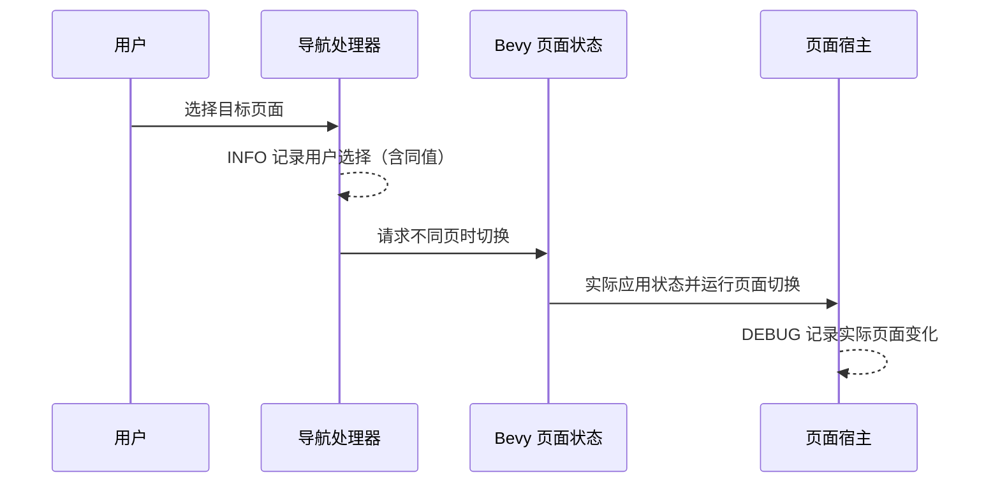

# 分离 Gallery 导航意图与页面实际切换

## 目标与设计思路

同一次页面导航应能看到“用户选择了哪个页面”（INFO）和“Gallery 实际切到了哪个页面”（DEBUG）。程序自动设置初始页面或其他自动跳转只需要实际页面状态 DEBUG，不得编造用户请求。两个层次不能因为在正常情况下紧邻发生就合并成一条消息。

当前 `gallery/src/gallery.rs` 的 `on_nav_button_activated` 会先比较 `State<GalleryPage>` 与目标；如果相同就直接返回，因而没有记录用户再次选择当前页的操作。不同页时它执行 `info!(page=?nav.0, "请求切换 Gallery 页面")`，然后调用 `NextState::set_if_different()`；这条 INFO 目前只说明排队请求，并没有实际页面切换的 DEBUG。实际页面内容由 `mount_page`／`unmount_page` 以及各页面的 OnEnter/OnExit 处理。

## 实施内容

在 `on_nav_button_activated` 验证目标是有效导航操作后，先记录一次 INFO，包含 `from`、`to`、`unchanged` 等足够明确的字段。目标与当前页相同仍记录实际用户选择与“不需要切换”结果，但不发起无意义 `NextState` 更新。错误或无效实体的守卫不应伪装为用户成功操作。

在负责**实际生效**的页面状态边界记录 DEBUG，附上原页面与新页面；程序自动启动到 Button 也使用这个记录点，不在每个按钮上分别打 DEBUG，也不在请求排队时声称切换完成。需要核对 Bevy 的状态迁移通知和现有 Page Host 挂载／卸载时机：若状态已经改变但页面构造失败，不能写成“页面内容已就绪”。可以清楚区分“状态迁移已发生”与“内容挂载已成功”，仅对实际可证实的事实记录。

一条正常页面跳转只出现一次用户意图 INFO 和对应的少量真实执行 DEBUG；同页重复选择只有新的用户意图，不新增“页面完成切换”日志。不要在 Widgetry 控件库的 Pointer、Keyboard 或按钮基础组件中增加任何业务日志。

新增日志正文统一中文，动态上下文使用英文结构化字段；只记录必要的对象身份、状态和结果摘要，不打印完整用户输入、敏感内容或大体量业务数据，也不手动重复 Tracing 已提供的 `file`、`line`、`module_path`、`crate_name` 等元数据。

## 验证

用现有页面状态、Gallery 导航处理器和必要的 GUI／BRP 场景检查：不同页点击、连续快速点击、同页重复点击、程序初始化跳转以及页面挂载失败。分别断言 INFO 与 DEBUG 的出现条件、目标字段和事件顺序，保证日志不能迫使状态重复切换或导致页面重复挂载。源头真实构造错误继续通过 `rules/code.md` 传播，不由日志消费或掩盖。

同步 `docs/gallery.md` 对页面切换行为新增的可观察日志描述，保留原有页面生命周期、资源释放和重入约束。
