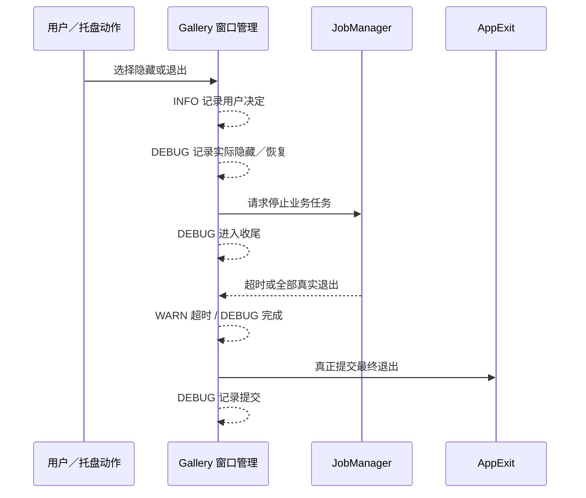

# 完善 Gallery 托盘与退出流程的分层日志

## 目标与设计思路

为 Gallery 的主窗口关闭、隐藏到托盘、托盘恢复、后台任务收尾和应用退出建立符合实际执行阶段的日志。用户确认的选择是 INFO，窗口和退出状态的真实变化是 DEBUG，超时与强制退出的风险是 WARN，已有真实错误仍为 ERROR。该增量只调整 Gallery 现有 `close.rs` 与 `close/shutdown.rs` 的记录点，不修改窗口管理或 ShutdownHandle 的行为。

## 需要调整的记录点

`gallery/src/close.rs` 的 `finish(world, root, choice)` 当前会关闭确认窗口，并在 `Some(Choice::Hide)` 路径对每个窗口的 `visible = false` 写 INFO，又对托盘隐藏会话写 INFO。`restore_from_tray` 对每个窗口的恢复也用 INFO，随后 `focus_restored` 把程序请求主窗口聚焦写为 INFO。它们描述的是内部状态和执行阶段，应改为 DEBUG；保留窗口 `Entity`、标题及实际变更数量，不把“ECS 已提交 visibility 修改”写成“操作系统已经完成显示”。

对主窗口的关闭确认，用户明确选“退出”“隐藏到托盘”“取消”时记录各自 INFO；收到 OS 关闭请求打开对话框是程序阶段 DEBUG，不应记录为已退出。托盘图标点击后触发的**应用恢复意图**由 Gallery 记录 INFO，Widgetry Tray 库只发送 `WidgetryTrayClick`，不得推测宿主业务。没有活动隐藏会话的重复托盘事件不要编造“恢复成功”。

`gallery/src/close/shutdown.rs` 当前对 `begin()` 等待后台任务、退出前恢复托盘窗口、`ShutdownMessage::Completed`、最终 `AppExit` 提交都使用 INFO，应统一改成 DEBUG。保留与实际动作吻合的 `remaining`、`timeout_ms` 和阶段；`begin()` 重入已经受 `ExitFlow.handle` 保护，不新增重复开始日志，`Completed` 仅在真实后台工作完成并收割时记录。退出时若 Canvas 阶段还有合法在途发布，仍要等待已有阶段流程，不能提前写“程序完全退出”。

`ShutdownMessage::TimedOut` 仍使用 WARN，因为超时后后台清理存在风险；这是状态变化而非每帧提醒。用户点击“继续等待”仍是 INFO。选择“强制退出”应有独立 INFO 表明用户决定，现有 WARN 可以保留用于描述后台清理与外部副作用不保证完成的**风险事实**，不能用 WARN 代替用户操作。重复取消／选择不生成伪造的新事件。

新增日志正文统一中文，动态上下文使用英文结构化字段；只记录必要的对象身份、状态和结果摘要，不打印完整用户输入、敏感内容或大体量业务数据，也不手动重复 Tracing 已提供的 `file`、`line`、`module_path`、`crate_name` 等元数据。

## 错误、测试与边界

不改变 `WindowCloseRequested`、`AppExit` 捕获时机、`Last` 与 `RemoteLast` 的顺序、原生窗口同步、托盘会话存储、1 秒关闭预算或强制退出策略。出错时继续使用诊断 Error Handler；正常用户取消不是 ERROR，实际后台失败不得仅用 WARN 掩盖。

利用现有 `gallery/src/close/shutdown.rs` 的测试覆盖空任务退出、后台任务真实回收、超时→继续等待→完成、强制退出、程序发出的 `AppExit`、多窗口隐藏／恢复、Dialog 取消及重复请求，加入关键日志等级和数量检查。窗口实际显示／隐藏和托盘点击需依照已有 Windows GUI 验证方式进行，不用 Headless 测试假冒 OS 执行结果。

同步 `docs/gallery.md` 的关闭、托盘和退出章节对新日志的描述；不要把普通窗口 Focus、Pointer 或内部事件额外追踪为 INFO。
