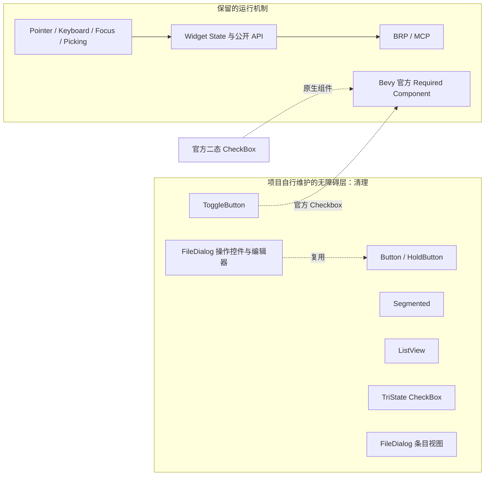

# 移除项目自建 Accessibility 语义：整体设计

Widgetry 的人类交互继续由 Pointer、Keyboard、Focus、Picking 和控件业务 API 承担；Agent 通过 BRP / MCP 复用输入与 ECS 契约。Accessibility / AccessKit 不再是项目主动维护的控件能力。清理目标是移除项目源码中额外创建或同步的无障碍节点、角色、标签与状态，不破坏 Bevy 官方控件所要求的组件和传递依赖。

图中的清理对象是彼此可独立交付的范围，虚线表示实际已有的控件复用或原生组件关系，不表示执行时必须依赖前一项完成。`FileDialog` 两个范围分别是可交互的操作/编辑控件，以及虚拟化条目视图；它们可以单独清理和验证。

## 清理边界

现有直接声明 `accesskit.workspace = true` 的生产 crate 包括 `button`、`hold_button`、`toggle_button`、`segmented`、`list_view`、`check_box` 和 `file_dialog`。这不是要求删除 Bevy 自身的无障碍实现：项目显式添加的 `AccessibilityNode`、AccessKit Role、`Toggled`、选中投影和对应测试应退出；官方 `Checkbox` 等组件自行注入的 Required Component、Bevy 的传递依赖不主动剥离。

`TabIndex(-1)`、`InputFocus`、`FocusedInput`、`Hovered`、`Pressed`、`Checked`、`Checkable`、`Selected` 等应逐项依据自身交互职责保留，不能仅因它们与无障碍代码邻近就删除。尤其不得把“删除无障碍节点”变成“关闭键盘输入/焦点”或“新增 BRP 专用状态总线”。

## 各范围的关系与顺序

八个增量形成唯一执行顺序。前三项分别处理独立按钮控件；第四项处理 Segmented 的 Group/Option 语义；第五项移除 ListView 的 ListBox / ActiveDescendant 投影；第六项移除三态 CheckBox 的同步系统及测试；最后两项分别清理 FileDialog 的控件元数据、虚拟化条目语义。最后一项在所有直接使用已经消除后，统一收尾 Workspace 的 `accesskit` 直接依赖。

大部分相邻方案只是实施顺序相邻而非功能上的硬依赖；FileDialog 的操作控件复用 Button，因此把 Button 清理安排在前。每项的测试与直接相关的文档同步都属于该项本身，不单列一个纯验证阶段。若行为发生变化，使用 BRP 按真实输入和状态验证，不能以直接写 ECS 值代替真实交互。

## 方案导航

1. [移除 Button Headless 的自定义无障碍节点](01-button-node.md)
2. [移除 HoldButton 的自定义无障碍节点](02-hold-button-node.md)
3. [移除 ToggleButton 对官方无障碍节点的覆写](03-toggle-button-override.md)
4. [移除 Segmented Group / Option 的无障碍角色](04-segmented-roles.md)
5. [移除 ListView 的无障碍语义投影](05-list-view-projection.md)
6. [移除三态 CheckBox 的无障碍同步及断言](06-tri-state-check-box.md)
7. [移除 FileDialog 操作控件与编辑器的无障碍元数据](07-file-dialog-controls.md)
8. [移除 FileDialog 条目无障碍投影并收口直接依赖](08-file-dialog-entries.md)
