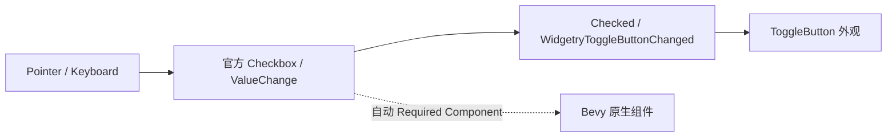

# 移除 ToggleButton 对官方无障碍节点的覆写

`WidgetryToggleButtonHeadless` 实际复用 Bevy 官方 `Checkbox` / `CheckboxPlugin` 处理输入请求，以原生 `Checked` 为唯一二态 Authority。现在的 Scene 又手工创建 `Role::Button` 的 `AccessibilityNode` 并根据 Props 初始化 `toggled`，这属于主动覆写，而不是让官方组件自然工作所必需的行为。

## 源码调整

在 `crates/toggle_button/src/headless.rs` 中：

- 从 `#[require(Node, Checkbox, ...)]` 删除项目自行构造的 `AccessibilityNode(Role::Button)` 覆写。
- 删除 `scene(props)` 中创建 AccessKit 节点、设置 `Toggled::True/False` 的模板；保留 `props.selected` 对 `Checked` 的初始化。
- 保留 `Checkbox`、`CheckboxPlugin`、`ValueChange<bool>`、`WidgetryToggleButtonChanged`、Pointer/Focus、Pressed 协调与默认 `TabIndex(-1)`。如果官方 `Checkbox` 自动要求 Accessibility 组件，不阻止其注入，也不重建额外覆写层。

删除 `crates/toggle_button/Cargo.toml` 的直接 `accesskit.workspace = true`。`docs/crates/toggle_button.md` 删除“根采用 AccessKit Button 角色及 toggled 属性、子文本提供可访问内容”的承诺，继续记录原生 Checked、提交后通知、程序化和用户输入语义。

## 行为和验证

验证初始 selected、Pointer 与获得 Focus 后的 Enter / Space、Disabled、同步与排队设置、重复同值不通知、实际变更时先提交 `Checked` 再发 `WidgetryToggleButtonChanged`。默认 Style 与外部 Headless 组合都应保持原根与视觉状态，使用现有测试和必要的 BRP 场景核对。

删除的是项目自定义的节点角色和无障碍状态初始化，不是 `Checked` 的所有权；不得为保持旧无障碍 `toggled` 外观而再写同步系统。此方案与前后独立清理项没有技术硬依赖。
