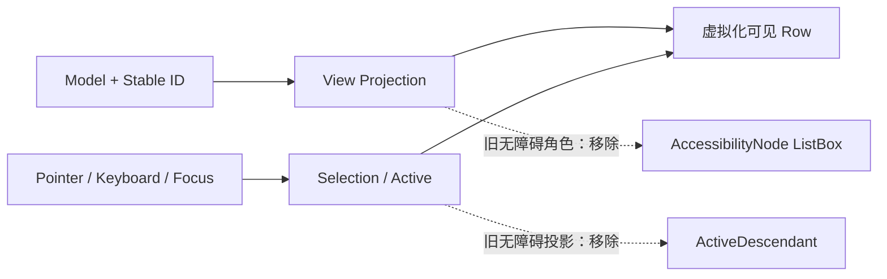

# 移除 ListView 的无障碍语义投影

ListView 的 Model、Projection、Selection、Active 与虚拟化可见行分别承载业务身份和交互状态；它们不应依赖无障碍节点保存事实。当前 ListBox 角色和 `ActiveDescendant` 是将业务 Active/Focus 再投影给辅助技术的旁路，可独立移除。

## 源码调整

- `crates/list_view/src/view.rs`：移除 `bevy::a11y::AccessibilityNode` import、BSN 根上的 `AccessibilityNode(accesskit::Role::ListBox)` 及仅用于这一无障碍通道的 `ActiveDescendant::default()`。保留 `TabIndex(-1)`、ScrollArea、容器 Node、`ListNavigation`、业务 View 与颜色状态。
- `crates/list_view/src/behavior.rs`：`ActiveDescendant(active)` 更新块目前只保存当前有 Focus 的可见 Active Row。移除该投影及相关 import，并检查只服务于此投影的局部 `active`、`focused` 变量和分支，避免留下死代码。选中行的 `Selected`、内部 Disabled、Pressed 取消等处理必须照旧。
- `crates/list_view/Cargo.toml`：删除 `accesskit.workspace = true`。当前 `docs/crates/list_view.md` 没有无障碍节点的契约声明；不需要凭空补一个移除声明。如相关测试只验证该投影，删除专属断言并保留真实选择/Focus 测试。

## 保留的可观察契约

`ActiveDescendant` 不是选择 Authority。BRP 仍可以通过已有业务状态、公开查询、实体与实际 GUI 输入观察 ListView，而不通过一个可能已经被回收的 Row Entity 作为业务身份。移除投影不应改变稳定 Item ID、Selection/Active、可见 Row 虚拟化、滚动定位、键盘浏览或 Disabled。

验证焦点获得/失去后 Active 的业务值、上下移动、Space/Enter、滚动使可见 Row 回收再创建、Selected 视觉更新及对 ComboBox/Tree 组合的影响。对真实 GUI 变动风险使用 BRP 检查输入后状态和画面。禁止为填补 `ActiveDescendant` 而增加新的 Agent 专用 Component 或额外状态副本。

## 边界

若进一步检查发现其他真实输入机制消费 `ActiveDescendant`，只应移除纯无障碍投影部分并保留该输入机制的必要最小组件；不得破坏 Bevy 官方必要依赖。此项不要求清理其他控件的无障碍代码。
