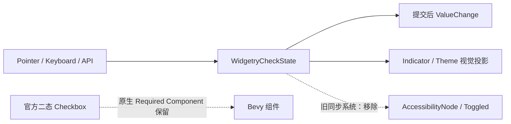

# 移除三态 CheckBox 的无障碍同步及断言

二态 CheckBox 复用 Bevy 官方 `Checkbox` 和 `Checked`，其原生 Required Component 可以保留。三态 CheckBox 则有 Widgetry 自己的 `WidgetryCheckState` Authority，现在还专门构建 `AccessibilityNode(Role::CheckBox)`，通过 System 将三态持续同步成 AccessKit 的 False / True / Mixed。这属于项目主动维护的无障碍能力，应从行为层退出。

## 生产代码

`crates/check_box/src/tri_state.rs` 删除 `accesskit::{Role, Toggled}`、`bevy::a11y::AccessibilityNode`、`WidgetryTriStateCheckboxHeadless` 的 Required 无障碍节点和 `sync_accessibility` 函数；同时移除 `WidgetryTriStateCheckboxHeadlessPlugin` 对这个系统的 `PostUpdate` 调度及其专用前后排序。保留 `WidgetryCheckState`、循环顺序、`ValueChange`、`Pressed` 清理、Focus/Keyboard/Pointer、程序化 Set/Cycle 和正常配色/Indicator 调度。

`crates/check_box/src/checkbox.rs` 的官方二态 Headless 依然复用 `Checkbox`，不手动剥离官方 Required Component。删除 `crates/check_box/Cargo.toml` 中仅供项目自定义 AccessKit 代码和旧测试使用的直接 `accesskit.workspace = true`。

## 测试与文档

- `crates/check_box/tests/tri_headless.rs`：调整“后挂载已有三态状态”“三次 Pointer 循环”“Disabled 期间程序 Set”等测试，移除 `AccessibilityNode` / `Toggled` 断言，保留业务 State、Checked 不作为三态 Authority、通知次数及 Pressed 清理的断言；测试名称同步去除无障碍承诺。
- `crates/check_box/tests/checkbox.rs`：删除只验证 AccessKit 状态同步的测试或改为有真实业务价值的 Set/通知验证；`assert_projection` 保留状态与 Indicator 可见性校验，移除 `Toggled` 对照。
- `crates/check_box/tests/headless.rs`：移除仅验证 Bevy 官方二态 Accessibility Role/Toggled 的额外断言，保留 `Checked`、请求、Focus 和真实输入回归。避免把 Bevy 内部行为当成 Widgetry 自己的测试契约。
- `crates/check_box/tests/COVERAGE.md`：删去 Accessibility 相关的 Invariant/Coupling 与测试覆盖描述，继续记录三态 Authority、Indicator 和输入耦合。`docs/crates/check_box.md` 删去 Headless 无障碍同步、Role 与 Mixed 语义等已退役功能；说明二态官方输入/状态时只记已有业务契约。

## 验收与边界

保持 Unchecked → Checked → Indeterminate → Unchecked、无效请求错误、同值静默、先提交后通知、禁用期间程序更新、后挂载 Headless 不重置已有状态，以及默认与自定义 Style 的颜色/Indicator 表现。利用现有 Integration Test、必要的 Headless 测试及定向 BRP Pointer / Keyboard 验证；不单独测试辅助树。不要删除官方 `Checkbox` 或 `Checked`，也不要把三态用原生 bool `Checked` 重新编码。
