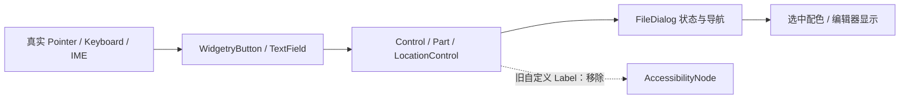

# 移除 FileDialog 操作控件与编辑器的无障碍元数据

FileDialog 的操作按钮、侧栏位置按钮和文本编辑器均已由现有 Widget、Name、业务 Part、Action、Focus 和交互事件识别。自定义 AccessKit Label 和 Selected 只额外描述这些实体，对目录导航、用户输入、确认或视觉高亮没有业务所有权。

## 源码调整

`crates/file_dialog/src/style.rs` 的 `control_scene` 现在为操作按钮创建 `Role::Button` 并设置 `label`，`editor_scene` 为 Path、Search、Filename、新建目录等输入创建 `Role::TextInput` 和名称。移除两个无障碍模板；保留按钮图标与可见文本、Navigation Tooltip、`Name`、`Control`、`Part`、`WidgetryWindowInitialFocus`、实际 TextField/按钮控件与 UI 布局。`label` 仍被普通文本和 Tooltip 使用，不能连同无障碍模板一起删除参数。

`crates/file_dialog/src/controls.rs` 的 `FileDialogLocation` 构造中，删除多余的 `accessible_label` 副本和手工生成的 AccessKit Button Node；保留 `label` 可见文本、LocationControl.path、可定位的 `Name("FileDialogLocation")` 和导航回调。`apply_color` 在侧栏选中时写入 `AccessibilityNode.set_selected(selected)`，删除该无障碍状态写入，但保留选中判断与正常按钮背景、前景配色，不能将整个选中分支一并删除。

## 测试与验证

在 `crates/file_dialog/tests/style.rs` 中，位置按钮测试目前直接断言 `AccessibilityNode.label()`，需要改为保留可见内容与真实 Activate 后的目标路径验证；另一个用 `AccessibilityNode.is_selected()` 断言侧栏选中状态的用例，应保留业务路径与选中颜色/Disabled/Theme 的断言，移除无障碍断言。测试重心是按钮仍显示正确标签、点击能导航、选中项仍高亮，Path/Search/Filename 仍可输入和响应正确按键。

必要时通过 Gallery 的 BRP 定向确认导航按钮、侧栏、文本输入、Focus 与 IME 相关可观察行为；真实输入与 ECS 状态必须一致，不通过删除 `Name` 或隐藏交互目标来“清理”无障碍能力。

## 与其他方案的关系和边界

此项包含 FileDialog 的操作区域与编辑器，不处理条目 Viewport / Row 的 ListBox 语义，故不能提前删除 `crates/file_dialog/Cargo.toml` 的 `accesskit` 依赖。FileDialog 复用的 Button 应按前序独立方案清理，官方 TextField / Button 内部可能自动存在的 Required Component 不额外覆盖或移除。本项也不修改文件选择/确认的业务状态机或后台 Job。
