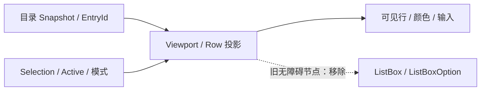

# 移除 FileDialog 条目无障碍投影并收口直接依赖

FileDialog 的目录数据、可见 Row、选中集合与多选模式分别由原有 State 和虚拟化投影负责；AccessKit 的 ListBox、ListBoxOption、Label、Selected 和 Multiselectable 只是一个重复的辅助描述层。移除它们后，文件列表仍由现有业务 Authority 及 UI 行为运行。

## 生产代码

`crates/file_dialog/src/view.rs` 的 `bootstrap` 给滚动区域主动插入 `AccessibilityNode(Role::ListBox)`，并在多选时设置 `multiselectable`。删除该角色创建与 Insert；`multiple` 若在该函数内只用于无障碍节点，应连同无用形参、调用实参一起清理，保留 Viewport / Content / Spacer 初始化与 `RequestRedraw`。

在虚拟化 Row 更新路径中，代码为每个条目创建 `ListBoxOption`，以文件名设置 Label，以业务 Selection 设置 Selected，并尝试更新或插入 `AccessibilityNode`。删除这套节点生成及对比/插入分支；同时删去只供其使用的局部变量与 import。`EntryRow`、`RenderedStyle`、Node 高度、物理 Row 复用、Stable EntryId、内容渲染、选中样式和真实输入路由必须保留，不能把无障碍 Selected 与业务 Selected 混淆。

在当前其他 FileDialog 自定义无障碍代码已经由上一方案清理后，删除 `crates/file_dialog/Cargo.toml` 的 `accesskit.workspace = true`。检查 Workspace 中是否还存在任何需要此**直接**依赖的生产或测试源码；如果所有 Workspace crate 均不再直接使用 AccessKit，再删除根 `Cargo.toml` 的 `[workspace.dependencies] accesskit`。Bevy 可能依然传递依赖 AccessKit，这是允许的，不修改 Bevy Feature 来强行排除。如果锁文件需要变更，按 Cargo 实际解析结果更新，不手工移除仍被 Bevy 依赖的包。

## 测试、文档与收口

保留 FileDialog 现有 `contract.rs`、`runtime.rs`、`style.rs`、`window.rs` 回归重点，检查单/多选目录的选中语义、Ctrl/Shift Range、键盘方向/Enter、点击导航、滚动后复用 Row 与名称显示、禁用与选中配色、文件和目录确认、Session / EntryId 不混淆。可通过受控测试验证业务状态与 UI 投影；涉及真实 GUI 的代表性场景，用 BRP 对 FileDialog 的单选、多选与滚动进行输入、截图和 ECS 状态核对。

完成整个清理后，搜索生产代码和测试中主动生成的 `AccessibilityNode`、`accesskit::Node`、Role/Toggled、AccessibleLabel 及专用同步 System，确认项目自建的调用路径已退出。检查剩余命中是否由 Bevy 官方 Required Component 或确有编译/运行要求的最小例外引入。`docs/crates/file_dialog.md` 当前没有承诺 AccessKit 功能；如实际变更不影响已描述的行为，无需虚构额外文档。若 Workspace 依赖结构在 `docs/architecture.md` 有对应明文记录，则依规则同步；未记录的依赖不强制扩写。

这一增量承接前七项已完成的代码清理，承担必要的最终 Workspace 依赖收口；不单独建立纯验收方案。保留 Bevy 原生 Checkbox、TextField 与其他控件自动携带的组件，不移除 Pointer、Keyboard、Focus、Picking，也不为了 Agent 添加新的无障碍替代结构。
