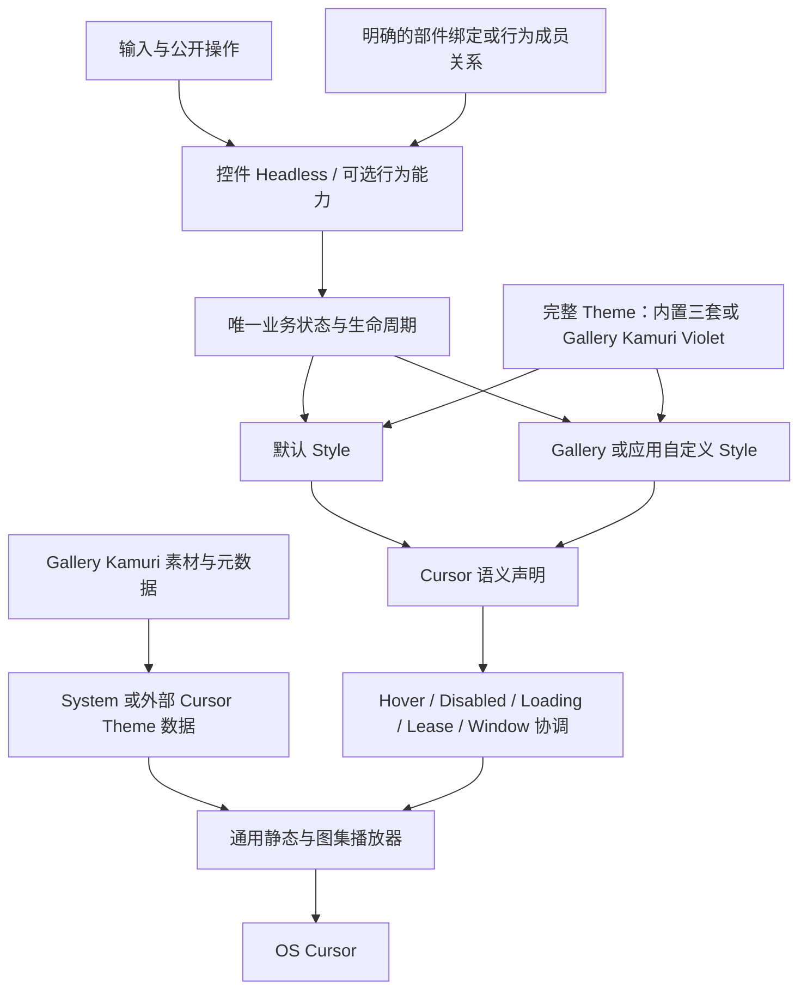
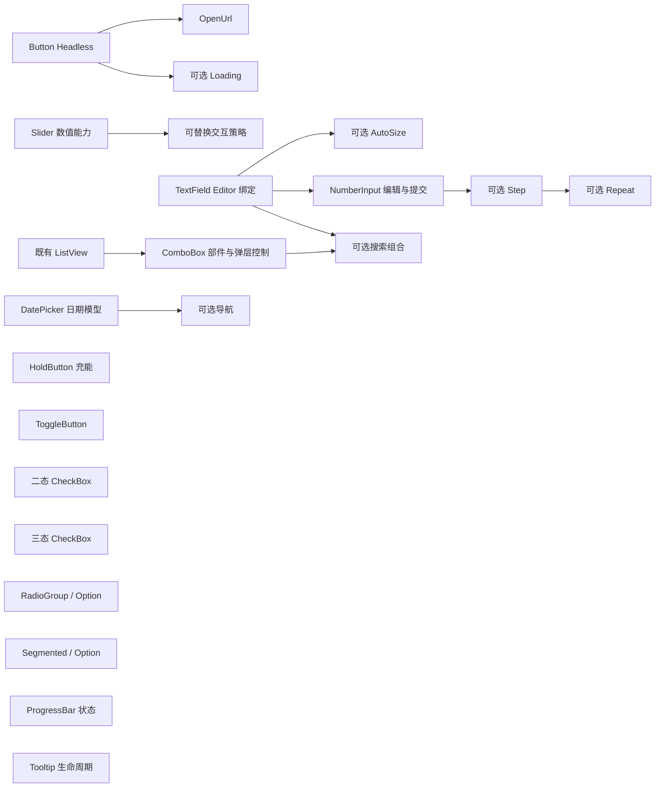

# 控件行为解耦与外部主题扩展

这次开放的不是给现成控件换颜色的接口，而是让外部程序复用输入、状态和生命周期，自行用 BSN 构造新控件。默认控件仍由同一套行为加原来的 Style 组成，不维护两条行为路径。

另有两项独立的外部扩展：应用可以提供完整 UI 配色，也可以提供静态或图集动画 Cursor Theme。现有 Kamuri Violet 配色和 Kamuri Cursor 都迁到 Gallery，作为真实的外部调用示例；它们的颜色、素材、动画时序和热点不重新设计。

## 不能在拆分中丢掉的边界

**Headless 与默认 Style 解耦。** 行为资格、初始化、Setter、Observer、查询与错误校验都识别行为能力，不能只有类型导出了，系统仍筛选默认 Widget。默认颜色、边框、Indicator、Frame、Spinner 或固定 Popup 树不是行为成立的条件。输入所需的 Node、官方 Editor、ListView 或明确成员关系可以是语义依赖，不必假装所有控件都能只有一个空 Entity。

**默认 Style 不能变。** 保留尺寸、布局、内容排列、颜色、图标、字体呈现、动画、Hover/Pressed/Focus/Disabled、选中和 Loading 等实际表现，也不顺便改变默认用户交互契约。外部可以拥有完全不同的 Style，不代表默认控件获得一次重新设计。复合控件不为了包装 Headless 多加一层影响布局、Picking、裁剪或事件传播的 Node。

**不考虑旧 API 兼容性。** 可以调整公开类型、方法、模块和内部 ECS 结构，直接迁移调用者；不保留两份状态、兼容别名或长期双实现。分阶段实施时允许尚未迁出的内置提供方继续工作，但最终只留下统一能力路径。每份增量结束时默认控件和已有 Gallery 仍能使用，不能用后续方案解释本阶段的破损。

## 开放范围与真实组合关系

本次控件范围是 Button/LinkButton、HoldButton、ToggleButton、二态/三态 CheckBox、RadioGroup/Option、Segmented/Option、Slider、NumberInput、TextField/ReadOnlyTextField、ComboBox、DatePicker，再加 ProgressBar 和 Tooltip。Button 已有 Headless，保留并修正其 Loading 反馈边界，不重做输入系统。

基础按钮与选择控件分别开放自身的行为。OpenUrl 组合 Button 激活，HoldButton 自己拥有充能阈值；ToggleButton、二态 CheckBox 与三态 CheckBox 不被强行统一成一种状态。RadioGroup 与 Segmented 共用 Core 选择基础，但保留各自输入契约并分别支持混合 Option Style。

图中的箭头表示能力之间的真实使用关系，不表示完整执行顺序。独立节点也都在范围内。复杂组合被拆开，是为了每次交付一个可以独立使用和验证的能力，而不是按文件或函数分工。

Slider 把数值权威与可替换输入策略分开；单纯公开 Track/Thumb Entity 不足以支持外部圆弧交互。TextField 通过明确引用找到真实 Editor，NumberInput 和 ComboBox 搜索复用这套编辑能力。NumberInput 的按钮与重复可选；ComboBox 仍使用 ListView 作为唯一选择引擎，不另造数据/选择协议。DatePicker 的日期数据与导航状态不要求外部提供全部默认页面。ProgressBar 动画由 Style 决定，Tooltip 定位也由 Style 决定。

Tabs、Collapsible、Splitter、ScrollArea、ListView、TreeView、Table、Waveform、Canvas、Window、MessageBox、FileDialog、Core Text/Icon 等不新增本轮 Headless 扩展。已有 Renderer 能力继续使用。它们因 Theme 数据入口或子控件调用变化产生的必要适配仍须完成，这不是扩大控件开放范围。

## Theme 与 Cursor 的最终归属

UI Theme 只管理已有配色字段，不引入字号、圆角、Padding 或布局参数。当前完整配色由 Resource 持有，内置与外部数据使用同一设置和通知路径，不再由封闭的主题模式枚举限制。局部 Overrides、托管 Style Owner、先提交后通知与同值静默继续保留。

库内保留 Dark、Light、Pink Dream，默认仍是 Dark；Light/Pink Dream 的原有开关保留。Kamuri Violet 的公共色值、各控件配色和完整定义一起迁到 Gallery，删除库及 Facade 的 kamuri_violet 入口。Gallery 顶部仍是原来的四个选项，不新增第五套 Custom。

Cursor 继续区分语义协调和素材呈现。库默认 System，接受外部静态图片和 SpriteSheet 动画；动画不支持独立多图序列。缺少语义使用既有系统回退，外部不必提供完整 45 项，也不受 80×80 画布限制。保持真实 Mouse、窗口、Loading/Disabled、Lease 和 Native 让权规则，显式 EntityCursor::Custom 不被主题映射替换。

Kamuri 的 45 份动画、静态后备、热点、帧参数和专用生成工具迁入 Gallery。通用播放与通用诊断/测试留在库；删除 kamuri_cursor Feature 和库内 Kamuri 分支。Gallery 仍显示 System/Kamuri，配色主题与光标主题独立选择。

## Gallery 是外部调用示例，不是后门

沿用现有页面、导航、顶部配色选择器、Color Showcase 和 Cursor 页。各控件默认示例保留，在相应页面增加真正可交互的自定义区域，不为每个 Headless 新增导航页，也不只画静态预览。Button 页继续承载其已有按钮族和 Radio 示例。

自定义示例只使用 Widgetry 公开入口和 Bevy 公开基础能力，不访问 internal、私有 Parts，不直接改内部状态。弧形 Slider、无按钮及异位按钮 NumberInput、多层 Editor、自定义 ComboBox Popup、混合 Option、日期-only 日历、圆环进度和气泡 Tooltip 分别证明相应边界。具体美术可以简洁，但不能仅改颜色就声称结构已经解耦。

Kamuri Violet 和 Kamuri Cursor 直接使用现有内容，承担完整配色和完整鼠标主题的展示，不重新制作一套素材。单项静态/缺项回退测试复用现有首帧，不删减完整 Kamuri 主题。

## 验证如何随能力交付

每份正文都包含自己的单元、组合、错误路径和 Gallery 验收条件。没有单独的“最后再补测试”阶段，也不要求每一份都重复执行未受影响的全仓回归。最后一份真实迁移增量承接必要的全局收口检查。

默认样式用现有 Gallery 的尺寸、状态、四套配色和动画作为对照；外部能力用不含默认视觉部件的独立实例验证。稳定状态不增加逐帧全量扫描，动画或计时结束后不残留唤醒。原生 IME、剪贴板和 Windows OS Cursor 需要真实环境验证，不能仅用 Headless 或 Custom Pointer 模拟替代。

沿用项目的 Windows 64 位目标和 Bevy 0.20 API，错误继续保留领域分类、原始原因链与诊断身份。纯视觉变化不修改业务状态，程序设置与真实用户输入的权限差异按各控件原契约保留，不强行统一事件模型。

策略接口的具体 Rust 承载形式、公开绑定类型的最终名称可以在对应增量内定型；其行为契约已经写在正文中。不得把这种实现自由变成继续要求默认私有结构，也不得把示意类型名当作现有可直接调用的 API。

## 唯一执行顺序

按以下编号依次实施。顺序相邻不意味着技术依赖，每份正文单独说明它依赖哪些已交付能力，并保留独立阅读所需的约束。

1. [以完整配色数据切换 Theme](01-theme-data.md)
2. [将 Kamuri Violet 配色迁入 Gallery](02-gallery-kamuri-theme.md)
3. [分离 Button Loading 与默认视觉反馈](03-button-loading.md)
4. [开放独立的 URL 激活行为](04-open-url.md)
5. [开放 HoldButton 的充能行为](05-hold-button.md)
6. [开放 ToggleButton 的状态行为](06-toggle-button.md)
7. [开放二态 CheckBox 行为](07-checkbox.md)
8. [开放三态 CheckBox 行为](08-tri-state-checkbox.md)
9. [开放 RadioGroup 与 RadioOption 组合](09-radio-group.md)
10. [开放 Segmented 与 SegmentedOption 组合](10-segmented.md)
11. [开放 Slider 数值状态](11-slider-value.md)
12. [开放 Slider 可替换交互策略](12-slider-interaction.md)
13. [开放 TextField 编辑器绑定](13-text-field-editor.md)
14. [开放 TextField 可选自动高度适配](14-text-field-presentation.md)
15. [开放 NumberInput 编辑与提交](15-number-input-editing.md)
16. [开放 NumberInput 步进触发器](16-number-input-step.md)
17. [开放 NumberInput 长按重复能力](17-number-input-repeat.md)
18. [开放 ComboBox 部件绑定与弹层控制](18-combo-box-parts.md)
19. [开放 ComboBox 搜索组合](19-combo-box-search.md)
20. [开放 DatePicker 日期模型](20-date-picker-model.md)
21. [开放 DatePicker 导航行为](21-date-picker-navigation.md)
22. [开放 ProgressBar 真实进度状态](22-progress-bar.md)
23. [开放 Tooltip 生命周期](23-tooltip.md)
24. [开放 Cursor 主题映射与静态样式](24-cursor-theme.md)
25. [开放 Cursor 图集动画播放](25-cursor-animation.md)
26. [将 Kamuri Cursor 整套迁入 Gallery](26-gallery-kamuri-cursor.md)

## 不在这次方案内

不建设新的主题编辑器、主题市场、全局 Style 注册框架或通用选项协议；不扩展未选中的控件，也不重画 Kamuri 素材。
