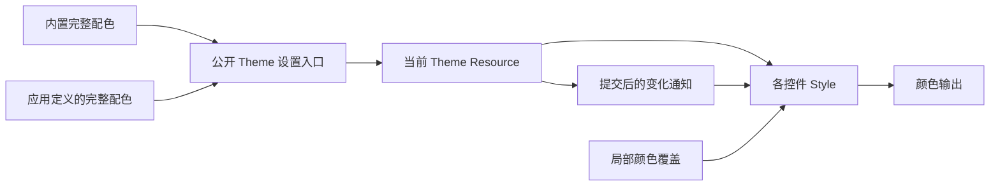

# 以完整配色数据切换 Theme

把主题切换的入口从固定的 `WidgetryThemeMode` 枚举改为完整的 `WidgetryTheme` 数据。外部程序可以复制一份预设、修改颜色，再通过同一个公开入口应用它；内置主题不再拥有外部主题无法使用的专属通道。

本增量交付可用的外部配色切换能力，并迁移所有直接读取旧模式的消费者。下一份方案再把 Kamuri Violet 的配色定义搬到 Gallery；这里不提前删除它，也不改变任何一套预设的颜色。两份方案有直接依赖。

## Theme 保存数据，不选择控件结构

保留 `WidgetryTheme` 及所有已有 Colors 类型的完整字段结构，包括窗口、对话框、列表、表格、波形等未参加本次 Headless 开放的控件。主题数据仍然可以统一影响它们，但不因此开放它们的行为扩展接口。

Theme 的范围只到目前已有的配色。字体、字号、间距、圆角、Padding、尺寸、动画和布局不进入 Theme；这些由默认 Style 或外部 Style 决定。控件的 Headless 不读取 Theme，也不因为换主题改变 Checked、文字、日期、进度或选择状态。

当前主题由一个 Resource 持有完整配色，而不是同时保存模式枚举与另一份可变配色。保留公开的预设常量，Dark 仍是默认值，Light 和 Pink Dream 保持原有可选 Feature。Kamuri Violet 在本增量结束时仍可选择，其最终归属由下一份方案处理。

## 公开设置与通知契约

提供同步 World 设置和 Commands 排队设置，语义上对应 `WidgetryTheme::set_in_world(world, theme)` 与 `set(commands, theme)`。同步入口返回是否发生真实变化；Commands 在实际执行时校验并提交。当前配色应有公开只读访问方式，调用方不必依赖固定枚举名称。

一次切换先完成校验，再替换当前完整数据，然后发送 `WidgetryThemeChanged`。监听者读取到的必须是已经提交的新配色。通知结构不再要求携带旧模式枚举；消费者也不能继续通过 `event.mode.colors()` 找颜色。沿用现有同步入口的通知与 flush 语义，不让默认控件晚一轮刷新。

合法同值设置保持静默，不重启动画、不重复标脏。相等性按完整配色数据判断，不为了去重引入主题注册表或全局主题 ID。颜色合法性沿用现有颜色约束，不能因为整体主题入口新增而允许非法颜色绕过原有校验；检查失败时不部分更新当前主题。

例如，应用复制 Dark 后只改 Button 的 Normal 背景和 Hover 背景，得到的是一份新的完整 Theme。其他字段保持复制时的值，而不是建立会随着未来 Dark 数据变动而自动继承的运行时链。

## 一次迁移完颜色消费者

重点实现位置是 `crates/theme/src/theme.rs`、Theme 导出，以及各控件读取 `WidgetryThemeMode` 和监听 `WidgetryThemeChanged` 的位置。把 `mode.colors().button` 一类读取改为当前 Theme 的字段访问。构造 Scene 时的初始颜色与后续主题刷新必须读同一份当前数据，避免先用默认色闪一下再变色。

既有局部 Overrides 和 `WidgetryStyleOwner` 的优先级不变。被复合控件托管的子控件继续由拥有者投影颜色，不能因迁移 Theme 而被独立主题系统覆盖。新生成的 Text、Icon 仍通过既有前景传播获得当前颜色。稳定帧也不能退化为逐帧全量重算。

本次必须覆盖所有实际消费者，而不只覆盖准备开放 Headless 的控件。NumberInput 的 TextField/Button 配色、ComboBox 的 Button/ListView 配色、Window 和 Dialog 的表面颜色，以及 Gallery 侧边栏、页头与 Color Showcase 都属于直接影响范围。Facade、示例、相关测试和文档同步改用新入口。

## Gallery 的主题名称留在应用层

Gallery 仍使用顶部选择器，不增加实时主题编辑器。Dark、Light、Pink Dream、Kamuri Violet 的显示名称及配置存储由 Gallery 自己映射到完整配色值。这个应用层目录不是库中的固定模式枚举，也不成为主题唯一来源。

选择器不能再以 `WidgetryThemeMode` 为条目类型。初始化、外部主题更新后的选中同步，以及配置读取/保存需要一起迁移，避免 UI 显示的选择与实际配色不一致。名称不写入控件状态。对不属于 Gallery 预设目录的外部完整配色，不得错误显示成某一内置主题；具体展示标签可以由 Gallery 决定，不影响库接受任意 Theme。

## 完成条件

- 用一个仅依赖公开接口的调用方构造第五份临时配色并切换；已有默认控件立即采用该数据，选择、编辑和动画进度不被重置。该临时测试值不成为 Gallery 的第五个正式主题。
- 覆盖同步与 queued 设置、设置前资源缺失、合法同值、非法颜色、连续两次切换。确认先提交后通知，失败无部分写入，同值不重复通知。
- 对四套现有配色逐字段对照，并在 Gallery 比较默认控件适用的 Normal、Hover、Pressed、Focus、Disabled、选中与 Loading 状态；默认色值与局部覆盖优先级不变。
- 检查构造时颜色、运行期颜色、托管颜色和新增内容的前景传播均读取当前 Theme；Color Showcase 显示当前实际数据。
- 独立调用方验证 Dark-only、Light、Pink Dream 的 Feature 组合，不用 Gallery 的依赖累加掩盖裁剪问题。

## 边界与失败处理

不保留旧模式枚举的兼容外壳，不建立第二份主题状态，不改默认 Style 的几何或动画。缺资源、无效数据与消费者错误继续使用既有领域诊断与 Error Handler；传播保留原因链和原始诊断身份，不重复报告源头。主题提供者不负责自动创建未安装控件的 UI。
