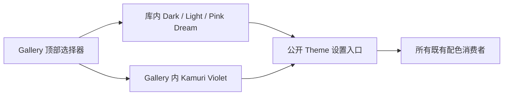

# 将 Kamuri Violet 配色迁入 Gallery

把 Kamuri Violet 从库内预设改成 Gallery 定义的外部 Theme。这里复用整套现有颜色，不重新设计配色，也不额外制作一个名为 Custom 的演示主题。迁移后的页面仍然能选到原来的四套主题，只是其中一套由应用提供。

本增量依赖前一份完整 Theme 数据入口。下一份 Button Loading 调整只是执行顺序相邻，不依赖 Kamuri 的具体颜色。

## 搬迁的是完整定义，不只是最外层常量

`WIDGETRY_KAMURI_VIOLET_THEME` 的各字段依赖各控件配色模块中的 `KAMURI_VIOLET`，后者还引用 `common` 中的 Kamuri 公共色值。完整迁移必须同时带走这些定义。不能只把最外层常量复制到 Gallery，再让 Gallery 访问库的私有模块。

Gallery 使用公开的 `WidgetryTheme` 和 Colors 类型组装整套数据。字段仍覆盖全部已有消费者，包括 Text、Icon、Button、HoldButton、LinkButton、CheckBox、RadioGroup、Segmented、Tabs、Collapsible、DatePicker、Slider、Splitter、ProgressBar、TextField、ComboBox、ScrollArea、ListView、Tree、Table、Tooltip、Window、MessageBox、FileDialog 和 Waveform。NumberInput 继续复用 Button/TextField 的颜色来源。

保留所有颜色分量和状态差异，不通过重新推导或复制 Dark 后零散覆盖来近似旧主题。特别保留选中且禁用的区别、TextField 警告提示色、HoldButton 液体及成功边框色、Slider 焦点环和 Waveform 的正常/禁用 Channel Palette。

## 库与 Gallery 的归属

从 `crates/theme` 移除 Kamuri 的公共色值、控件配色常量、完整预设导出和 `kamuri_violet` Feature；Facade 不再转发这个 Feature，Gallery 不再开启它。Dark、Light、Pink Dream 的原有定义和启用规则保持不变。

Kamuri 配色、相关对照测试以及名称到配色的映射集中到 Gallery 的主题模块。模块可以按控件拆文件，但不能再次创建一套平行的 Colors 类型。库不能反向依赖 Gallery。

Gallery 顶部仍列出 Dark、Light、Pink Dream、Kamuri Violet。沿用已有名称、配置选项和展示入口，配置恢复时由应用把 Kamuri 名称解析成自己持有的配色。Color Showcase 从当前完整 Theme 读取字段，不区分颜色来自库还是应用。

## 与鼠标主题互不绑定

Kamuri Violet 是 UI 配色，Kamuri Cursor 是鼠标素材。两者分别迁出，仍独立选择、独立应用。切换 Kamuri Violet 不自动换鼠标，切换鼠标也不改 UI 配色。

这次不再保留“库中必须内置四套主题”的限制。需要保留的是 Gallery 四套主题的可见结果，而不是原来的代码归属。库本身仍默认 Dark。

## 完成条件

- Gallery 只通过公开 Colors 数据和 Theme 设置入口使用 Kamuri Violet；不访问私有常量，也不使用隐藏的专用模式。
- 逐字段验证搬迁后的配色与原定义完全一致，并对现有 Gallery 页面做主题切换对照；窗口、对话框及本次不开放 Headless 的控件也正常变色。
- 顶部选择器、启动配置恢复、颜色目录和同值切换仍正常；不会多出第五个 Custom 选项。
- 从库及 Facade 的有效实现、Cargo 配置和当前使用文档中清除 `kamuri_violet` 专用入口；Gallery 能在不启用该 Feature 的情况下呈现 Kamuri Violet。
- 主题相关数值与对比度测试随配色归属迁移，通用主题提交与通知测试仍留在库中。

## 范围限制

不改变任何默认控件的布局、字体、动画或交互。只迁移本次明确指定的 Kamuri Violet，不继续把 Dark、Light、Pink Dream 搬到应用，也不新建独立主题市场、注册服务或编辑器。
