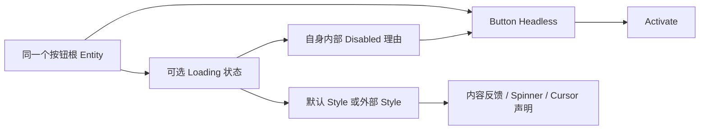

# 分离 Button Loading 与默认视觉反馈

普通 Button 已经具备公开的 `WidgetryButtonHeadless`，不需要再实现第二套按钮输入。本增量只补齐 Loading 与默认表现的边界，使外部按钮能够复用 Loading 状态和输入限制，而不被强制安装 Spinner、内容隐藏或 Wait 光标。

前一份 Kamuri 配色迁移与这里没有行为依赖。后一份 OpenUrl 直接复用已经公开的 Button Headless，不依赖 Loading；两者不能被合并成一个新按钮类型。

## 保留已完成的 Button 输入契约

Headless 根仍然是控件身份、Picking、Focus、Activate 和状态查询目标，不额外包一个布局节点。它不创建默认 Children、背景、边框或 Loading。公开的 Hovered、Pressed、有效 Disabled 可供外部 Style 读取。

继续只接受有效主键点击；副键不能误激活或改写主键 Pressed。Enter/Space 在获得焦点后按下时激活，重复按键和松开不再次激活。取消、拖动后的点击、事件传播截断以及默认 `TabIndex(-1)` 的语义保持现状。同根的外部 Observer 仍可处理右键标记，不给根再挂 Bevy 原生 Button 造成双重输入。

## Loading 是可选状态能力

保留 `WidgetryButtonLoading` 的只读查询、同步/queued 设置及提交后的 `WidgetryButtonLoadingChanged`。业务负责在任务成功、失败或取消后结束 Loading，控件不代管任务。

Loading 以独立理由参与有效 Disabled。开始时阻止后续真实鼠标和键盘激活，结束时只撤销自己的理由，不清除显式禁用、祖先禁用或其他内部禁用。合法同值保持静默，真实变化先提交状态再通知。程序直接 trigger Activate 不等同真实输入，也不提供并发任务互斥保证。

状态查询和设置不能为了检查 Spinner、Content 或布局完成而依赖默认 Style。移除与 Loading 状态无关的 `ComputedNode` 要求；必要的 Headless 身份与 Core Disabled 前提仍应校验。基础 UI Node 可以是输入能力所需组件，但不是默认视觉结构的证明。

## 视觉反馈由 Style 决定

默认 Style 继续在 Loading 时隐藏自己创建的 Content 包装层，保留布局占位及业务子节点状态；保持现有处理显式 Visible 子元素的包装层变换方式。结束后恢复包装层，不修改业务 Children 的 Visibility 和原有变换。

Spinner 仍为绝对居中、无 Picking 的双层圆环，前景弧约 300°、1.2 秒顺时针一圈，底环固定，停止 Loading 后不持续请求动画帧。Loading 使用 Normal 配色，整体视觉优先级仍是 Loading、Disabled、Pressed、Hover、Normal。

Wait 光标是默认表现，不再由 Loading Setter 无条件写入。默认 Style 的反馈路径仍声明 Wait，沿用 Cursor 协调层中 Loading 高于 NotAllowed 的优先级；外部 Style 可以选择自己的反馈。若这条优先级需要公开的语义声明能力，应公开最小语义入口，而不是让外部调用 `cursor::internal` 或自行直接写 OS Cursor。具体承载类型可随实现整理，不创建第二个 Cursor 写入者。

默认 `WidgetryButton` 继续组合 Headless、Loading 与原有 Style。默认颜色系统只管理默认 Style 实例，不能覆盖仅使用 Headless 的外部节点。

## Gallery 与直接影响范围

保留 Button 页已有 GalleryButton：自定义 BSN、同根 Loading、右键标记以及本地/祖先禁用控制。演示必须完全使用公开入口，且在不含默认 Content/Spinner 子树的情况下工作。

修改集中在 `crates/button/src/loading.rs`、`loading_style.rs`、必要的 Cursor 语义桥接及 Facade 导出。默认 Button 样式和托管颜色调用者只做同步适配，不借此改造其他控件。

## 完成条件

- 外部 Headless 根不安装默认 Style，查询和设置 Loading 仍成功；没有默认视觉部件也不产生结构错误。
- 验证 Loading、本地禁用、祖先禁用的不同组合，结束 Loading 不错误启用按钮；失效目标和缺必要资源不留下部分状态或旧光标。
- GalleryButton 的主键、键盘、右键扩展及 Changed 事件顺序正常；默认 Button 不产生重复 Activate。
- 四套 Gallery 配色下比较默认按钮的内容占位、双环外观、动画速度与 Wait/Disabled 优先级；控件原来的外观和交互保持不变。

## 边界

不重写已工作的 Button Headless，不维护旧 API 兼容层。默认视觉诊断仍报告真实的默认子树损坏，但不能把外部自定义结构当作损坏。所有状态 API 保留现有领域错误和提交时机，主题变化不触发业务状态变更。
