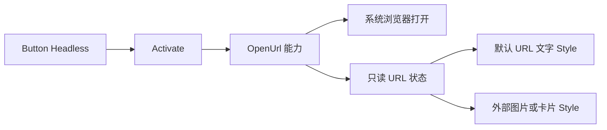

# 开放独立的 URL 激活行为

将 LinkButton 中的 URL 状态、校验和浏览器打开行为抽为可选能力，暂称 `WidgetryOpenUrl`。它与 `WidgetryButtonHeadless` 组合在同一个根实体上，外部可以用图片、卡片或图标作为可点击外观，不必继承默认 LinkButton。

本增量复用既有 Button Headless；前一份 Loading 修正不是链接能力的依赖，LinkButton 不因此获得默认 Loading。下一份 HoldButton 有不同的输入语义，只是顺序相邻。

## 行为只依赖 URL 和激活条件

能力保存 URL 原文，提供公开查询和同步/queued 更新。校验不改变 URL 原文，不把解析器规范化后的字符串替代调用方输入。更新 URL 不打开浏览器，也不发送 Activate 或额外业务变化事件；合法同值返回未变化。

URL Setter 不再寻找默认 `LinkText`，也不写默认 Text 节点。默认 Style 自己读取已提交 URL 并投影文字；外部 Style 可以显示“打开帮助”或一张图片，完全不显示 URL。这个分离比公开现有 `Parts` 更重要，否则自定义图标链接仍会因没有文字节点而失败。

继续接受包含主机的完整 HTTP/HTTPS URL，Scheme 不区分大小写；保留 Unicode、查询参数、Fragment、合法端口与 IPv6 的已有支持。空白、控制字符、反斜杠、非完整地址和其他 Scheme 仍拒绝。非法请求保留原状态。

Activate 的执行路径读取当前 URL，排队命令实际执行时再次确认根仍存在且未禁用。目标已删除或已禁用是正常取消，不调用 opener。程序更新 URL 与用户激活分开，不能把 setter 变成跳转操作。

## 默认 LinkButton 的表现不变

默认 LinkButton 改为组合 Button Headless、OpenUrl 与链接专属 Style。保留原始 URL 文字、自动换行、不截断、不显示省略号；默认填满父容器可用宽度，根 Node 的宽度 Patch 仍有效。

继续使用独立的 Normal/Hovered/Pressed/Disabled 前景色。Normal 和 Disabled 没有下划线，Hovered/Pressed 有下划线。不能套普通 Button 的背景、边框、Padding 或 Spinner。默认 Style 不因抽出 URL 行为而接受任意替代文字；外部自定义外观走 Headless 组合。

## 展示与代码影响

在 Button 页保留默认 LinkButton，并增加一个由 Gallery 自己构造的图标或卡片链接。两者复用公开 URL 能力，演示运行期替换 URL；自定义示例没有 `LinkText` 也能正确工作。使用明确的演示网址，不在主题刷新或示例构造时自动打开浏览器。

主要处理 `crates/button/src/link.rs` 中的状态、校验、setter、Activate 与 Style 混合部分，相关错误、颜色及 Facade 导出同步分离。内部颜色管理仍只作用于默认链接样式。

## 完成条件

- 自定义图片链接只组合公开能力即可使用；更新 URL 无需默认子树，不产生视觉结构错误。
- 有效主键和键盘激活各打开一次，副键不误打开；执行前禁用、删除以及连续排队 URL 更新使用正确的最终状态。
- URL 校验、同值静默、失败不改原配置和 queued 错误传播保持原语义。浏览器 opener 使用替身验证，不让自动化测试真的访问网页。
- 默认 URL 文本、换行、四态颜色和下划线在四套 Gallery 主题下保持一致。

## 错误边界

沿用现有 Windows `ShellExecuteExW` 的打开方式与失败分类。原生失败保留请求根、URL 和系统原因，源头只记录一次；放弃当前打开请求时保留同一诊断身份，不自动重试、不新增弹窗或失败事件，也不监测网页是否加载成功。默认文字损坏由 Style 报告，不再阻止合法的独立 URL 状态操作。
