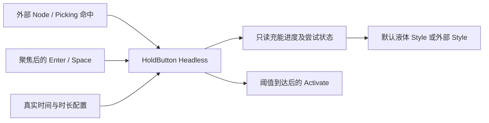

# 开放 HoldButton 的充能行为

把长按确认行为公开为 `WidgetryHoldButtonHeadless`，让外部可以制作条形充能按钮、环形确认按钮或其他命中形状。库继续负责输入归属、充能、衰减和成功激活，外部 Style 只读取状态并绘制。

前一份 URL 行为与本增量没有依赖。下一份 ToggleButton 也只是顺序相邻，不能把普通点击切换与长按阈值混成一种输入组件。

## 独立的长按状态机

公开充能与衰减时长配置，以及足够驱动外观的只读进度/状态访问。持久输入 Owner、成功锁存、进度和计时仍由库管理，不把内部可变状态直接交给外部修改。默认时长仍为充能 3 秒、衰减 1.2 秒。

一个输入来源独占一次尝试。默认 `TabIndex(-1)` 与无障碍 Button 角色保持。有效主键按下或聚焦后的 Enter/Space 启动充能，重复按键与其他持续按住的来源不能接管。到达阈值后发送一次官方 Activate；持续按住不重复成功，成功后松开归零。提前松开或取消按固定速率衰减，再次有效按下从剩余进度继续。零充能和零衰减时长沿用原有即时语义。

不能同时装普通 `WidgetryButtonHeadless`。普通按钮的有效点击会触发 Activate，而这里必须达到充能阈值；叠加两种输入处理器会产生错误确认。外部扩展行为可以用 Observer 组合，不应复制原始长按状态机。

## 命中形状不属于充能算法

Headless 根据实际 Picking 命中与离开结果处理输入，不假定圆心、半径或正方形直径。默认圆形约束留在默认 Node/Style，外部矩形按钮不必伪造圆形部件。

指针离开有效命中范围、指针失效或键盘失焦会结束当前尝试，重新进入或恢复焦点仍需重新按下。有效 Disabled、Hidden 或 Display::None 会取消并清零。这里保持已有取消语义，不顺便增加新的操作系统窗口失焦策略。

## 计时不能靠默认材质驱动

充能是行为，不是动画。即便没有默认液体 Shader，Reactive 桌面应用也必须在充能或衰减期间继续推进。把维持行为计时所需的更新/重绘请求放到行为能力中；停止、静止满值或空值时不持续唤醒。默认 Style 只为自己的波浪与成功闪光申请必要帧。

自动时间从实际输入的单调时钟起算，不能把桌面静止期间积累的帧 delta 加到新尝试。显式手动时间测试继续使用确定性的 Real Time 步进。

## 默认外观与 Gallery

默认 HoldButton 保留 112px 圆形、原有圆形 Picking、透明角落穿透、内容尺寸限制与无 Picking 的展示后代。保留浅底深色液体、两层波浪、细边框、前景内容阴影和约 180ms 成功边框提亮。四态及 success_border 覆盖仍属于默认 Style。

Button 页的默认 HoldButton 示例不变，增加一个非圆形的 Gallery 自定义充能按钮。它使用公开 Headless、自己的 BSN 和进度显示，不导入默认材质或内部计时组件。演示短按衰减、续接、阈值成功和禁用取消。

主要影响 `crates/hold_button/src/headless.rs`、`style.rs`、公开导出及对应示例。行为系统改为识别 Headless，不再识别默认 `WidgetryHoldButton` 才工作。

## 完成条件

- 矩形自定义按钮在整个矩形内接受按下，离开实际区域取消，不受默认圆形几何限制。
- 覆盖输入独占、重复按键、零时长、提前松开、残余进度续接、成功只激活一次、失焦与禁用清零。
- 不安装默认 Style 的调用方在 Reactive 模式下仍能按时完成充能；空闲时不会为了不存在的液体动画持续唤醒。
- 默认圆形、内容阴影、液体波浪与成功闪光的视觉对照不变；材质正常加载等待不误报错误。

## 边界

Headless 不生成默认内容、材质或颜色，不允许外部直接改写充能权威状态。默认材质和部件损坏继续使用原有诊断；错误不能重置长按状态，也不能阻止其他健康实例处理。
