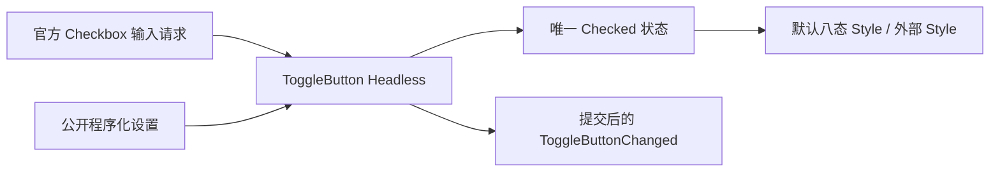

# 开放 ToggleButton 的状态行为

公开 `WidgetryToggleButtonHeadless`，复用 Bevy Checkbox 输入和 Checked 状态，同时保留 ToggleButton 的状态查询、设置及提交后事件。外部自定义按钮不再为了使用这些 API 而必须带上默认颜色与布局。

前一份长按行为与此处无依赖。下一份 CheckBox 也使用官方二态能力，但保留不同的控件语义和对外事件契约，不在本增量合并两种控件。

## 输入、状态和事件

官方 Checked 是唯一二态状态。Headless 组合官方 Checkbox、必要焦点与 Pointer 基础能力，根采用 AccessKit Button 角色和 toggled 属性，不重新实现一份鼠标/键盘输入系统。

公开 `selected`、同步 setter 和 Commands setter，行为检查以 Headless 身份为准。用户输入及受支持 API 真正改变 Checked 后，先提交再发送 `WidgetryToggleButtonChanged { entity, selected }`。同值、初始化不通知。官方 `ValueChange<bool>` 仍是输入请求，不能被说明为已提交状态事件。

保留直接增删原生 Checked 的 ECS 用法，但这种直接操作不额外补发 Widgetry Changed。缺少 Checked 表示未选中，不是结构错误。Disabled 阻止用户操作，合法程序化设置仍可执行。

## 默认 Style 与自定义 Style 的边界

默认 `WidgetryToggleButton` 在同一根组合 Headless 与现有视觉。保留原有尺寸、Padding、边框、圆角、内容布局及 content/children 组合方式。未选中沿用 Button 色，选中沿用 CheckBox checked 相关色；八态颜色与 Disabled、Pressed、Hovered、Normal 的优先级不变。

默认颜色状态、ResolvedForeground、背景和边框只属于 Style。外部只带 Headless 时，不要求这些组件存在，也不能被默认样式系统误写颜色。默认 Style 继续支持局部覆盖、托管 Owner 拒绝外部覆盖和受管理内容的前景传播。

## Gallery 和代码范围

Button 页保留现有 Toggle 示例，增加一个外观明显不同的自定义切换按钮，例如图标开关或无边框标签切换。状态读数和程序设置直接调用公开 Headless API。

涉及 `crates/toggle_button/src/lib.rs`、当前 `style.rs` 中的状态提交 Observer、Plugin 安装与 Facade。把输入提交从样式注册中拆出，使自定义 Style 无需安装默认视觉也能收到 Changed。

## 完成条件

- 外部控件不挂默认 ToggleButton 标识和 ColorState，点击、键盘、查询、程序设置、无障碍状态及 Changed 仍有效。
- 同值保持静默；默认控件与自定义控件都不会因旧/新 Observer 并存而提交两次。
- 验证本地/祖先 Disabled，程序设置、直接 Checked 操作和 Changed 事件之间的差异。
- 四套 Gallery 配色下默认八态和原有 content/children 布局保持原样；切换 Theme 不改变 Checked。

## 限制

不增加互斥组、三态或业务状态。失效目标与 queued 类型不符继续显式失败。默认 Style 缺必要输出时仍报告样式错误，但不能把纯 Headless 的合法缺省当作损坏。
