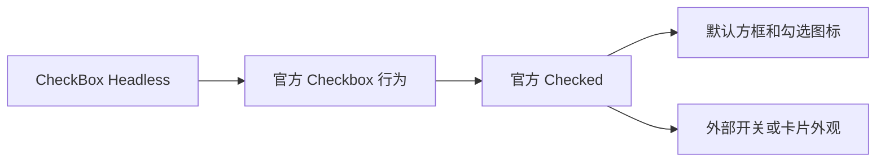

# 开放二态 CheckBox 行为

将二态复选框的行为公开为 `WidgetryCheckBoxHeadless`。它只组合 Bevy 官方 Checkbox、Checked 及必要的焦点、Pointer 和无障碍能力，不创建方框或勾选图标。外部可以用开关、圆点或卡片表达同一个二态选择。

前一份 ToggleButton 提供相近但不同的事件 API，本增量不照搬该专用 Changed 契约。下一份三态复选框保留独立状态模型；两者可以共用默认视觉部件实现，但不能合并状态权威。

## 保留原生二态模型

官方 Checkbox 的输入请求、自更新及 Checked 使用方式保持现状。Headless 不再要求默认 `WidgetryCheckBox` 标识，不引入与 Checked 同步的第二个 bool 状态，也不为了整齐统一而新增一套二态业务事件。

焦点、Tab 配置、有效 Disabled 和无障碍语义属于行为。默认 `TabIndex(-1)` 及现有鼠标/键盘体验保持不变。Hover、Pressed 等公开 ECS 状态可以供外部 Style 读取，颜色组件不能成为这些状态产生的前提。

自更新只在本能力拥有的输入路径安装一次，避免同时保留原 Scene Observer 和新增全局 Observer 而让一次输入发生重复处理。

## 方框、图标与颜色完全留给默认 Style

默认 CheckBox 仍组合原有方框、边框、勾选 SVG 和内容，保持横向排列、间距、最小高度及四套配色表现。Indicator 的资产就绪、尺寸更新、Icon 颜色归属和前景传播继续由默认 Style 管理。

仅使用 Headless 的外部控件既不加载默认 Indicator，也不接受其缺失检查。反过来，默认控件真的丢失 Indicator 时仍应报告错误，不能为容纳自定义控件而把默认诊断全部吞掉。主题刷新与资源加载不能写 Checked。

## 展示与改动位置

CheckBox 页保留二态默认示例，并增加一个没有方框/勾选图标的外部二态控件。实际点击、键盘选择、禁用和 Checked 读数都通过公开行为工作。

主要处理 `crates/check_box/src/checkbox.rs`、`lib.rs`、默认 `indicator.rs`/`style.rs` 的筛选边界及 Facade 导出。行为系统和默认 Style 分别按自己的身份筛选，不用默认控件类型充当行为资格。

## 完成条件

- 不创建默认 Indicator 的独立调用方能正常使用二态输入和 Checked，且无默认样式结构报错。
- 默认 CheckBox 的鼠标、键盘、Disabled、焦点和无障碍反馈保持原样，一次输入只更新一次。
- 四套 Gallery 配色下方框、勾选图标及受管内容一致；加载晚到时逻辑状态不丢失，图标最终反映当前 Checked。
- 只安装可复用行为时，不因缺默认颜色或图标资源而无法运行其输入测试。

## 范围

不把三态状态塞进 Checked，不扩大为通用选择框架。颜色 API 与默认托管关系保持既有约束，默认样式错误和行为错误分开传播。
