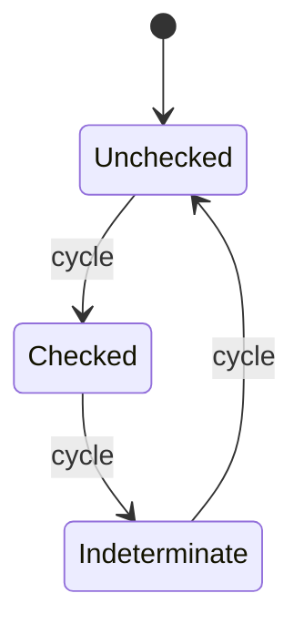

# 开放三态 CheckBox 行为

公开 `WidgetryTriStateCheckboxHeadless`，保留现有三态输入、循环、设置和状态通知。外部可以改变三种状态的视觉表达，而无需复制三态状态机。

本增量与前一份二态 CheckBox 只共享默认指示器实现和公共基础设施，不共享状态权威。后一份 RadioGroup 是组级互斥选择，属于独立目标。

## 唯一状态与操作

继续由 `WidgetryCheckState` 表达 Unchecked、Checked、Indeterminate，默认 Unchecked。保留 Setter 和 Cycle 的公开能力；Commands 在实际执行时验证目标并提交。查询、设置与输入资格改为识别 Headless，不能继续要求默认 TriState 控件和默认指示器。

真实变化先写入状态再发送原有 ValueChange；同值和初始化不通知。程序设置不被用户 Disabled 阻止。状态由原有受控入口管理，不另外插入官方 Checked 来表达“部分选中”。

主键输入、Space/Enter、既有 ActivateOnPress 支持及取消/释放后的 Pressed 清理从视觉构造中独立出来。保留现有输入时机，不借拆分新增未讨论的键位或双击行为。

无障碍 CheckBox 角色以及三态 toggled 属性同步属于行为系统，不能只在默认 Style 的 Colors 阶段存在。自定义外观没有默认方框时，辅助技术仍应得到同样的状态含义。

## 默认 Style 保留三种指示器

默认 Scene 在原根组合 Headless 与现有 Style，保持方框、勾选/不确定态图标、布局、颜色和前景继承。三态与二态可以继续共享图标构造代码，但默认 Style 读取各自正确的状态源。

结构诊断按 Style 实例执行。自定义节点不需要默认 mark、colors 或 Indicator；默认实例缺失这些节点仍是错误。图标资源等待和主题刷新不会改变业务状态，也不发选择事件。

## Gallery 与影响范围

CheckBox 页增加一个三态自定义控件，用不同符号或自有图形表达三种状态，展示当前枚举值，并提供程序化指定状态与循环操作。与默认三态控件并列，二态示例继续保留。

涉及 `crates/check_box/src/tri_state.rs` 中的输入、写状态与无障碍同步，Plugin 注册和默认样式筛选，以及公开导出/文档。不为统一接口重写二态行为。

## 完成条件

- 三次 Cycle 按 Unchecked、Checked、Indeterminate 回到起点；Observer 读取到提交后的值，同值无通知。
- 不含默认图标或颜色组件的自定义实例支持点击、键盘、程序设置和无障碍同步。
- Disabled 阻止真实输入而不阻止合法程序设置；排队执行时销毁或类型不符保留原诊断语义。
- 四套主题中默认三态 Indicator、Hover/Pressed/Disabled 与内容布局保持原样；纯视觉变化不触发 ValueChange。

## 边界

不合并二态/三态模型，不把所有 CheckBox 强制改为同一个新 Authority。状态缺失与默认视觉缺失必须能区分，多个实例的错误聚合与持续诊断规则延续现有做法。
