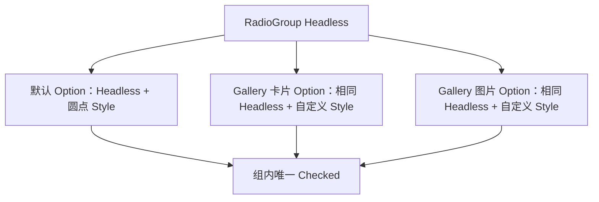

# 开放 RadioGroup 与 RadioOption 组合

公开 `WidgetryRadioGroupHeadless` 与 `WidgetryRadioOptionHeadless`，让外部选项参与同一套互斥选择。两个入口必须在本增量一起可用：只开放 Option，Group 仍按默认类型验证成员；只开放 Group，Option 仍要求圆形指示器，都不能形成可交付的外部组合能力。

前一份三态复选框没有直接依赖。下一份 Segmented 复用同一 Core 选择基础设施，但输入契约不同；两种组仍保持独立。

## 行为成员与视觉部件分开

Group 只识别 Option Headless，选择初始化、合法性校验、动态结构观察、用户输入转发和程序化 API 都迁移到这个识别条件。Option 的身份不再以默认 `WidgetryRadioOption` 是否存在判断。

保留本次已有的行为成员约定：Option 是所属 Group 的直接 Child，索引对应其直接成员顺序；不新增跨层成员注册或运行时重排能力。这个公开的成员关系不等于要求默认纵向容器或圆形指示器。外部可以改变 Group 的布局、Option 内容及整个组外部的包装层，但不能把任意装饰节点误当作选项。

继续复用 Bevy RadioGroup/RadioButton 输入和官方 Checked。Group 获得 Pointer Focus 后处理既有方向键导航，默认 `TabIndex(-1)`，Tab/Shift+Tab 跳过 Group。Disabled、输入传播和无障碍语义保持现状，不把 Segmented 的轴向且不循环导航强加到 RadioGroup。

## 选择与动态结构

Checked 是唯一选择权威，历史只用于修复结构变化，不保存第二份选中值。结构有效时至少一个 Option，恰有一个 Checked，初始化沿用选择第一项的规则。

添加 Option、删除未选中项时保留合法选中实体；新增项自带 Checked 不抢已有选择。删除选中项后，在正常输入派发前按上次合法顺序优先选择仍存在的后继，没有后继再选前驱；旧项全部消失时选新集合首项。替补不受 Disabled 限制，结构恢复不发用户选择通知。空集合进入结构错误，重新加入合法成员后恢复。

用户选择继续以 Group 为 source 发 `ValueChange<usize>`。程序 `set_selected` 按 Commands 实际执行时的成员顺序解析索引，合法同值及程序设置不发用户通知。Root、成员集合、父归属和索引验证失败不能部分改 Checked，也不能阻止同批其他合法组更新。

## 混用 Style 时不能反向依赖默认 Group

同一 Group 可以混用默认圆点、外部卡片和外部图片 Option。自定义 Group 也可以使用默认 Option；默认 Group 的颜色系统不能覆盖自定义 Option。

默认 Option 解析颜色时，自己的覆盖优先，存在父级默认 Option palette 覆盖时再使用父级值，其余回退当前 Theme。父级只带 Group Headless 而没有默认 ColorState 是合法组合，不应报“父默认 Group/颜色缺失”。父级缺行为身份仍然是结构错误。

默认 Group/Option 继续保留原来的容器布局、边框、间距、指示器、圆点与状态色。默认 Style 自己需要的 Indicator/Dot 丢失仍报告错误，但这些部件不能进入 Headless 的必要条件。

## Gallery 与实现范围

沿用 Button 页现有 Radio 示例，增加一个混合外观单选组：默认圆点选项与 Gallery 卡片/图片选项一起互斥。展示当前索引，并演示动态添加、删除当前选项和程序选择。

修改 `crates/radio_group/src/group.rs`、`option.rs`、输入/自更新安装与默认 `group_style.rs`、`option_style.rs`。Core 独占选择算法保留，其调用识别条件同步改变。共享 Focus/Pointer 路由中若仍以默认 Group/Option 类型识别交互目标，也必须迁移到行为能力，不能只改本 crate 的 Query。Facade、文档和测试与新入口一起完成。

## 完成条件

- 默认 Group+自定义 Option、自定义 Group+默认 Option、同组混合 Option、全自定义四种组合都可选择且不需要伪造默认颜色或 Indicator。
- 动态增删的选中身份、后继/前驱回退、同值通知和执行时索引保持原语义；多个组互不影响。
- 无父级颜色覆盖的默认 Option 使用当前 Theme，四套主题切换后正确；默认完整组合的视觉不变。
- 构造期延后挂接不被提前报错，稳定结构不逐帧全量重验；独立错误只影响对应组。

## 边界

不引入 Style 注册表，不共享 RadioOption 与 SegmentedOption 的输入身份，不增加无选择模式。结构错误与样式错误继续分离，持续故障保留诊断身份、恢复记录以及原有 Error Handler 传播。
