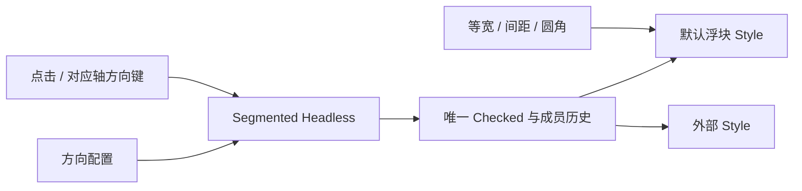

# 开放 Segmented 与 SegmentedOption 组合

公开 `WidgetrySegmentedHeadless` 与 `WidgetrySegmentedOptionHeadless`。外部可以制作胶囊、下划线、图标或卡片分段选择器，同时复用已有单选、键盘导航、动态结构修复和状态通知。

它与前一份 RadioGroup 共享 Core 的选择历史与 Checked 提交，不共享输入身份。本增量之后进入 Slider 数值能力，二者没有直接依赖。

## 保留独立输入规则

继续使用官方 Checked/Checkable、标准无障碍角色及共享 Focus/Pointer 基础设施，保留自行处理点击和键盘的方式。不能为复用 RadioGroup 而安装原生 RadioButton，避免循环导航或最近祖先 RadioGroup 的事件路由干扰。

横向只处理左右键，纵向只处理上下键；导航跳过禁用项，到首尾停止，不循环。非对应轴、Home/End 不改选，失焦和整体 Disabled 时不处理导航。点击 Option 或内容令 Group 获得焦点，默认 `TabIndex(-1)`，程序选择不抢焦点。

`orientation` 属于行为配置，因为它决定键盘含义。`equal_width`、Grid/Flex、间距、背景、边框和圆角属于 Style。默认 Scene 用同一初始方向构造布局和行为，后续单纯修改 `Node.flex_direction` 不隐式改变键盘规则；不新增运行期方向 setter。

## 选择提交和成员规则

Checked 仍是唯一选择权威。初始化无 Checked 时选首项，一个 Checked 时尊重声明，多个 Checked 明确报冲突，不偷偷覆盖；冲突修复后可以恢复。初始化之后通过公开选择入口更新，不新增清空选择 API。

用户选择先提交再发送根上的 `ValueChange<usize>`；同项点击、程序设置、初始化和结构修复静默。合法程序选择不受 Disabled 限制。添加不抢已有选择，删除选中项依历史顺序优先后继、其次前驱；旧项全部消失后选首项。

继续以直接 Child Option 作为行为成员和顺序来源，不新增任意重排或跨层成员协议。所有验证、结构观察、点击和键盘筛选都改为 Headless 身份，而不是默认 Segmented 类型。

## 默认外观和混合外观

同组允许默认与自定义 Option 混用，也允许自定义 Group 包含默认 Option。默认 Option 颜色不再强制要求父级有默认 Style：自己的覆盖、可用的父级 Option palette 覆盖、当前 Theme 逐级解析。自定义 Option 不被默认 Style 写入颜色。

默认控件仍为柔和背景、内边距、圆角容器和即时选中浮块，没有新增插值动画。保留 Root Focus 边框、Option Hover、选中禁用的区别以及前景继承。水平等宽仍使用原来的 `1fr` Grid 语义；纵向不把 equal_width 改成等高。

## Gallery 与改动边界

Segmented 页保留原有横向、纵向和等宽示例，在自定义区展示下划线式或图标式选择，并安排一组默认/自定义 Option 混用。示例仍只通过公开选择 API 读取和改值。

涉及 `crates/segmented/src/group.rs`、`option.rs`、`input.rs`、`style.rs` 和导出。迁移行为资格、父归属和颜色回退，共享 Focus/Pointer 路由对 Group/Option 的识别也要适配 Headless。不把 Core 选择算法扩大为新的通用组框架。

## 完成条件

- 横/纵键位、跳过禁用、首尾不循环及同项静默在默认和自定义实例上一致。
- 初始 Checked 的零个/一个/多个情形、动态增删和失效 Root/成员/索引均维持原契约，失败不部分改选。
- 混合样式正常工作；自定义 Group 没有 ColorState 时默认 Option 正确回退，默认完整组合的四套主题外观不变。
- equal_width 只影响布局，不影响索引、选择或通知；Theme 更新不重排成员。

## 限制

RadioOption Headless 与 SegmentedOption Headless 不互换，也不同时装在同一选项上。稳定结构与稳定颜色不增加逐帧全量工作，结构和样式诊断延续去重、恢复及多实例隔离。
