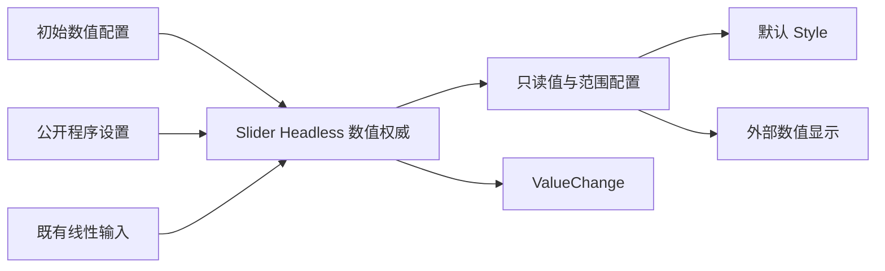

# 开放 Slider 数值状态

先把 Slider 的单值模型从默认 Scene 中拆出，形成不依赖 Track/Thumb 的公开 Headless 状态能力。这个增量完成外部查询、合法程序设置和自定义数值显示；可替换 Pointer 交互由下一份方案完成，不把两种能力硬塞进同一个大改造。

前一份 Segmented 没有直接依赖。下一份 Slider 交互策略以这里的数值权威与提交路径为基础。默认 Slider 在两个增量之间仍完整可用，不能暂时禁用拖动等待后续修复。

## 状态不再由默认 Style 创建

把 `value.rs` 中的初始化、配置校验、状态查询和提交从 `WidgetrySlider` 默认类型约束中独立出来。公开语义入口可使用 `WidgetrySliderHeadless`，具体 Rust 字段和函数签名以职责为准。外部只构造 Headless 即可拥有合法数值，不需要默认 ColorState、Parts、Track、Fill 或 Thumb。

公开只读的当前值及外部绘制/策略需要的范围和步长信息，保留唯一内部权威，不能让外部复制一份可写 value。只读查询或快照需要支持合理的变化检测，避免外部 Style 被迫逐帧重新解析。

方向不是通用数值约束。默认横/纵方向保留在线性交互配置中，默认 Scene 仍据此构造外观；圆形策略不应为了拥有数值而伪造 Horizontal/Vertical。颜色、轨道厚度、Thumb 直径及它们的尺寸校验留在默认 Style。

## 数值与设置契约不改变

默认范围 0 到 100，step 为 None，未指定初值时采用 min。端点与值必须有限，min 严格小于 max，f32 跨度有限；step 必须有限且大于零。范围、步长等配置仍在构造时确定，不借开放接口新增运行期修改策略。

连续模式接受闭区间内的有限值。步进模式保留“从任一端点可达”的合法值规则，例如 0..10、step=3 时 4 合法、4.5 非法。继续保留既有 f32 投影比较和不超过步长 0.1% 的额外容差，不把所有设置请求统一 Clamp 或吸附。

同步 setter 返回真实变化或合法同值；queued setter 在实际执行时校验。程序设置允许修改 Disabled Slider。失败保留旧值且无事件。真实变化先提交再发根 source 的 `ValueChange<f32>`，程序设置 `is_final=true`，初始化和同值不通知。事件只承诺数值已提交，不承诺视觉或其他 Observer 已同步。

## 默认消费者的过渡

默认 Slider 改为在原根组合新的数值能力与既有输入/Style。默认线性输入继续通过统一提交路径写值，默认 Style 读取真实状态。不能新增“默认 SliderState”和“外部 HeadlessState”两份值，也不能在本增量结束时依赖旧公开 API 兼容包装来协调它们。

当前 `style::initial` 中数值与尺寸校验要分开：数值合法性由 Headless 负责，track_thickness 与 thumb_diameter 由默认视觉构造负责。默认 6px 轨道、20px Thumb 以及原有布局不变。

## Gallery 与完成条件

Slider 页保留现有默认交互，增加只使用公开数值能力的读数/自定义显示，并用合法预设操作验证程序设置。下一份方案将这个自定义展示扩展为实际可拖动的弧形控件。这里的交付是可用的独立数值能力，不是空的策略占位。

- 在不创建默认视觉部件的 World 中构造、读取并设置数值，检查无效配置、范围、非有限值、端点、步进可达与同值。
- 通过真实公开 API 证明没有布局完成前提，失效根与缺状态仍明确返回领域错误。
- 默认 Slider 的点击、拖动、键盘和通知维持原契约，初始非零值及四套主题表现不变。
- 涉及 `slider.rs`、`value.rs`、默认输入/Style 的调用迁移、错误导出和文档；其他使用 Slider 的组合页面同步适配。

## 诊断边界

保留数值配置原始 f32 快照、拒绝分类、目标与缺失状态上下文。正常等待布局、合法同值和 Disabled Guard 不构造错误；数值错误不再被包装成缺默认 Parts。默认视觉部件损坏仍由其自己的路径报告。
