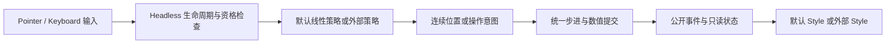

# 开放 Slider 可替换交互策略

把线性 Slider 的几何假设移到可替换的交互策略中。外部不只是提供 Track/Thumb Entity，而是可以自行定义坐标投影、命中、抓取偏移、轨迹连续性和键位映射；范围校验、步进提交、Pointer 生命周期及业务事件仍由库统一处理。

本增量依赖前一份独立数值能力。后一份 TextField 与这里无直接技术依赖。交付后 Gallery 能在库外实现弧形 Slider，默认线性 Slider 的表现保持不变。

## 策略必须真正可由库外定义

现有 `project_position()` 读取 `style::Parts`，`press()` 又假定圆形 Thumb 命中和数值偏移。两处一起拆分，不能只把 Parts 改成 public。默认线性策略可以通过公开绑定读取 Track/Thumb 的布局，但通用 Headless 不要求这两个节点存在。

策略需要能够读取自身绑定的实体布局、当前数值配置与输入信息，并维护每个控件/每次手势的私有状态。例如圆弧策略需要记住上一次角度，处理角度切口处的连续性，抓住手柄时也需要避免初次跳值。这些状态不能塞入默认 Style 的私有 Parts。

接口承载形式没有预先固定为 trait、组件还是注册系统。实现需要选择可在当前 ECS 中落地的公开方式，但必须满足：外部类型可实现、每实例可持状态、同一应用可混用不同策略，不要求向库内 enum 增加 Circular 变体，也不要求调用内部 commit。这里保留的是明确的扩展契约，不是新增一套全局交互框架。

## 库控制生命周期，策略解释输入

Headless 统一负责 Pointer 所有权、Capture、Pressed、有效 Disabled、可见性、窗口焦点、开始/结束与取消。策略负责“在哪里按、这一移动表示什么”，不能自行覆盖库内数值或再建立一套 Capture。

需要提供受控的策略结果提交通道，而不是让外部在每个 Move 中调用程序化 `set_value`。后者会把所有移动标成 `is_final=true`，还绕过手势步进锚点和生命周期通知。策略提出连续位置或增减意图，由库执行当前数值模型允许的步进与提交。具体结果类型须在编码前与策略接口一并定型，不能以开放任意 World 写入替代契约。

开始前检查目标、有效输入源和 Capture 资格。捕获成功后发送 `SliderDragStarted`，其值是开始时已经提交的值；开始观察者排队的命令要先于轨道首次改值执行。再次检查控件和手势仍有效，才提交初次候选值。

结束清除手势、释放自身 Capture 并移除 Pressed 后，最多发一次 `SliderDragEnded`。Release/正常 DragEnd 为 Completed；Cancel、不可用、失焦、Pointer/Capture 丢失或键盘打断为 Cancelled。取消保留已提交值，不回滚。不移动也有完整 Start/End；结束不补发同值 ValueChange，`is_final` 不代表手势结束。

## 线性策略保持现有手感

默认仍是水平向右增大、垂直向上增大。轨道点击立即定位并开始手势，按 Thumb 保留抓取偏移而不跳值；拖出控件后 Capture 继续输入，超出行程到端点。默认圆形 Thumb 命中属于线性策略，不是外部策略必须使用的形状。

沿用当前坐标换算对 UI Scale、窗口比例、Camera viewport 原点和 UiGlobalTransform 的处理，不能在抽取时简化成裸屏幕 X/Y。布局未准备好时等待，不把它当作结构损坏。

步进仍按移动方向从当前锚点递进，反转以当前值重新建立锚点，相同行程不依赖 Move 数量。0..10、step=3 的正向序列是 0、3、6、9、10，反向是 10、7、4、1、0；未满一步保留当前值，端点可到达。

默认键盘仍只处理相应轴方向键，支持重复按键；连续模式每次跨度的 1%，步进模式每次一步。未处理的键和 Disabled 下的键继续冒泡。策略可以换键位解释，但不能因此扩大默认 Slider 的键盘功能。

## 外部弧形示例与验证

Gallery 的 Slider 页面并列保留默认横/纵线性实例与库外弧形实例。弧形示例用中心、角度及每次手势状态解释输入，不创建隐藏的默认 Track/Thumb 来冒充解耦。两者复用同一数值查询、通知和禁用规则。

- 测试外部策略注册、每实例隔离、开始拒绝、策略等待/失效、抓取偏移和角度跨切口不跳变。
- 对默认线性输入回归 Scale/Transform/viewport、轨道点击、Thumb 无移动、越界、步进反转、键盘中断和 Capture 丢失。
- 验证 Started 在初值提交前、Ended 在清理后，同次手势只结算一次，Disabled 不接受用户修改但程序设置仍可用。
- 四套主题下默认 Track、Fill、Thumb、焦点环、尺寸和颜色都不变；弧形实例只使用公开接口，外部 Style 不被默认颜色系统写入。

主要改动是 `input.rs`、`gesture.rs` 与默认 `style::Parts` 的交互依赖，连同公开策略 API、Facade、Gallery 和测试一起完成。

## 失败与范围

Parts/绑定或状态在拖动中损坏时先清理手势和捕获，再传播原始错误。有真实值时可发送 Cancelled；状态已经丢失时不伪造 Ended 数值，错误记录清理情况。销毁根后不保证还能向已销毁实体发送通知。

可扩展轨迹不等于承诺多指手势、无限多圈数值、区间双 Thumb 或新的数值模型。本次仍是有界单值 Slider；不为所有可能策略预建闭合枚举。
