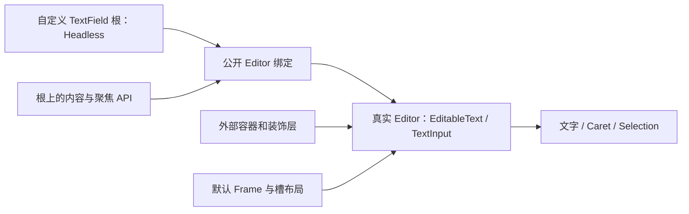

# 开放 TextField 编辑器绑定

把 TextField 的根身份与真实 Editor 的关联公开，让外部在自己的 UI 树中安排编辑区域。Headless 保留内容、输入约束、焦点和无障碍相关行为；Frame、前后缀排列、计数行和提示文字的结构由 Style 决定。

前一份 Slider 与这里无依赖。本增量是后续 NumberInput 和 ComboBox 搜索组合的基础；下一份单独开放可选 AutoSize，不把布局策略塞进基础编辑能力。

## 引用解除的是默认结构依赖

公开 Root 到 Editor 的明确绑定以及 Editor 所属根的校验能力。Headless 不再通过默认 `Parts { editor, frame }` 要求 Editor 是 Frame 的直接 Child，也不靠“父节点再父节点”判断编辑器身份。

例如 Gallery 搜索框可以把 Editor 放在图标之后、若干装饰容器之内，把清除按钮和错误提示放在另外的位置。根 API 仍直接找到这个 Editor；不能通过隐藏一份默认 TextField 再映射内容来实现。

真实 Editor 仍然必须存在，它承载 Bevy 的 EditableText/TextInput。一个行为根对应自己的编辑状态，绑定验证要防止错误类型、失效实体和错误 Owner。允许自定义装饰层级不等于允许多个根共享同一可变 Editor，也不自动承诺运行时跨根搬迁选区。

公开行为类型可以统一普通与 ReadOnly 的内部机制，默认两种 Scene 继续保留不同模式。具体 Rust 命名不需要复制一套状态模型。

## 唯一正文、光标和选区

正文、Caret、Selection 和 IME 状态继续由官方 EditableText 持有。Headless 根提供 text、同步/queued set_text、聚焦和只读编辑状态访问，不创建第二份 Widgetry 文本 Authority。外部 Style 通过公开数据读取显示状态，不直接改编辑器或排入未经约束的文本请求。

支持原有单行/多行、visible_lines、visible_width 和构造期固定 max_length。长度按 Unicode 扩展字素簇计算；零上限只能保留空文本。程序写入超限时截取可容纳的完整字素簇前缀，不截断字节、组合字符或 emoji 序列。

用户输入在官方编辑提交前按请求顺序处理选择、删除与插入，用试替换后的全文计算允许插入的最长前缀。键入、粘贴和 IME 正式提交一致；预编辑仍由官方处理，不提前裁剪、不计入正文计数。无关的普通 EditableText 不受这些约束。

Setter 丢弃旧编辑和待处理粘贴，结束旧组合态，尽量保留新文本中仍有效的光标与选区，否则折叠到末尾。返回值表示正文是否变化，不表示是否执行了队列/IME 清理。保留官方 TextEditChange 的正文或光标变化语义，不另造文本事件转接。

## ReadOnly、Disabled 和焦点

ReadOnly 保留导航、选择、复制，过滤会修改正文的输入；Disabled 优先于 ReadOnly，阻止相关用户输入，并清理待执行 Edit/Paste，重新启用不能补执行旧请求。两者都不阻止合法的程序化内容设置。

根身份、AcquireFocus、Tab 配置和 Window InitialFocus 仍映射到实际 Editor。聚焦 API 接受根而不是让调用方查内部节点。前后缀中的可聚焦子控件保留自身行为，不能为了任意层级支持把整个根下所有点击都重定向到 Editor。

通过公开绑定保持焦点路由、有效 Disabled 和生命周期归属，不再依赖默认 Frame。原先从根投影到 Editor 的 TextFont、TextLayout、LineHeight、FontHinting、EditableTextFilter、SelectAllOnFocus 等配置仍有受支持路径；不让外部样式和默认投影系统互相覆盖。

## 默认 Style 与辅助内容

默认 TextField/ReadOnlyTextField 仍构造原来的 Root→Frame→Editor 视觉结构，保留边框、背景、Padding、字号、颜色与焦点外观。Prefix/Suffix 的默认排序和每类最多一个的校验只作用于默认槽组合，不要求外部整个 UI 树遵守这套布局。

计数是从官方正文派生的数据，提示是展示文案，不能成为内容 API 的必需节点。默认 show_count、hint_text 继续工作；自定义 Style 可以把计数或提示放到自己选择的位置，或不展示。默认计数不含 Prefix/Suffix、IME 预编辑和提示文字，保持当前字素数格式及同帧刷新。提示保持常显黄色警告语义，Disabled 不变灰，按词/必要字符换行。

## 影响范围与 Gallery

处理 `text_field.rs`、`composition.rs`、`content.rs`、`input.rs`、`length.rs` 和注册/导出边界。拆开行为 Editor 绑定和默认 Frame/Count/Hint/槽部件，样式系统只识别默认 Style。

NumberInput 和 ComboBox 仍须在此增量结束时正常工作：允许内部组合消费者迁移到新的公开访问方式，不要求继续走仅接受默认 Widget 的 API。它们的完整外部开放由各自方案完成，不顺便扩展 ListView。

TextField 页增加一个不同层级的 Gallery 搜索框或无边框输入区，带自有图标、清除按钮和独立提示位置，同时展示 ReadOnly。它只组合公开 Headless/Editor 能力。

## 完成条件

- 自定义树不含默认 Frame，文本输入、光标、选区、复制/粘贴、IME、根聚焦及内容设置仍工作。
- 覆盖字素上限、零上限、选择替换、组合字符、IME 正式提交和预编辑；超限不破坏字素，主题更新不重置编辑状态。
- ReadOnly 可复制而不可修改；Disabled 清理待处理请求；合法程序 setter 在两种模式下仍可用。
- 默认前后缀、计数和提示的布局、颜色、文案更新时机与原来一致；槽内按钮仍可独立聚焦。
- 原生剪贴板和 IME 使用真实 Windows 环境补充验证，不把模拟 Pointer 测试当成完整输入法验收。

## 约束与错误

保持 max_length 与 EditableTextFilter 的现有限制：有上限时不可组合不可访问过滤函数的官方过滤器；无上限时沿用官方路径。失效映射、Editor/Owner 错误和缺必要资源必须明确诊断。内容已写入而后续默认显示投影失败时，保留“已写入”的错误上下文，不虚构回滚。
