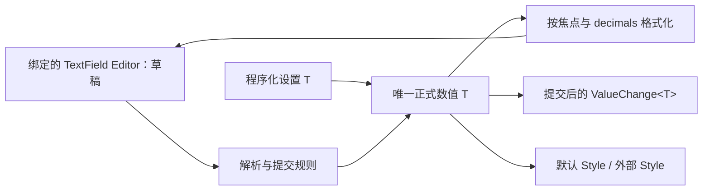

# 开放 NumberInput 编辑与提交

公开 `WidgetryNumberInputHeadless<T>`，保留原类型数值、解析、草稿提交和恢复逻辑，通过公开 TextField 编辑器能力绑定一个真实文本编辑区。加减按钮不再是行为成立的前提。这个增量已经可以交付一个只有输入框的外部 NumberInput。

它依赖公开的 TextField 编辑能力，不依赖前一份可选 AutoSize。下一份步进触发器使用这里的唯一值与草稿提交路径；默认控件现有加减与长按在本增量中仍通过原组合适配保持可用。

## 数值与草稿不是两份相同状态

正式值始终用原始 T 保存，支持现有有符号/无符号整数和 f32/f64，沿用 sealed WidgetryNumber。不能为了统一模型把 i128/u128 等转成 f64。草稿仍由 TextField 的官方 EditableText 唯一持有，可以暂时是空串、负号或任意未完成文字；键入不直接改变正式数值。

构造时初值必填，min/max 默认无应用范围，step 默认同类型的一。值、端点、步长必须有限，step 严格为正，min<=max，初值在范围内。配置固定。setter 验证有限性和范围，但不要求步进对齐。

公开值查询、同步/queued 设置和编辑器绑定，均以 Headless 根为身份。真实数值变化先提交再发以根为 source 的 `ValueChange<T>`，`is_final=true`；初始化、合法同值和失败不发数值通知。

## 编辑与提交保留当前语义

Enter 只提交合法草稿，非法草稿保留。键盘焦点离开控件时，合法草稿提交，非法草稿恢复正式值文本；鼠标移出不提交。Esc 放弃草稿、恢复正式文本并保留编辑焦点。

解析只接受普通十进制整数/小数，不支持科学计数法、进制前缀、千位分隔、空白、正号和非有限浮点文本。无符号拒绝负号，整数拒绝小数，按 T 自身范围解析。`.5`、`-.5`、`1.` 可提交并规范化，浮点整值保留 `.0`。

浮点可配置 `decimals: Option<u8>`，范围仍为 0–255，整数误配小数位仍失败。失焦时按指定精度显示，聚焦时使用能往返恢复原类型的完整普通十进制文本；显示舍入不改正式值。未配置 decimals 时一直使用完整规范文本，极小/极大有限浮点也不改为指数表示。普通刷新不能覆盖正在输入的草稿。

合法程序设置立即覆盖草稿；即使正式值相同，也清理旧 Edit/Paste/IME 请求。非法 setter 保留数值和草稿。内容替换走 TextField 公开入口，不直接写其内部状态。

## ReadOnly 与有效 Disabled

ReadOnly 仍为构造期模式，不新增运行期模式切换入口；它保留选择、复制及焦点下完整精度显示，不允许文本修改或用户步进。根/祖先 Disabled 阻止内部文本及按钮交互，进入禁用时放弃未提交草稿与排队编辑，恢复为正式值文本；重新启用不恢复旧动作，也不在后续失焦时补交。两者均允许合法程序设置。

根身份、焦点转移和编辑状态通过公开绑定协调，不因为 Editor 外面多一层 Node 就误判“离开控件”。不把 ReadOnly 当作 Disabled，也不把程序 setter 当成用户输入操作。

## 默认三段布局完全保留

默认 `WidgetryNumberInput<T>` 仍是水平减号、输入框、加号。按钮始终存在，两侧各 36px，中间使用剩余宽度；默认宽 200px、最小高 38px、最小宽 134px，编辑区至少 60px。保留外圈 1px 边框、4px 圆角、按钮内分隔线、外侧圆角和文字居中。ReadOnly 时两个按钮仍显示且禁用。

当前 `layout.rs` 中清除内部 TextField Frame 边框的操作只留在默认 Style。外部绑定自定义 TextField 时不能被这段默认修饰偷偷改掉。默认颜色继续组合 TextField 和 Button palette，焦点/主题刷新不重置草稿、光标或正式值。

## Gallery、迁移与完成条件

主要涉及 `value.rs`、`editing.rs`、`layout.rs`、默认 Style、公开导出和 TextField 组合访问。把公共 Editor 绑定与默认 decrease/increase 部件拆开；没有按钮不再报 Parts 缺失。

NumberInput 页保留全部默认类型/只读/禁用/窄布局示例，增加只有编辑区的自定义数字框，展示正式值与草稿的区别。

- 验证所有已支持 T 的精度、范围及无效初值；整数不经 f64，程序同值能清理旧草稿而不发 ValueChange。
- 覆盖 Enter、Esc、失焦、半成品文本、十进制边界、decimals 聚焦切换及 IME。
- 自定义绑定没有两个按钮、没有默认 Frame 仍可编辑和程序设置；Readonly/Disabled 的区别保持。
- 默认三段几何、长文本滚动、四套主题和原加减操作不变，现有组合消费者不因 API 迁移而失效。

## 错误边界

保留原类型的诊断数值快照、解析/范围分类和 Editor 上下文。普通半成品输入、提交拒绝、端点和焦点守卫不制造错误日志。真实投影失败保留已写入事实，不承诺不存在的回滚；错误不影响其他合法实例。
