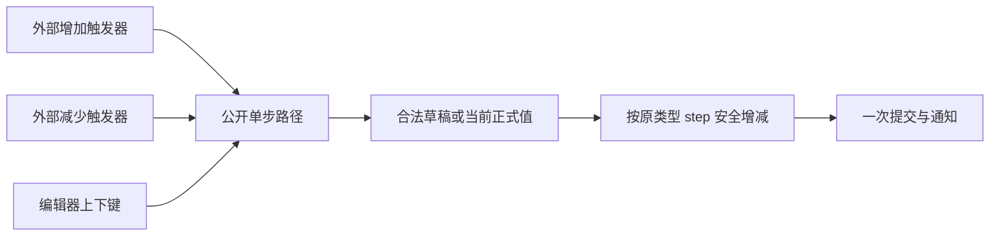

# 开放 NumberInput 步进触发器

把加减操作公开成可组合的 Step 行为，让任意外部触发器指向一个 NumberInput Headless 根，并声明增加或减少。按钮数量、位置、图标和外观由应用决定，数值运算仍只走库的一条提交路径。

本增量依赖上一份 NumberInput 的值、草稿与 Editor 绑定。下一份长按重复建立在这里的单步操作上；本增量不会新增第二套步进算法。

## 一个动作不等于两个必备按钮

公开触发器到 NumberInput 根的关联以及增减方向，沿用 StepButton 所表达的语义，但不暴露只适合默认三段结构的私有 Parts。自定义控件可以没有按钮、只有一个增加按钮，或者在右侧上下排列两个按钮。

触发器使用自身输入能力发出单步请求；数值行为不关心它是 Text、Icon 还是卡片。直接的公开单步调用与触发器适配应共用相同的用户资格校验，不允许外部为了复用步进而自行绕过 ReadOnly/Disabled。

## 步进沿用草稿语义和原类型运算

先处理编辑器内待执行的输入，合法草稿作为起点；非法草稿回退到当前正式值。按 T 的 step 安全加减，再截断到显式 min/max 和类型边界，整数不回绕、浮点不溢出为无穷。手动值不要求对齐步长。

最终结果一次性提交和通知，不把合法草稿中间值先发布一次。比如 0..10、step=3 正向仍是 0、3、6、9、10，反向是 10、7、4、1、0。端点同值静默，但按钮不因此自动禁用。

按钮操作获取并保留文本焦点，不先触发一次失焦提交。根或 Editor Disabled、ReadOnly 都阻止用户单步；合法程序 setter 的权限仍与用户操作分离。

## 默认输入时机不改变

默认加减区域仍在按下时立即执行一次。不能直接把原来 ActivateOnPress 的输入替换成只在释放点击后激活的普通 Button Headless，也不能同时监听按下和 Activate 导致双步。需要为 Step 触发器保留明确的按下适配。

编辑器聚焦时上下方向键，包括重复按键，调用同一单步路径。IME 组合期间方向键归输入法。鼠标滚轮仍不改数值，也不截断父 ScrollArea 的滚动。

既有长按重复在这一步继续工作并调用公开单步路径，下一份才把重复能力独立开放；中间不能让默认 SpinBox 失去长按功能。

## Gallery 与完成条件

在 NumberInput 页自定义区展示一个把两个 Step 触发器放在输入框右侧的实例，与原默认三段布局并列。无按钮实例继续保留，用来证明按钮是可选能力。

涉及 `crates/number_input/src/input.rs`、StepButton 关联、焦点路由与默认 Scene 适配，连同公开入口、Facade 和说明一并交付。

- 不同位置、不同数量的触发器都操作正确的根，多个 NumberInput 之间不串值。
- 按下只增加/减少一次，释放不额外步进；合法/非法草稿起点、端点饱和、整数边界和浮点有限性保持原语义。
- ReadOnly/Disabled/IME 阻止相应用户操作，触发器不造成提前失焦提交。
- 默认三段按钮的按下、Hover/Pressed、焦点与现有长按行为不变，四套主题布局和颜色不变。

## 边界

不增加任意加速曲线、滚轮调节或动态步长。失效触发器目标在实际执行时验证，失败不改正式值或发送虚假通知；不得把直接写 value 当作步进接口。
