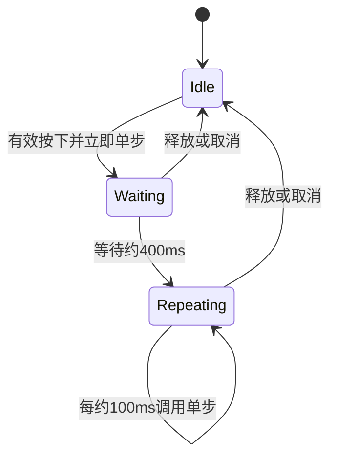

# 开放 NumberInput 长按重复能力

将默认加减按钮的连续步进计时公开为独立可选能力。外部触发器可以选择只执行单步，也可以组合相同的长按重复；重复系统只产生后续 Step 请求，不拥有数值状态。

本增量直接依赖上一份公开单步路径。下一份 ComboBox 不依赖 NumberInput 的重复计时，只是执行顺序相邻。

## 重复调用同一单步路径

初次按下由 Step 触发器立即执行一次，Repeat 不再重复执行首步。保持约 400ms 的启动等待，再约每 100ms 尝试一次。每次仍执行草稿处理、ReadOnly/Disabled 校验、边界截断及正式值提交。

到端点时合法同值无通知，不自动禁用按钮。连续真实变化可能每秒约十次；消费方自行决定合并昂贵业务，不在控件里另造业务节流。

## 计时与 Reactive 调度

使用真实经过时间，不受虚拟游戏时间暂停影响。自动计时从实际输入时间计算，不能把休眠前的空闲 delta 当作新按下的持续时间；手动时间策略保留可确定性测试。掉帧后每帧最多尝试一次，不追补积压周期。

有效按住期间请求必要更新，使 Reactive 桌面宿主能继续重复；退出后不留下持续唤醒。计时不能依赖默认按钮动画或默认 Style 是否安装。

释放、Pointer Cancel、有效 Disabled 和失效的触发器/根结束重复。恢复可用后必须重新按下；同帧释放再按下也重新等待 400ms。原生 Mouse 所属窗口失焦终止重复，重新聚焦不续接旧计时。Custom Pointer 沿用独立 Release/Cancel 语义，不被错误套上 OS Mouse 的窗口焦点条件。

## 默认表现与 Gallery

默认 NumberInput 两侧按钮始终组合 Step 与 Repeat，保持原来的按下、等待、重复节奏和文本焦点行为。外部示例把相同能力放在自定义增减按钮上，也保留一个单步不重复的对照。

主要改动是 `crates/number_input/src/repeating.rs`、公开重复配置/状态边界及默认 Scene 安装。内部 next 时间不对外可写，外部只选择是否组合能力，不需要自己驱动计时。

## 完成条件

- 在真实时间和手动时间环境中覆盖首步、400ms 等待、100ms 周期、掉帧、长时间空闲后按下、同帧释放再按下。
- 验证 Release、Cancel、本地/祖先 Disabled、根销毁及原生窗口失焦会停止，恢复不自动续接。
- 不安装默认 Style 的外部触发器在 Reactive 宿主仍可连续步进，停止后不持续请求帧。
- 每次重复只调用一次已公开的单步提交，端点同值无业务通知，合法草稿只产生最终一次数值变化。
- 默认三段 NumberInput 的布局、颜色、按钮状态和重复节奏保持不变；Gallery 示例仅依赖公开 API。

## 范围

这里开放的是 NumberInput 的重复步进行为，不借此设计覆盖所有控件的通用手势/定时框架，也不增加速度加速、自动连点或后台任务。
