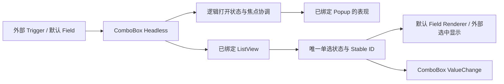

# 开放 ComboBox 部件绑定与弹层控制

公开 `WidgetryComboBoxHeadless<T>`，通过显式引用关联触发器、Popup 和 `WidgetryListView<T>`，不再从默认父子层级推导这些部件。外部能够更换整个触发器和弹层结构，同时继续使用现有选择引擎。

本增量复用 Button 公开激活能力及已有 ListView，和前一份 NumberInput 重复计时无直接依赖。下一份为这套绑定增加可选搜索；默认可搜索 ComboBox 在此期间必须继续可用。

## 绑定替代默认层级查找

Headless 能定位 trigger、popup、list，后续再带可选 search_field。具体绑定类型可以整理，但不能继续要求 List 的父亲是默认 Popup、Popup 的父亲就是 ComboBox，也不能要求触发器具有默认 `WidgetryButton` 或默认内容容器。

触发器复用 Button Headless 的 Activate 或公开的打开操作，Style 决定它是文本框、图标还是卡片。根、触发器、Popup 和列表的所属关系需要明确，使事件路由、点击内外判断、禁用和销毁清理不依赖默认树。

这里仍要求绑定一个 `WidgetryListView<T>`。列表继续负责数据、虚拟化、候选导航与单选状态；Renderer 控制条目内容。不新增 ListView Headless，不再定义一套通用选项提供者或复制 Model。

## 选择继续由 ListView 唯一持有

Source 仍是 `WidgetryListModel<T>`，使用 Stable Item ID。初始化保持 None，不因 Model 非空就选首项，默认 Placeholder 仍是 `Select…`，调用方仍可提供内容工厂。清空或删除已选项恢复 Placeholder；新增数据不自动选择，移动不改变稳定 ID。

公开 select_id、执行时解析原始索引的 select_index、clear_selection 和 selected_id。根只读查询委托绑定的列表，不再另存可变 selected。真实选择先提交列表状态，再以 ComboBox 为 source 发 `ValueChange<Option<WidgetryListItemId>>`，同值不重复通知，删除修复静默。

程序化选择不强行关闭 Popup，继续保留 PreservePopup 的时序语义；排队多个选择时，前一通知观察者的命令要在下一请求解析 ID 前得到执行。Disabled 阻止用户输入，合法程序选择仍可执行。

## 打开状态与显示方式分离

Headless 保存逻辑打开状态并公开必要查询/控制入口。Popup 的 Visibility 是默认 Style 对这个状态的投影，不再是业务状态的唯一存储位置。外部可以使用不同的显示容器和布局，但关闭状态下隐藏的列表不能继续接收键盘选择。

用户触发、选择完成、Escape、外部点击、有效 Disabled 和部件失效都进入同一生命周期路径。保持已有焦点语义：Escape 回到触发器，选择后的清理按原有输入归属处理，外部点击不能无条件抢回焦点。关闭时清理焦点与同批后续确认，避免看不见的列表继续提交。

非搜索且 Model 为空时沿用不显示候选 Popup 的规则；程序化选择不改变这个规则。逻辑打开 API 的用户资格与程序设置能力不能混淆，不把 Disabled 下合法的 select_id 推广成任意用户打开请求也可执行。

## 默认 Style 保留现有结构与尺寸

默认 ComboBox 继续使用原来的 Button Field、下拉图标、Popover、ListView 与可选搜索。默认根宽 200px，Field 高 36px，默认行高 32px、max_visible_items 为 8；行高与 max_visible_items 决定列表尺寸；下/上候选定位、边框、圆角和图标状态保持原样。布局计算留在默认 Style，不强制写入外部 Popup 的高度或搜索区位置。

Field 的内容/Placeholder Renderer、缓存和颜色刷新分离。更换 Theme 不重建 Renderer，新增 Text/Icon 同帧获得前景色。默认的 Button/ListView 颜色托管继续使用对应 Owner；外部自定义 Trigger 不需要假装接受默认 Button 的颜色输出函数。

## Gallery 与代码影响

在 ComboBox 页保留现有默认示例，增加一个使用自定义触发器、额外 Popup 装饰层及现有 ListView Renderer 的实例。它展示真实选择、清空、外部点击关闭、Escape 和禁用，且不依赖默认 Field/Popup 私有标记。

涉及 `combo_box.rs`、`popup.rs`、`field.rs`、`style.rs`、typed 注册、Facade 和说明。原有默认搜索在这一阶段通过正确绑定继续运行，下一份再开放搜索自身的外部入口。

## 完成条件

- 自定义布局可多包一层或采用自有弹层位置，不改变选择/关闭/焦点语义；删除根或关联部件不会留下孤儿 Popup。
- None 初始化、稳定 ID、Model 增删移动、合法程序选择保持 Popup、同项重选关闭及事件提交顺序都回归。
- 关闭或 Disabled 后同帧剩余输入不能再次选择，嵌套/外来列表的行不被误判为本 ComboBox 选项。
- 默认 Field、图标、Popup、行宽、列表虚拟化及四套配色完全不变；稳定帧不反复重建内容或遍历建立颜色归属。

## 边界

不把本增量扩大成通用浮层管理器或 ListView 重构。绑定的 Source 类型、Model/列表映射和合法部件需要执行时校验；错误保留原 ListView/Button 等原因链及上下文。行为错误不能要求默认颜色组件才能报告。
