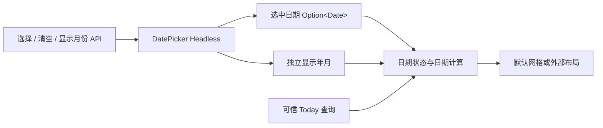

# 开放 DatePicker 日期模型

公开 `WidgetryDatePickerHeadless` 的日期、显示月份、范围校验和日期数据访问，使外部可以只显示日期选择区域，而不构造默认月份/年份候选页面。默认 DatePicker 的完整界面仍保留。

前一份 ComboBox 搜索与此处无直接依赖。下一份在这里的日期模型上公开可选导航；本增量结束时默认三级视图继续通过内部适配工作，外部日期选择本身已经可交付。

## 两项独立状态

选中日期与显示年月保持独立，不把浏览月份当作选择。公开 selected_date、displayed_month、选择/清空、设置显示月份和 shift_month 的同步/queued 入口。真实变化先提交再分别发送既有 SelectionChanged 和 DisplayedMonthChanged；初始化与同值静默。

选择一个不同日期时定位到其所属月份；同值选择不跳月；清空 None 保留当前显示月份。程序 API 不受 Disabled 限制。用于响应外部点击的用户操作需要经过有效 Disabled 和可选性检查，不能因为 setter 可程序化使用就让自定义 UI 绕过输入限制。

构造的 min_date/max_date、week_start 等配置保留原有语义，范围只限制可选日期，不限制浏览。显示月份优先显式配置，其次初始选中日期，最后可信本地今天的月份。

## 日期数据不等于日期节点

保留 `DatePickerMonth`、`DatePickerDay` 和 `days(world, root, today)` 数据能力。现有辅助计算返回连续 42 个真实日期及 current_month、selectable、selected、today 等标志，包含邻月。week_start 默认为 Monday，仍允许任意 Weekday。

返回 42 条数据不代表 Headless 必须查询 42 个实体。外部可以自行选择布局，读取日期数据后画网格或列表；行为层不遍历默认 `Part::Day`，也不验证默认 UI 节点数量。42 格完整月历的可表示范围和计算失败仍遵守原有日期模型约束，不借此扩大到全新日历算法。

外部日期触发器应以实际 Date 或公开语义操作提交，而不是必须使用默认格子索引；默认 Style 可以继续用索引驱动自己常驻的 42 格。

## Today 与本地时钟

继续共享 App 级可信本地日期缓存，不要求每个控件自行访问系统时钟。本地日期不可用时不得伪造 Today；初始化显示月份可按现有规则回退到 min_date 或 UTC 日期的月份，并保留原来的失败与回退上下文。

保持约 60 秒检查和 Reactive 宿主唤醒协作，以及恢复更新后处理到期检查的行为。已有 Winit 等待上限合并逻辑保留，不因为 Headless 不绘制 Today 图标就失去日期更新。Today 变更、失效或恢复不修改选择/显示月份，也不发送业务选择事件。

## 默认外观与外部示例

默认 Style 仍采用 304×352 外框、星期标题、6×7 日期网格、翻月箭头及底部清空。邻月可选日期、越界日期无 Hover/Pressed、清空按钮的可用状态都保持。

Today 的固定朱红笔圈仍使用原 SVG、尺寸关系和 tint，可叠加选中背景，在禁用及四套主题下保持原色。固定图标属于默认 Style，不是外部日期模型必须加载的资源。

DatePicker 页保留原默认示例，增加只展示日期选择的 Gallery 自定义布局，不放月份/年份候选面板。示例通过公开日期和可选性数据绘制，不访问私有 State/Part。

## 完成条件

- 不存在默认日期格节点时仍能查询日期、选择、清空、翻月，公共 API 不要求默认颜色或图标。
- 选择与显示月份的独立性、同值不跳月、清空保月、范围限制、week_start、邻月及极端日期计算均回归。
- 本地日期失败不伪造 Today，恢复不发业务事件，持续故障复用原诊断。
- 默认日历的尺寸、42 格、文字、清空按钮、Today 笔圈及四套主题不变；默认三级导航也继续可用。

主要实现位于 `model.rs`、`today.rs`、默认 `view.rs` 的数据访问/筛选和公开导出。

## 边界

不新增日期区间选择、其他历法或业务日历。程序写入的校验失败不改业务状态。默认 UI 结构诊断只检查默认 Style，不把外部省略候选页面视为错误。
