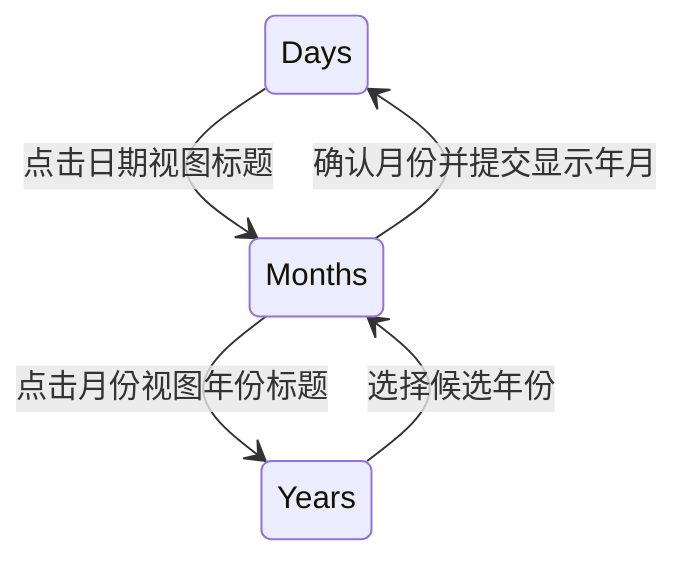

# 开放 DatePicker 导航行为

把 DatePicker 的日期/月/年导航从默认 View 中拆出来，使外部可以复用这套浏览过程，也可以完全不提供月份或年份页面。导航能力提供状态与操作，不强制创建标题、箭头、42 个日期节点或 12 个候选节点。

本增量依赖上一份日期模型。下一份 ProgressBar 与这里没有直接依赖。

## 候选浏览不是正式日期状态

公开当前导航视图及候选年份/年份页所需的只读数据，提供进入视图、前后翻页和确认候选的语义操作。不要把 `Part::Candidate(index)` 或私有 UI 节点作为唯一调用入口。

日期视图箭头按月浏览；月份视图箭头按年浏览；年份视图每页连续 12 年，按 12 年翻页。点击年份返回对应年份的月份视图，确认月份才提交正式显示年月并返回日期视图。浏览候选不改选中日期或正式显示月份，不发它们的业务变化通知。

月份和年份候选的高亮表达已提交的显示年月，与选中日期独立。日期范围不限制候选浏览；无法表示完整月历的月份或超出 time::Date 范围的候选保留原有不可用判断。

## 外部按需组合

只做日期网格的外部控件可以完全不创建月份、年份 UI，也不需要伪造隐藏页面来通过校验。需要三级导航的外部控件则使用公开导航状态，按自己的布局显示候选。

用户操作必须通过有效 Disabled 和当前视图资格检查，合法程序设置日期/显示月份仍保留原权限。导航状态不写默认 Node.display；具体面板切换由默认或外部 Style 投影。

## 默认三视图与语言

默认完整 DatePicker 继续使用 6×7 日期、3×4 月份、3×4 年份候选，共用原来的 304×352 外框。切换原位进行，无新 Popup、无新动画。标题、箭头、候选和清空的显示/禁用规则维持现状。

保留 English 与 SimplifiedChinese 的 App 级呈现配置。语言变化只刷新星期、清空、月份及年份文字，不重建实体，不重置未提交候选视图，不发日期选择或显示月份事件。格式化文案属于呈现能力，不成为 Headless 的唯一数据接口。

默认颜色和 Today 图标归属不变；月份与年份候选不显示 Today 笔圈。默认 Style 的 UI 数量校验只针对自己的固定网格。

## Gallery 与实现范围

在 DatePicker 自定义区域保留日期-only 示例，并用自定义布局展示可复用的标题/候选导航。两个示例共同证明“可以复用完整导航，也可以省略导航 UI”，不把省略页面做成错误。

主要从 `crates/date_picker/src/view.rs` 拆出 Navigation、View 和语义动作，默认场景与 apply 逻辑改为状态消费者。语言、颜色和图标仍是呈现侧消费者，Facade 与文档一起公开必要入口。

## 完成条件

- 日期→月份→年份→月份→日期的完整路径正确，翻候选不提前改业务状态，确认月份才提交显示年月。
- 自定义控件不创建两级候选页面时仍合法；创建页面时不依赖默认 Part 和固定网格。
- 有效 Disabled、极端年月、候选不可表示及程序化修改与导航状态的既有关系有回归。
- 中英文切换保留日期、月份和候选浏览位置，默认三视图外观与切换方式不变。

## 边界

不增加键盘日历导航、选择范围或新的日期状态。导航 API 的具体 Rust 名称可整理，但必须表达语义动作与只读状态，不能仅将私有 View 枚举公开后继续要求默认 UI 执行动作。
