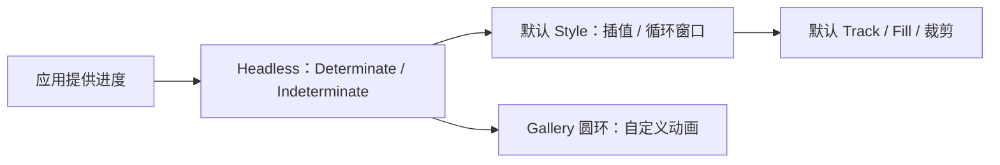

# 开放 ProgressBar 真实进度状态

公开 `WidgetryProgressBarHeadless`，只负责应用提供的真实进度及其校验。默认横条与外部圆环、仪表盘或分段显示读取同一类状态，各自决定动画，不要求创建 Track/Fill。

前一份 DatePicker 导航与这里无依赖；下一份 Tooltip 也独立。此增量不引入输入处理或任务执行能力。

## 状态与程序 API

继续使用 `WidgetryProgressState::Determinate { value }` 和 Indeterminate。默认确定值为 0，可以用非零初值或不确定模式构造；配置只初始化一次，不保留旧确定值供跨模式自动恢复。

确定值必须有限且在 0..=1 内，允许增加、减少、重置和双向切换模式。NaN、无穷、越界、无效根及缺状态明确失败，不 Clamp，失败保持旧状态。

公开查询、同步和 queued setter，真实状态改变返回 changed，同值静默。进度是应用提供的展示输入，不新增 ValueChange 或其他业务变化事件。外部读数读取已提交真实值，不读取视觉缓动值。

## 默认动画不是 Headless 状态

150ms Cubic Ease-Out 只属于默认 Style。真实值立即提交，填充从当前可见比例追赶目标；连续更新从途中接续，初始非零值直接显示，同值不重启。Theme/尺寸变化不重播，到达目标后停止持续重绘；空闲后的首次更新不把之前的空闲时间计入新动画。

默认不确定模式仍以约 1.2 秒周期让约 30% 轨道长度的高亮段向右循环。相位不是业务进度；确定→不确定取消插值并开始循环，不确定→确定直接显示新的真实比例，不伪造从零增长。重复不确定设置不重置相位，退出后不残留循环唤醒。

Headless 不强制这些时长、缓动或动画窗口。外部圆环可以旋转，分段条可以逐段点亮，也可以完全不做插值。

## 默认几何与 Gallery

默认 Style 保留水平左到右圆角 Track/Fill、完整 1px 边框和内层裁剪。默认高 12px、宽度填满父级，height 必须有限正数，根 Node 尺寸 Patch 仍有效。0% 无填充、100% 填满内侧区域；内部几何不能盖住边框。保留无 Text/Thumb/刻线且不接受 Pointer/Keyboard 的表现。

ProgressBar 页保留默认进度控制与读数，增加一个 Gallery 圆环示例。确定值变化、重置和模式切换通过公开状态入口操作，自定义动画不引用默认 Animation/Parts。

## 完成条件

- 不含默认视觉节点的 Headless 实例支持查询、设置、同值和模式切换，非法值不部分提交。
- 没有业务变化事件；Style 自己插值时真实值始终可立即读回。
- 默认插值中连续更新、回退、空闲后更新、两种模式互切与重复设置都保持原时序，完成后不继续重绘。
- 四套 Gallery 配色、边框、裁剪、尺寸变化和0%/100%端点原样保留，极小非零进度不产生非有限布局值；自定义圆环独立工作。

影响 `progress.rs`、`style.rs`、`animation.rs` 的资格筛选及初始化归属，连同 Facade、Gallery 和相关诊断测试交付。

## 边界

不读取任务进度、不控制任务生命周期。默认结构损坏仍报告具体 Track/Fill/clip 诊断，但纯 Headless 不需要这些节点；同值、模式切换和正常等待不制造错误日志。
