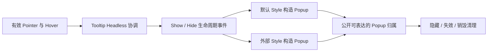

# 开放 Tooltip 生命周期

把既有 Tooltip 行为正式公开，让外部通过 Show/Hide 生命周期构造自己的提示浮层。Hover、延迟和单实例协调留在库中，Popup 的结构、内容工厂、颜色与定位留给默认或外部 Style。

前一份 ProgressBar 与这里无依赖，后面的 Cursor 开放也不依赖 Tooltip。现有 `headless.rs` 是基础，不需要重写一套悬停计时器。

## 行为层保留现有所有权和延迟

按有效 Pointer Hover 和祖先绑定找到 Anchor，一个 App 同时只选择一个显示中的 Tooltip。初次 Hover 等待 200ms，短时间切换使用 50ms Warm 延迟，离开后保留 300ms Warm 窗口。计时使用真实时间，静止 Hover 到期也需要 Reactive 宿主继续推进。

相同 Anchor 持续悬停不重复构造内容；Owner/Window 目标变化重新 Cold 等待。离开、Pointer Cancel、目标/输入源失效清理当前显示。无有效输入时只有唯一合法 Hover Source 才能决定 Owner，不能任取一个伪输入源。Disabled 目标仍可显示说明。

## 公开事件不绑定默认内容工厂

公开 Tooltip Headless、对应安装能力及 Show/Hide 事件。默认 `WidgetryTooltip` 继续组合它与现有 Style；仅使用 Headless 的调用方不需要默认 Content Factory、Popover、ColorState 或 TooltipPopup。默认显示 Observer 只处理默认 Style 实例，不能在自定义 Observer 之外再创建一份默认提示。

Show 表达本轮展示请求，Style 据此创建 BSN 内容。事件不能被误当成已成功创建 UI 的确认。默认 Content Factory 仍在每次真正展示时调用，Theme 更新不重新构造内容。

## Popup 的清理不能依赖固定父子关系

外部 Popup 可以采用自己的布局和定位，因此需要公开表达它与 Anchor/本轮展示的归属。库与 Style 必须能据此执行隐藏和失效清理，不能只扫描 Anchor 的直接 Children，也不能只依赖将被销毁的 Anchor 上的局部 Observer。

这个归属入口可以在实现时定型为绑定组件或登记操作，但对外契约必须完整：一个展示结果对应明确 Owner；重复 Show 不重复创建；过期 Hide 不删除较新的展示；排队构造前 Anchor 已失效时放弃；外部节点不挂在 Anchor 下时也不残留孤儿。

只把两个事件改成 pub 而不解决归属，不算本增量完成。外部仍负责自己的 Scene 构造与定位，但不应被迫复制 Hover 状态机或窗口失效判断。

## 默认 Style 与定位原样保留

默认 Popup 仍在下、上、右、左候选位置中选择，保持居中对齐、6px 间距、8px Window margin、OverrideClip、Tooltip ZIndex、原 Padding、边框和圆角。首次创建就具备正确 Picking IGNORE，后代展示内容也不抢取输入。

定位不进入 Headless。外部气泡可以选择其他位置或浮层布局；本轮不扩展为可交互的菜单/Popover。默认 Disabled 目标说明、Theme/局部覆盖配色以及新增富内容的前景传播不变。

## Gallery 与完成条件

Tooltip 页保留默认文本/富内容示例，新增 Gallery 气泡式提示，使用公开 Show/Hide、所属关系与自己的 BSN/定位设置。它与默认实例共用同一全局显示协调，不允许两套管理器各自同时显示。

- 真实时间/手动时间测试 Cold/Warm、持续悬停不重建、切换 Owner/Window、Cancel 和输入源失效。
- 删除 Anchor、移除 Headless、构造前失效、外部 Popup 不在默认树中及重复事件时都正确清理，默认 Style 不接管自定义外观。
- Theme/Override 更新只刷新颜色；默认内容工厂调用次数、候选定位、边框和输入穿透保持一致。
- 异步 Scene 失败不留下已预约的 Popup；正常候选切换、等待和隐藏不制造错误。

实现涉及 `crates/tooltip/src/headless.rs`、`style.rs`、生命周期公开导出、归属适配与 Gallery 示例。

## 边界

不增加同时显示多个 Tooltip、持久编辑业务内容或通用浮层框架。默认工厂缺失仍返回 MissingContent；纯 Headless 无默认工厂不是错误。嵌套内容错误保留源诊断、Anchor/Popup 上下文和清理事实，不以清理完成冒充错误已被业务处理。
