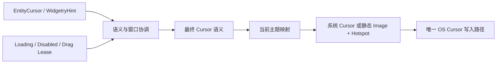

# 开放 Cursor 主题映射与静态样式

把光标语义与外观数据分开，先交付外部可定义的静态 Cursor Theme。库继续协调真实 Mouse、Hover、Disabled、Loading、Drag Lease 和窗口归属；主题只把最终语义映射成系统光标或静态图像。

前一份 Tooltip 与这里无直接依赖。下一份在相同主题通道上加入通用图集播放，再下一份将 Kamuri 整套搬到 Gallery。本增量中现有 Kamuri 仍需工作，允许它暂时作为现有提供方接入同一选择通道，但不能引入两份竞争的当前主题或 OS Cursor 写入者。

## 用外部数据定义主题，不扩充库内枚举

当前主题接受外部完整映射数据。键覆盖现有 SystemCursorIcon 和 WidgetryCursorHint 语义，值描述系统 Cursor 或静态素材及热点。外部不需要增加库内 enum 变体或注册主题名字；名称、选择菜单和持久配置属于应用。

主题可以只替换 Pointer，其他未配置的语义按原有语义回退到 System Cursor。十一种扩展 Hint 继续使用各自既有 system_fallback，不要求应用提供全部 45 项，也不把未配置项视为错误。

静态素材使用 Bevy Asset 体系，允许整图或图集中指定区域的表达，以便复用后续 Kamuri 静态后备图集。资源定义与实际加载分开，不为设置一个主题而强制解码全套素材；具体公开描述类型在实现时定型，不能把 `BuiltinCursorAnimation` 当成公共通用模型。

当前资源提供只读访问与受控切换入口，切换不修改控件业务状态。UI 配色 Theme 与 Cursor Theme 保持独立，库默认仍是 System。

## 既有语义优先级保留

只允许 `PointerId::Mouse` 决定 OS Cursor，Touch/Custom Pointer 不取得 OS Cursor Lease。解析最近有效祖先声明，同一 Entity 上 EntityCursor 优于 WidgetryHint；有效 Loading/Disabled 仍按现有协调规则覆盖为 Wait/NotAllowed。

`EntityCursor::Custom` 不被当前主题换成另一张图。这里说的是外观映射不能覆盖调用方显式图片，并不取消已有 Loading/Disabled 的语义优先级。两个层次不可混淆。

有效 Drag Lease 固定当前拖拽语义，释放、取消、Owner 失效或窗口失焦后清理；Native Move/Resize 期间让出控制权，不继续写 OS Cursor。一个窗口的状态不能泄漏到其他窗口，失效 Lease 不能残留。

主题提供方不能直接接管 Pointer 派发或 Capture，也不能各自安装一个窗口 Cursor 更新器。继续拒绝与官方 CursorIconPlugin 的双写冲突。

## 资源和默认系统行为

通用静态外观能力不依赖 `kamuri_cursor` Feature。没有 Asset/Image 能力时 System 路径仍可用；自定义资源不可用时使用对应语义的系统后备，而不是返回与实际语义无关的普通箭头。

素材大小与热点来自外部定义，不继承 Kamuri 的 80×80 限制。热点必须落在实际可用图像区域内，资产未就绪、解码失败和非法数据需要区别处理。有效加载等待可以请求必要更新，静态成功或失败后不维持无限重绘。

## Gallery 与完成条件

Cursor 页保留原 System/Kamuri 入口。静态扩展的演示可以复用现有 Kamuri 首帧图集中的一项，不制作新素材；正式 Kamuri 全主题入口在后续迁移后自然成为自定义主题示例，不新增第三套完整主题。

- 独立调用方只配置一个语义即可使用自定义静态图，其余系统/扩展语义正确回退。
- 覆盖静态图热点、资源加载、失效/错误尺寸、多个窗口和无 Asset 环境下的系统回退。
- 真实 Mouse、Disabled、Loading、最近声明、EntityCursor::Custom、Drag Lease 与 Native 让权规则保持现状；未启用 Kamuri 也能使用外部静态主题。
- 默认 System 不改变；已有 Kamuri 演示继续工作。Facade、文档与应用当前主题读取同步改为数据入口，不需要旧公开 API 兼容层。

主要位置为 `crates/cursor/src/theme.rs`、`coordination.rs`、通用 presentation 和导出。

## 范围

不新增任意业务光标语义注册协议，不把 Cursor Theme 扩展为 UI 皮肤。当前阶段只承诺静态外部样式，动画支持在下一增量完成；不能提前公开一个接受动画却静默不播放的接口。
