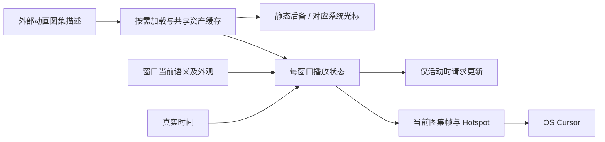

# 开放 Cursor 图集动画播放

在通用 Cursor Theme 上增加动画外观，复用现有播放、窗口管理和后备能力。外部提供图集、布局、帧范围/顺序、时长和热点，库负责选择当前帧并输出 OS Cursor。

本增量依赖上一份主题语义映射。下一份 Kamuri 迁移使用这里的通用定义和播放器；播放器本身不能再以 Kamuri 类型、固定数组索引或专用 Feature 为前提。

## 图集是唯一动画素材形式

动画只接受 SpriteSheet/TextureAtlas，不增加多张独立图片列表、GIF 解码或动画制作工具链。静态图像仍由上一份入口支持。独立图片需要调用方先整理成图集，Cursor 系统不维护两套播放逻辑。

每种动画定义自己的图集布局、有效帧数或帧索引序列、帧时长和热点。不能把所有语义强制成同一帧率，也不能固定为 80×80 或八列；这些只是现有 Kamuri 数据。维持同一动画的一致画布/热点语义，避免播放时指针作用点跳动。

公开描述需要支持可选静态后备，使现有“动画未就绪→对应静态首帧→对应系统光标”的路径可以作为普通数据表达。没有静态后备时直接系统回退，不能在通用播放器中引用 KamuriStaticAtlas。

## 播放状态与主题数据分开

素材定义可共享，每个窗口独立保存当前外观及进入时间。使用真实时间推进，不受虚拟时间暂停或单帧上限影响。进入新语义或新的有效动画时从首帧开始，同一语义持续显示不重启。

主题切换不能只比较语义名字而继续播放旧素材；播放身份需要能区分当前外观数据。具体身份表示可随数据结构实现，不因此引入全局主题注册表。合法同值主题或状态刷新不重置相位。

Native 操作、窗口失焦、无有效 Mouse 目标且无有效 Lease、当前语义失效时停止播放及额外唤醒。Hover 清除不应错误结束仍有效的 Lease/Capture。图集播放与真正的 OS Cursor 输出沿用同一协调入口，不让 Gallery 自己循环写窗口光标。

## 懒加载、后备与 Reactive 更新

按实际出现的语义懒加载动画并缓存，不在主题选择时解码全部动画。可按需要预载静态后备。资源描述要保留资产身份与加载来源，既支持正常 Asset 流程，也不把加载状态伪装成新的业务模式。

有效窗口当前需要某语义且图集正在加载时，保持必要更新直到 Loaded 或 Failed，避免 Reactive 宿主永久停在后备图。加载失败、已加载但 CPU 图像不可用、失焦或语义失效时，不维持加载唤醒。静态/System 后备本身不持续请求动画帧。

动画可用且有效播放时按现有实时行为更新，停止后不残留 RequestRedraw。允许沿用现有每帧唤醒实现，不顺便引入新的全局调度框架或性能协议。

## 预览与测试复用同一帧定义

通用动画描述提供可复用的帧选择计算，Gallery 预览和 OS 播放读取相同帧顺序、时长、布局与热点。预览不需要复用某个窗口的实时相位，但不能维护另一套不同元数据。

库的播放/诊断测试使用小型合成 RGBA 图集，不依赖 Kamuri 素材是否存在。Gallery 后续再使用真实整套 Kamuri 验证素材定义完整。

## 完成条件

- 不启用 `kamuri_cursor` 的独立调用方能播放自定义图集动画，静态与动画语义可以在同一主题中共存。
- 覆盖不同帧数、时长、图集布局和热点，测试首帧、循环、真实时间推进、同语义连续显示、切换动画和多窗口相位独立。
- 覆盖未加载、加载中、失败、尺寸/像素格式/CPU 数据错误、恢复、静态后备可用/不可用及系统回退。失败不产生持续重绘或重复源头诊断。
- 真正 Windows 鼠标静止时动画仍播放；失焦、Native Move/Resize、取消及失效 Lease 后停止额外唤醒。仅 Custom Pointer 或 UI 预览不能替代这项验证。
- 现有 Kamuri 的时序、热点、后备顺序和实际鼠标效果在内部提供方适配后保持不变，为下一份整套搬迁做好条件。

主要处理 `presentation.rs`、`presentation/diagnostics.rs`、通用数据类型、Feature 裁剪及库内测试。

## 防御性约束

空帧集合、零/非法时长、越界 atlas 区域或热点在合适边界明确拒绝，不以模零或索引 panic 暴露。共享资产故障按原因复用原诊断；真正选择后备时才记录处理结果，恢复记录一次，正常加载等待静默。不得保留 Kamuri 专用尺寸、素材路径或帧表作为通用校验。
