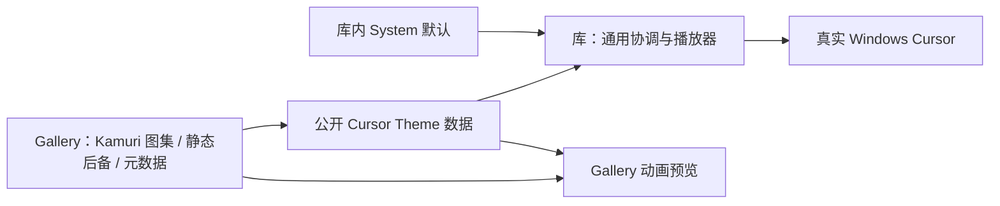

# 将 Kamuri Cursor 整套迁入 Gallery

把 Kamuri 从库内主题改成 Gallery 用公开接口定义的完整 Cursor Theme。保留全部现有图片、动画、热点与演示入口，不重新绘制一套素材，也不把播放器一起搬到 Gallery。

本增量直接依赖前一份通用图集播放器。它是本次最后一个有实际交付的增量，全局收口检查附在本增量的完成条件中，不另建只有测试或汇报内容的末尾阶段。

## 素材、定义与工具一起搬迁

迁移 45 份动画图集、静态后备图集，以及每种语义的帧数、帧时长、Hotspot 和图集布局。现有数据使用 80×80 帧画布，这些数值作为 Gallery 的素材参数原样保留，不成为库的尺寸限制。

`BuiltinCursorAnimation` 中与 Kamuri 绑定的目录、metadata、path 和布局定义迁到 Gallery，名称可以改为应用内类型；其通用帧选择算法归通用播放器，不应复制另一份漂移的实现。所有 34 种系统语义和 11 种扩展 Hint 的映射仍完整。

把 Kamuri 专用生成工具、动作说明、相关素材与验证资料迁到 Gallery 的资源/工具目录，调整输出路径和生成的 Rust 目录。不能只移动 PNG，而让再次运行生成脚本又把旧库入口生成回来。通用原生光标探测工具可以按用途保留；其 Kamuri 专属期望数据与路径必须改用 Gallery 定义。

## 库内不再认识 Kamuri

从 `crates/cursor` 移除 Kamuri 专属变体、固定索引映射、专用资源缓存与加载分支。从 `crates/asset` 移除 Kamuri 的 include_bytes、嵌入注册、BuiltinCursorImage 专用项和对应目录。

删除 asset、cursor、Facade 和 Gallery 依赖链中的 `kamuri_cursor` Feature。通用静态/图集播放能力仍留在库中，不因 Feature 删除而消失。库的生产路径不再包含 Kamuri 名称、路径或元数据，也不反向引用 Gallery。

不维护旧 Feature 或旧主题枚举的兼容别名。旧测试和 benchmark 中的通用能力检查改用合成素材，真实 Kamuri 素材检查随示例归属迁移；不能直接删除原有覆盖。

## Gallery 仍是 System / Kamuri

Cursor 页仍保留 System 和 Kamuri 两个主题选择，不新增第三套完整 Custom。Kamuri 本身就是完整的外部主题示例，应用通过公开 Cursor Theme 入口传入数据。页面仍展示全部语义、动画预览及真实鼠标验证区。

GalleryAssetPlugin 接收资源嵌入注册；顶部/页面选择、启动光标、配置恢复和 Cursor benchmark 等旧调用位置一起适配。只改资源归属，不改变热点、动作、帧率、首帧、静态后备或系统回退顺序。

UI 配色 Kamuri Violet 与鼠标 Kamuri 保持两个独立选择。不能因为两者都移到 Gallery，就强制成一个联动主题。

## 预览和真实鼠标有不同生命周期

页面预览可以按原逻辑在进入时准备资源、离开时释放自己的引用，但不能销毁当前 OS Cursor 主题仍在使用的 Image/TextureAtlasLayout。主题的活跃资源由通用播放路径保留，页面只管理预览实体与自己的持有关系。

操作系统路径仍按当前语义懒加载，不能把页面一次性加载全部预览的策略带进全局播放器。离开 Cursor 页后，只要当前选择 Kamuri，其他页面中的鼠标样式仍然有效。

静态样式与缺项回退的演示/测试直接复用已有静态后备中的帧和部分映射，不再制作新图。完整 Kamuri 映射本身不删除任何语义；测试“未定义时回退”使用临时的部分主题数据。

## 本增量的完成条件

- 45 项动画逐一比较素材像素、帧数、顺序、时长、热点和布局；静态后备仍对应各自动画首帧，语义映射不串项。
- System/Kamuri 切换、真实鼠标 Hover、Loading、Disabled、扩展 Hint、Drag Lease、Native 操作及资源后备保持原效果。验证热点时使用真实 Windows 鼠标，UI 预览不能替代。
- 离开 Cursor 页、切其他页面、开关原生窗口、失焦再聚焦时，主题资源和播放状态没有错误释放或持续唤醒。
- 库与 Facade 不再导出 Kamuri 专用接口或 Feature，Gallery 在没有这些入口的情况下仍完整展示；生成脚本、测试、benchmark 和使用文档不存在失效路径。
- 通用静态/动画能力只依赖公开描述和 Bevy Asset 体系；没有 Gallery 的普通调用方也能使用自己的主题。

## 全部增量的收口检查

针对实施中实际受后续改动影响的路径完成一次整体检查，不要求每一份前置方案都重新运行无关全仓回归。

- 在 Windows 64 位目标和项目使用的 Bevy 0.20 API 上构建公开 Facade、Gallery 与必要测试。覆盖基础 Feature 裁剪、Dark-only 及保留的可选配色；Kamuri 两套示例不再依赖旧 Feature。
- 所有确定开放的控件均有只使用公开 API 的外部自定义实例。不能访问 internal、私有 Parts 或直接改内部状态；普通 Bevy 公开基础组件不受此限制。Slider 弧形、无按钮 NumberInput、任意装饰层的 TextField、ComboBox 绑定、混合 Option 和自定义 Tooltip 均实际可操作。
- Gallery 保留现有默认示例、导航及 Color Showcase，四套 UI 配色仍可切换。比较默认尺寸、布局、颜色、图标、动画与适用的 Hover/Pressed/Focus/Disabled/选中/Loading 状态，切换主题不重置业务状态。
- Kamuri Violet 和 Kamuri Cursor 都从 Gallery 定义，库只提供通用接口。二者的可见结果与迁移前一致，独立切换。
- 既有未开放控件只因依赖/Theme 读取做必要适配，不新增它们的 Headless 扩展接口。组合控件及原 Gallery 页面无重复输入、遗留 Popup、Capture、Lease 或异常重绘。
- 用现有测试与可用 GUI/BRP 能力观察实际状态和页面；原生 IME、剪贴板和 OS Cursor 专项用真实环境补充。验证记录不能把静态结构检查当作原生行为通过。

## 范围

不设计新角色光标，不改变 Kamuri 画风，不把素材重新打包成另一个库内特例。默认 System 行为、通用语义规则和外部自定义入口是库的责任；Kamuri 的内容和演示是 Gallery 的责任。
