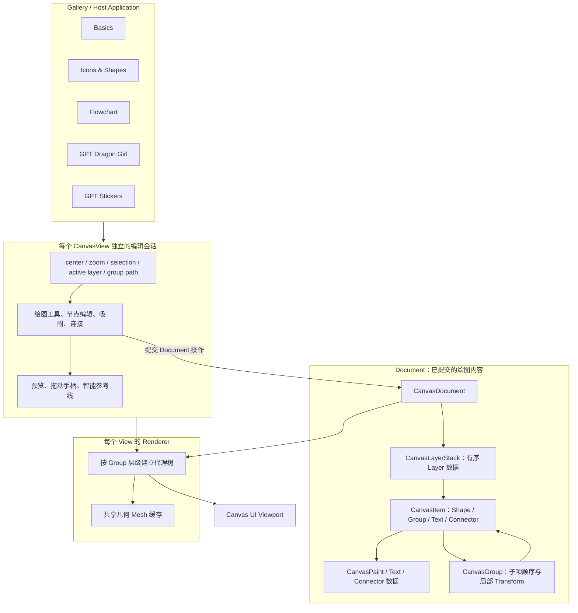
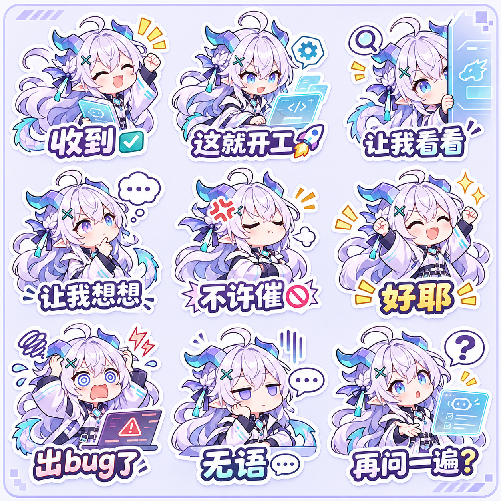

# Canvas：通用矢量绘图模型与 Gallery 展示扩展

这次扩展把现有 Canvas
发展为一套面向图标、流程图、简单矢量插画和表情贴纸的运行时矢量绘图系统。它仍然是
Bevy 应用中的绘图控件，不是独立绘图软件，也不是 SVG 浏览器。

现有 Canvas 已经具备独立的 `CanvasDocument`、参数化
Shape、Path、Paint、Transform、平铺 `ShapeOrder`、多
View、选择与变换、节点编辑、Pen 草稿，以及 SVG/PNG
导出。扩展应沿用这些基础，而不是另起一套平行模型。新的
LayerStack/ItemOrder 成为唯一顺序权威后，旧 `ShapeOrder`
组件会被移除；公开的 `shape_order` 查询由新层级结构动态展平得到。

## 整体职责

Document 是正式绘图数据的唯一权威；View
保存每个视图自己的观察、选择和临时编辑状态；Renderer 从 Document 与 View
派生显示资源；Gallery 作为消费者组合工具栏、属性面板和作品演示。

## Document 的层级模型

Layer 不需要成为独立 ECS Entity。它没有自己的 Transform
或渲染生命周期，使用 `CanvasDocument` 上的 `CanvasLayerStack`
组件保存更直接，也能让 `CanvasDocument` 在没有 `CanvasPlugin` 的 World
中继续创建。

-   `CanvasLayerStack` 保存有序的 `CanvasLayer`
    记录，并在默认状态下包含一个可见、未锁定的默认 Layer。
-   每个 Layer 使用稳定的
    `CanvasLayerId`，保存名称、可见性、锁定状态和直属绘图项顺序。
-   顶层绘图项仍是 Document 的 ECS 子实体，并由所属 Layer
    的顺序列表管理。
-   Group 是真正的 ECS 绘图项实体，使用 `CanvasItemOrder`
    保存直属子项顺序；Group 可以嵌套。
-   Shape、Group、Text、Connector 都实现统一的 `CanvasItem`
    身份。`CanvasShape` 继续只标记具有 `CanvasGeometry` 的几何 Shape。
-   `ChildOf` 表达 ECS 所有权和生命周期；Layer 列表与 Group 的
    `CanvasItemOrder` 才是绘制顺序的权威来源。

因此逻辑关系是 Document → Layer → Item，Group 内再递归包含
Item；不需要为了表现逻辑层级而额外创建 Layer Entity。迁移后的
`CanvasDocument` Required Components 为 `Transform` 与
`CanvasLayerStack`；`ShapeOrder` 不再作为第二份顺序数据保留。

当前 `CanvasDocument` 是空标记组件，Required Components 提供 `Transform`
和 `ShapeOrder`；每个 Shape 是独立 Entity，含
`CanvasGeometry`、`Transform`、`CanvasPaint`，并通过 `ChildOf(document)`
归属文档。`renderer.rs` 当前通过 `CanvasDocument::_shape_order` 取得平铺
Shape 列表，再读取 Shape 自身的 Transform、Geometry 和 Paint，最后为每个
View 创建 Shape
Proxy。扩展需要把这一条读取路径升级为层级遍历，而不是只增加几种组件。

新模型提供通用的 Layer 顺序、容器直属 Item 顺序和展平后的绘制顺序。现有
`CanvasDocument::shape_order` 保留为 Shape-only 的展平查询；新 API
负责查询 Layer、容器直属 Item 和完整绘制项。旧的 Raise/Lower/Front/Back
操作在当前父容器内生效，跨 Layer 移动使用明确的移动 API。

## View 与 Renderer 的边界

View 继续保存 Document 引用、center、zoom、selection
和工具模式，并增加当前活动 Layer、组内编辑路径，以及网格/吸附等 View
级辅助配置。多个 View 可以观察同一 Document，但各自的选择、活动
Layer、观察范围和草稿互不共享。

Renderer 为每个 View 建立自己的 Group Proxy 层级，Shape Proxy 挂在对应的
Group Proxy 下。这样 Bevy 的 Transform Propagation 可以自然组合 Group 与
Shape 的局部变换；几何 Mesh 仍由共享缓存管理，不因每个 View
重复细分。层级展平顺序仍由 Document
顺序列表决定，并用于设置绘制深度；`Transform.z`
不成为第二套绘制顺序权威。

输入、命中检测、边界计算、Path 节点定位和导出使用同一套 Document
局部到文档坐标的变换解析。该解析沿 Group 祖先链组合局部
Transform，并继续忽略 Document 根自身的 Transform，这与当前 Canvas
的坐标约定一致。不要直接把 Document 根的 `GlobalTransform` 当成 Canvas
几何变换。

Group 使用平移、旋转和等比缩放。等比缩放是有意的约束：当前 Shape 仍以
Bevy `Transform` 保存局部 TRS；Group 等比缩放与子项 TRS
组合后，取消分组时仍能还原为可表示的
Transform，不会引入无法写回的剪切变换。Group
整体缩放默认保持宽高比；需要非等比效果时，用户可以对组内 Shape
执行批量变换。

## Document 编辑历史

Undo/Redo 属于 Document，不属于某个 View。多个 View 编辑同一份 Document
时共享历史；View 的
center、zoom、selection、活动工具和未提交草稿不进入历史。

每个成功的 Document API
操作形成一个历史事务；批量操作整体提交；拖动手势在开始时建立事务，在结束或取消时提交为一个历史条目，而不是每个
Pointer Move 都生成一条记录。Pen 和基础绘图工具的草稿在提交前不修改
Document，也不产生历史记录。

为保留现有 Entity 身份，删除操作进入历史时将对象从可见层级中分离并保留为
tombstone；Undo 重新挂回原父容器，Redo
再次分离。历史条目被清理后，只有不再被任何历史记录引用的 tombstone 才能
despawn。这样 Undo 删除后，外部仍持有的 Entity
不会因为恢复而突然变成另一个身份。

Document 同一时间只允许一个会写入的交互事务；第二个 View
可以继续观察、平移和缩放，但不能同时启动会与之交错的写入手势。这样每个事务的
before/after 状态有明确边界，历史顺序不会因多 View 并发拖动而错乱。

## 这次明确纳入的功能

-   基础 Path 工具：直线、折线、多边形。
-   参数化 Path 工具：正多边形、星形、圆弧。
-   流程图形状预设：菱形、平行四边形、圆角矩形/终止符、圆柱体、文档形状和独立箭头形状。
-   可编辑文字项：文字内容、字号、颜色、对齐和位置。
-   Connector：直线/折线路由、箭头、标签、形状连接锚点和自动跟随。
-   Layer、嵌套 Group、复制/剪切/粘贴/重复、Undo/Redo。
-   网格、网格吸附、对象吸附和智能参考线。
-   图形对齐与等间距分布。
-   线性与径向渐变填充。
-   对应的 Gallery 作品演示。

本次不扩展像素画编辑、位图画笔、照片编辑、自由手绘笔刷、完整 SVG
读取、CSS、动画、滤镜、遮罩、ForeignObject 或脚本执行。现有 SVG/PNG
导出需要支持新增的 Text、Connector、层级和渐变，但这不等于实现完整 SVG
标准。

## Gallery 的组织方式

当前 Gallery 已经有一个 Canvas 页面：`gallery/src/pages/canvas.rs` 中的
`CanvasDemoPlugin` 安装 `CanvasPlugin`，创建一份 Document 和两个共享它的
CanvasView，并演示基础图形、Path 编辑、排序和导出。本次在这个既有 Canvas
页面中增加演示选择器，保留现有 Basics 演示，再加入四个作品型演示：

-   Icons & Shapes
-   Flowchart
-   GPT Dragon Girl Illustration
-   GPT Dragon Girl Stickers

不需要为每个作品新建独立的顶层 GalleryPage。每个演示使用自己的
Document，切换演示时按现有页面生命周期清理和创建资源。

## 参考素材

以下两张图片是本次生成的原始参考图，按原文件打包，不使用聊天截图代替：

-   `assets/赛博幻彩龙娘与全息界面.png`：1086 × 1448，角色立绘。
-   `assets/萌龙少女九宫格表情包.png`：1254 × 1254，九宫格表情包。

它们是 Gallery 侧的位图参考素材，不是 Canvas
矢量文档，也不作为最终作品的替代品。Gallery
可以把它们显示在画布旁边作为参考；角色和贴纸主体必须由 Canvas 的
Shape、Path、Text、Group、Layer 等公开 API 创建，能够单独选择和编辑。

## 唯一实施顺序

1.  [建立 Document 层级与通用绘图项模型](01-document-tree.md)
2.  [实现 Layer 管理](02-layers.md)
3.  [实现嵌套 Group 与统一变换投影](03-groups-and-transforms.md)
4.  [建立 Document 级 Undo/Redo](04-undo-redo.md)
5.  [增加直线、折线与多边形工具](05-basic-path-tools.md)
6.  [增加正多边形、星形与圆弧工具](06-parametric-path-tools.md)
7.  [增加流程图形状预设](07-flowchart-shapes.md)
8.  [增加可编辑文字项](08-text-items.md)
9.  [增加 Connector 与箭头](09-connectors.md)
10. [增加网格与网格吸附](10-grid-snapping.md)
11. [增加对象吸附与智能参考线](11-object-snapping.md)
12. [增加连接锚点与自动跟随](12-connector-anchors.md)
13. [增加复制、剪切、粘贴与重复](13-clipboard.md)
14. [增加对齐与等间距分布](14-alignment.md)
15. [增加线性与径向渐变填充](15-gradients.md)
16. [Gallery：图标与几何图形](16-gallery-icons.md)
17. [Gallery：流程图与结构图](17-gallery-flowchart.md)
18. [Gallery：GPT 龙娘矢量立绘](18-gallery-character.md)
19. [Gallery：GPT 龙娘表情包](19-gallery-stickers.md)

## 工程约束

-   项目当前使用 Bevy 0.20.1，目标平台为 Windows 64 位；外部依赖版本以
    Workspace 配置为准。
-   Canvas 专属类型、状态、Renderer 和行为留在 Canvas crate；Facade
    只聚合公开 API。
-   Gallery 是库的消费者。Gallery 专属素材和演示逻辑留在 Gallery，不得让
    Canvas crate 依赖 Gallery。
-   两张参考图通过现有 `GalleryAssetPlugin` / Embedded Asset
    机制注册，放在 Gallery 自己的 Asset 目录，不迁入 `crates/asset`。
-   UI 继续使用 BSN 构造和组合；运行时 Document 修改通过 Canvas 公开
    API。
-   `CanvasDocument` 模型操作保持 Headless：不安装 `CanvasPlugin`
    也能创建、修改、查询 Document。`CanvasPlugin` 继续负责交互
    View、Renderer 和编辑系统，不为形式统一拆成 Headless / Style 插件。
-   每个新增可观察行为按 Type → Red → Green → Refactor 实施。Canvas
    行为测试放在对应 Unit / Integration Test；覆盖模型变化时更新
    `crates/canvas/tests/COVERAGE.md`。
-   GUI 行为变化按项目规则使用 BRP 对 Gallery 进行针对性验证；Gallery
    至少必须正常编译。
-   只有涉及大规模数据操作或 GUI 流畅度的变更才建立对应
    Benchmark；Headless Benchmark 不替代真实 GUI 渲染验证。
-   每个 Canvas crate 功能增量同步更新 `docs/features/canvas.md` 和
    `docs/design/modules/canvas.md` 中受影响的
    API/机制说明；测试职责变化时同步更新 Coverage Model。
-   正式开发维护任务进度记录，并按项目规则执行适用的独立 Code Review。

## 不再保留的旧方案问题

本方案明确解决了旧版中几个容易导致返工的地方：

-   Layer 是 Document 内的稳定数据记录，不再含糊地要求每层都必须成为 ECS
    Entity。
-   Group 的 Transform 不只停留在"使用 Transform
    Propagation"的描述；Renderer
    代理树、命中检测、边界计算、导出都采用一致的层级变换语义。
-   Group 使用等比缩放，避免取消分组时把剪切变换塞回现有 TRS Shape
    Transform。
-   Undo/Redo
    提前建立事务边界，后续所有新增操作必须接入，而不是等功能全部写完才补历史。
-   Connector
    分为自由端点与箭头基础能力、网格/对象吸附、锚点绑定三个阶段。
-   对齐到画布明确使用当前 View 的可见文档矩形；项目当前没有固定
    Artboard。
-   文字内容通过 Canvas Document API 修改，Gallery
    使用属性面板承载文本输入；Canvas 不因此依赖兄弟 TextField crate
    或实现完整富文本编辑器。
