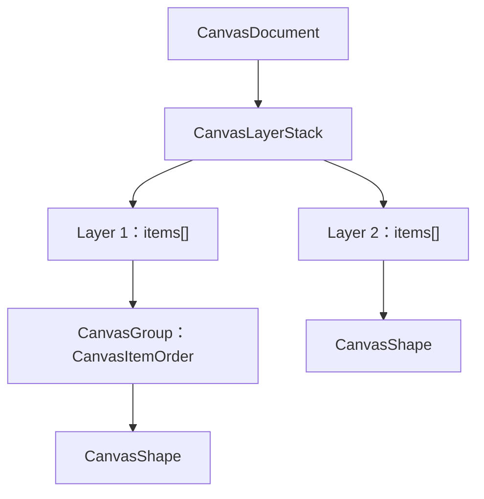

# 建立 Document 层级与通用绘图项模型

## 目标

把当前 Document 的平铺 `ShapeOrder` 升级为通用的有序绘图项模型，为
Layer、Group、Text 和 Connector 建立共同身份与顺序基础。完成后，现有
Shape 仍可按原方式创建、选择、编辑和导出。

## 为什么不能只给 Shape 增加 Layer 字段

当前 `CanvasDocument` 是 ECS Entity，通过 Required Components 获得
`Transform` 和 `ShapeOrder`。Shape 是独立 Entity，包含
`CanvasGeometry`、`Transform`、`CanvasPaint`，并通过 `ChildOf(document)`
归属 Document。`ShapeOrder(Vec<Entity>)`
同时承担绘制顺序和命中顺序的权威来源。

Layer 与 Group 需要有自己的直属顺序；Text 和 Connector 也不是
`CanvasGeometry`，因此继续使用 `Vec<Entity>` 但把它命名为
ShapeOrder，会让 Renderer、Selection 和导出不断假设每个绘图项都是
Shape。

## 采用 Document LayerStack 与通用 ItemOrder

`CanvasDocument` 增加 Required Component `CanvasLayerStack`。Required
Components 保留 Document 根 `Transform`，新增
`CanvasLayerStack`，并移除旧 `ShapeOrder` Required
Component。该组件是纯数据，不需要创建 Layer ECS Entity：

``` rust
struct CanvasLayerStack {
    layers: Vec<CanvasLayer>,
    next_layer_id: u64,
}

struct CanvasLayer {
    id: CanvasLayerId,
    name: String,
    visible: bool,
    locked: bool,
    items: Vec<Entity>,
}

struct CanvasItemOrder(Vec<Entity>);
```

`CanvasLayerStack::default()` 自动包含一个可见、未锁定、名称为 `Layer 1`
的默认 Layer。`CanvasLayerId` 在同一 Document 内稳定且不因 Layer
重排而改变。

每个 Layer 的 `items` 保存直属绘图项；Group Entity 上的
`CanvasItemOrder` 保存 Group 的直属子项。顶层绘图项通过
`ChildOf(document)` 归属 Document，Group 内的子项通过 `ChildOf(group)`
归属 Group。`ChildOf` 表达 ECS 所有权与生命周期，顺序只由
`CanvasLayerStack.layers[*].items` 和 Group 的 `CanvasItemOrder` 决定。

新增统一 `CanvasItem` 标记，表示某个 Entity 是可被 Document
管理的绘图项。现有 `CanvasShape` 保持 Shape 专属语义，并由
`CanvasGeometry` 继续要求；Group、Text、Connector 在各自增量中也实现
`CanvasItem`。



## 统一顺序查询

提供三种清晰的查询语义：

-   `layer_order`：返回 Document 的 Layer 顺序。
-   `item_order`：返回指定 Layer 或 Group 的直属 Item 顺序。
-   `draw_order`：递归展平所有 Layer 与 Group，返回完整绘制项顺序。

现有 `CanvasDocument::shape_order` 保留为 Shape-only
的展平查询，便于现有调用方读取所有 Shape，但它从 LayerStack/Group
顺序递归计算，不再读取存储的 `ShapeOrder`。`reorder_shape` 继续作为
Shape 专属便捷 API，但顺序调整发生在 Shape 当前所在容器内；通用 Item
的顺序修改通过容器级 `reorder_item` 完成。不得同时保留旧 `ShapeOrder`
和新顺序列表作为两套可写权威。

现有 `create_rectangle`、`create_ellipse`、`create_path` 在没有指定
Layer 时写入默认 Layer，保持原有简单调用方式。后续 Layer API
增加显式目标 Layer 的创建入口；CanvasView 的绘制工具使用当前活动
Layer。Document 所有权校验从"是否直接 ChildOf(document)"扩展为沿 Group
祖先链回溯，并确认根 Item 出现在对应 Layer 的直属顺序中。

## Renderer 迁移边界

本增量只迁移数据模型和现有 Shape 的顺序读取，不在这里完成 Group 变换。旧
`ShapeOrder` 组件在迁移完成后移除；不得保留一份只读镜像
Component，以免调度和错误修复出现双重顺序状态。Renderer 从 `draw_order`
获取绘图项，只处理当前已存在的 Shape 类型；未来 Text、Connector
增加后再扩展对应渲染分支。绘制顺序仍由 Layer
与容器顺序展平结果决定，不能通过 `Transform.z` 建立另一套顺序。

Document 根的 `Transform` 继续不参与 Canvas
文档坐标。当前模型测试可以在没有 CanvasPlugin、Renderer 或 GPU 的
`World` 中创建 Document 并操作 Shape；迁移后仍必须保持这一性质。

## 完成条件与验证

-   `CanvasDocument` 创建时自动包含一个有效默认 Layer。
-   现有 Shape 创建 API 将图形写入默认 Layer。
-   Shape Entity 身份、Geometry、Paint 和 Transform 不因迁移而变化。
-   Layer 顺序、容器直属顺序和展平绘制顺序均有确定性测试。
-   `shape_order` 返回的 Shape 顺序与旧版平铺 Document 顺序一致。
-   `reorder_shape` 在默认 Layer 中保留原有 Raise/Lower/Front/Back
    行为。
-   删除 Shape 后同步清理对应 Layer/Group 顺序；Document
    删除后不留下可见绘图项。
-   现有 Renderer、Selection、SVG/PNG 导出继续按展平顺序工作。
-   更新 `crates/canvas/tests/COVERAGE.md`，记录 Document item
    identity、层级顺序与默认 Layer 契约。
-   更新 `docs/design/modules/canvas.md` 和 `docs/features/canvas.md`。

## 设计边界

本增量不实现 Layer 面板、Layer CRUD、Group/ungroup 命令、Text、Connector
或 Undo/Redo。它只建立后续功能共用的数据模型，不把 Gallery 的 UI
层级写进 Document。
