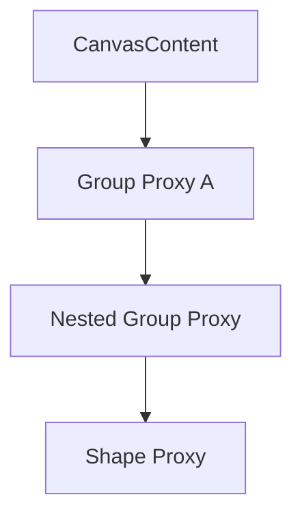

# 实现嵌套 Group 与统一层级变换

## 目标

支持把同一父容器中的多个 Item 组成 Group，整体移动、旋转和等比缩放；允许
Group 嵌套，并保证 Renderer、Picking、边界计算、Path
节点编辑和导出采用相同的变换结果。

## Group 结构与分组边界

Group 是一个具有 `CanvasItem` 身份的 ECS Entity，包含名称、局部
`Transform` 和 `CanvasItemOrder`。它可以作为 Layer 的顶层
Item，也可以作为另一个 Group 的子项。Shape、Text、Connector 均可进入
Group。

分组只接受同一父容器中的多个 Item。父容器可以是同一
Layer，也可以是同一个 Group；跨 Layer 或跨 Group
选择直接拒绝，用户需要先移动 Item 到同一容器。这样不会在分组时悄悄改变
Layer 归属。

创建 Group 时以所选 Item 的父容器局部边界中心作为 Group 原点。Group
初始旋转为 0、缩放为 1；子项 Transform 转换为相对 Group 的局部
Transform，保持屏幕位置、尺寸和顺序不变。取消分组时，将 Group
的局部变换组合回子项，并按 Group 原来的位置展开子项。

## Group Transform 使用等比缩放

Group 支持局部平移、绕 Z 轴旋转和正数等比缩放，约束 `scale.x == scale.y`
且 `scale.z == 1`。组级缩放默认保持宽高比。

这个约束是为了与现有 Shape 的 Bevy `Transform` 模型保持可逆组合。若
Group 使用非等比缩放，再叠加旋转的子
Shape，合成结果可能包含剪切；剪切无法无损写回现有 TRS Transform。等比
Group Transform 与子项 TRS 组合后仍可表示为
TRS，因此取消分组可以保留视觉结果，而不需要将 Geometry 烘焙成新的 Path。

## 统一层级变换解析

Renderer 为每个 View 镜像 Document 的 Group 层级：每个 Group 对应一个
Group Proxy，子 Group Proxy 和 Shape Proxy 挂在对应父 Proxy 下。Shape
Mesh 仍来自共享 MeshCache；Group Proxy 只承载局部 Transform 和结构。

Bevy Transform Propagation 在渲染代理树中组合 Group 与 Shape
Transform。模型侧不直接依赖 Document 的 `GlobalTransform`，因为 Canvas
现有坐标约定明确忽略 Document 根 Transform。

输入、命中检测、选择边界、Group
Bounds、节点编辑和导出使用同一个局部到文档坐标解析函数：从 Item 向上遍历
Group 祖先，按顺序组合局部 Transform，得到 Document-space
Affine。Renderer 代理树的最终 GlobalTransform
必须与该解析结果一致，并通过测试对照。不能让命中使用局部
Transform、渲染使用父级 Transform、导出又忽略 Group。

## 组选择与组内编辑

普通选择优先将 Group 作为一个整体选择。CanvasView 增加组内编辑路径：双击
Group 或调用公开的 EnterGroup 操作进入组内，之后可以选择其子项；Escape
退出当前层级。嵌套 Group 可以逐层进入和退出。组内编辑路径是 View
状态，不写入 Document。

## 完成条件与验证

-   分组、取消分组、嵌套分组、组内编辑和组级变换有确定性测试。
-   Group 只能接收同一父容器的 Item；跨容器分组明确拒绝。
-   分组/取消分组保持子项 Entity 身份、绘制顺序和视觉位置。
-   Group Transform 校验等比正数缩放；组级缩放保持宽高比。
-   嵌套平移、旋转和等比缩放在 Renderer、命中检测、选择边界、节点编辑和
    SVG/PNG 导出中一致。
-   Renderer 为每个 View 建立独立 Group Proxy；销毁 View 时只回收该 View
    的代理，不影响共享 Document。
-   更新
    `crates/canvas/tests/COVERAGE.md`、`docs/design/modules/canvas.md`
    和 `docs/features/canvas.md`。
-   Gallery 通过 BRP 验证整体选择、组内编辑、嵌套变换和取消分组。

## 设计边界

Group 不烘焙成单个 Path，不实现 Symbol/实例复用、布尔运算、Group
混合模式或非等比组级缩放。Layer 的显隐与锁定由所属 Layer 决定，Group
不另建一套 Layer 状态。
