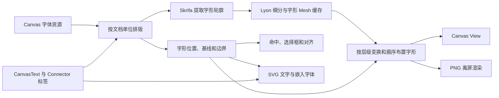

# Canvas 文字的矢量轮廓渲染

Canvas 在编辑视图和 PNG 导出中使用 Bevy `Text2d`。文字手柄改变绘图项的 Transform，滚轮改变 View 的投影。这两种放大都会把原字号生成的字形贴图拉大，放大组时也会出现同样的笔画模糊。[文字代理](../../crates/canvas/src/text.rs#L409) · [View 渲染](../../crates/canvas/src/renderer.rs#L248) · [PNG 文字绘制](../../crates/canvas/src/export/png.rs#L969)

方案把字体轮廓细分成 Mesh，按排版给出的字形位置和文档变换绘制。`CanvasText` 和 Connector 标签共用这条路径。用户通过原有接口编辑内容、字号、颜色和对齐方式，View 和 PNG 从同一套文字排版与轮廓生成逻辑取得绘制数据。

## 从排版到字形 Mesh

当前 `LayoutEngine` 已经用 Bevy `TextPipeline` 排版，并用 Parley 的字形位置和 Skrifa 的字形度量计算墨迹边界。渲染所需的派生数据从同一次排版取得，包括每个字形的字体、字形 ID、字号、局部位置以及排版采用的字体变化参数。多行基线、水平对齐和文字项的局部原点以排版为准。[排版与字形度量](../../crates/canvas/src/text.rs#L123)

Skrifa 从排版选中的字体提取字形轮廓。轮廓进入 Canvas 的局部坐标时，按字形基线换算字体坐标的 Y 轴方向。使用 Lyon 细分轮廓，保留字形内部的镂空，例如 `O` 和「回」。空白字符的宽度由排版计入。命中、选择框、对齐和导出区域使用文档坐标下的排版与墨迹边界。

字形 Mesh 缓存按字体、字形 ID 和影响轮廓的参数复用几何。颜色由绘制时的材质提供，位置和旋转由变换提供。同一文档的两个 View 可以使用相同的字形布局，并分别依据各自的输出像素密度选用合适的轮廓精度。

曲线细分精度以输出像素中的轮廓误差衡量。文字项、父组和 View 的缩放会共同放大这个误差，PNG 则以导出倍率衡量。例如同一段文字在主视图放大四倍、辅助视图保持原倍率时，主视图对曲线精度的要求更高。用低倍率的小字和高倍率的曲线字形共同确定细分容差与抗锯齿设置。缓存粒度、容量以及是否需要多个精度档位，由实测确定。[Canvas 的路径细分](../../crates/canvas/src/path/geometry.rs)

## 编辑视图与导出

View 渲染器按 Canvas 的 Layer、Group 和绘图项顺序绘制文字。Connector 标签使用路由解析后的标签位置，并保持标签与连接线路径之间的叠放关系。内容、字号和对齐变化时更新排版与字形布置。对象和父组变换作用于排版后的字形。

PNG 使用导出请求的文档快照和同一套字形轮廓绘制。捕获时机依据字形 Mesh 和离屏渲染资源的就绪状态。分块导出使用统一的像素密度，跨块文字与裁剪边缘采用相同的曲线精度。SVG 写入 `<text>`、行基线和嵌入字体，保留可编辑文字。[PNG 导出准备](../../crates/canvas/src/export/png.rs#L909) · [SVG 文字写入](../../crates/canvas/src/export.rs#L443)

## 验收

- 在 `crates/canvas` 验证字形位置、字形镂空、多行基线、水平对齐和中英文混排。覆盖空字符串与空白字符，并核对排版边界和选择框。
- 验证文字项拉伸、父组缩放和两个 View 使用不同倍率时的字形清晰度与文档位置。验证 Connector 随锚点移动后，标签仍位于路由上指定的位置。
- 比较同一文档在低倍率与高倍率下的 View 截图和 PNG 导出。检查字形边缘、镂空、画序和跨分块文字，核对 SVG 中的文字与字体。
- 分别测量首次生成轮廓 Mesh 和缓存命中后的连续缩放。记录帧耗、Mesh 数量与缓存占用，覆盖重复字形和大量不同中文字符两类场景。[Benchmark 规则](../../rules/benchmark.md)
- 用现有 Gallery 的流程图或九宫格做 BRP 演示，核对放大、编辑文字和导出的主要流程。Canvas crate 的行为与回归按工程标准审查。[Code Review 规则](../../rules/code-review.md#gallery-演示的审查标准)

## 范围与约束

首期覆盖当前内置默认字体、现有单样式 `CanvasText` 和 Connector 标签。字形 Mesh 属于渲染派生资源，Document、历史和剪贴板记录文本、样式与变换。

字体或轮廓处理错误沿 Canvas 的诊断通道报告，PNG 导出通过已有的任务失败路径结束。
