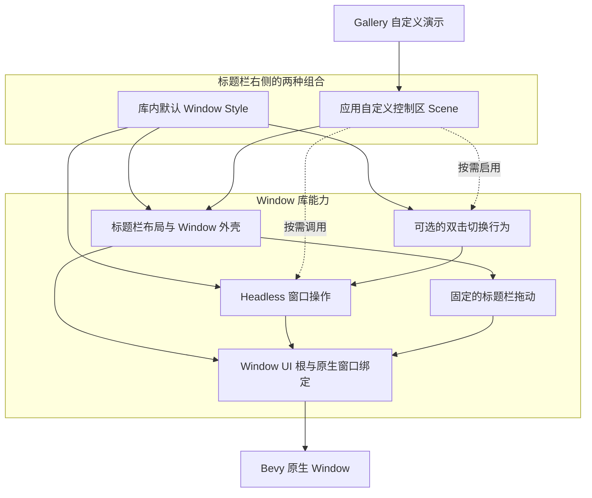
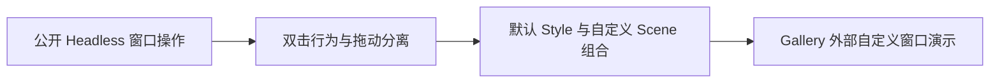

# Window 标题栏控制能力与外观解耦

目前 Window 使用自绘标题栏。右上角的最小化、最大化／还原、关闭按钮由库直接创建：按钮实体附带内部专用标记，图标和布局固定在标题栏 Scene 中，相应 Observer 执行窗口操作；双击标题栏的最大化／还原则与拖动逻辑放在一起。这样的默认窗口可以直接使用，却无法让应用仅替换右上角区域，同时保留独立的窗口操作能力。

这次调整不重建整个 Window。保留原生 Window、Camera 与 UI 根之间的绑定及已有的窗口外壳，只将右侧控制区分为可复用行为和可替换外观。库负责提供无固定 UI 的窗口操作与可选的双击能力，再以它们构建现有默认 Style；应用可以通过 BSN 提供自己的一整块控制区，选择调用任意部分的窗口能力，或完全使用自己的业务操作。

## 稳定的职责边界

Headless 不负责把操作绘制成按钮，也不规定右上角必须有三个位置。最小化、最大化、从最大化恢复和请求关闭是可复用的动作；标题栏双击切换最大化／还原则是应用可以选择挂接的输入行为。默认 Style 使用这些能力恢复现有交互，应用的自定义控制区可以不使用某些动作、改变顺序或数量，甚至放置与窗口系统操作无关的控件。

标题栏可拖动区域的鼠标拖动属于 Window 外壳的固定机制，不随默认 Style 或自定义控制区而关闭。它也不能抢走自定义可交互子控件的输入。窗口按钮原生可用性继续由已有的 `Window.enabled_buttons` 表达；重构不重新设计该属性，也不把隐藏按钮当成禁用原生操作。

可自定义的是**右上角整个控制区域**，不是三个只能替换图标的槽位。外部通过项目现有 BSN/Scene 组合能力提供内容，不引入另外一套 UI Builder。默认 Style 继续使用现有的内建图标、状态配色及三按钮布局；外部 UI 的视觉状态则归外部管理。库负责窗口绑定、拖动、关闭请求与生命周期，不因自定义外观而转移这些责任。

## 实施关系

依次先独立开放操作，再将双击操作从拖动中拆出，之后才让右侧控制区切换默认与自定义组合。最后的 Gallery 示例作为真实消费者，只使用公开接口验证自定义路径。Gallery 的演示依赖右侧 Scene 注入和 Headless 操作，但库不依赖 Gallery。

## 方案导航

1. [公开 Window Headless 窗口操作](01-公开Window-Headless窗口操作.md)
2. [标题栏双击最大化行为可选化](02-标题栏双击行为可选化.md)
3. [默认 Window Style 与自定义控制区组合](03-默认Window-Style与自定义控制区组合.md)
4. [Gallery 外部自定义窗口演示](04-Gallery外部自定义窗口演示.md)
