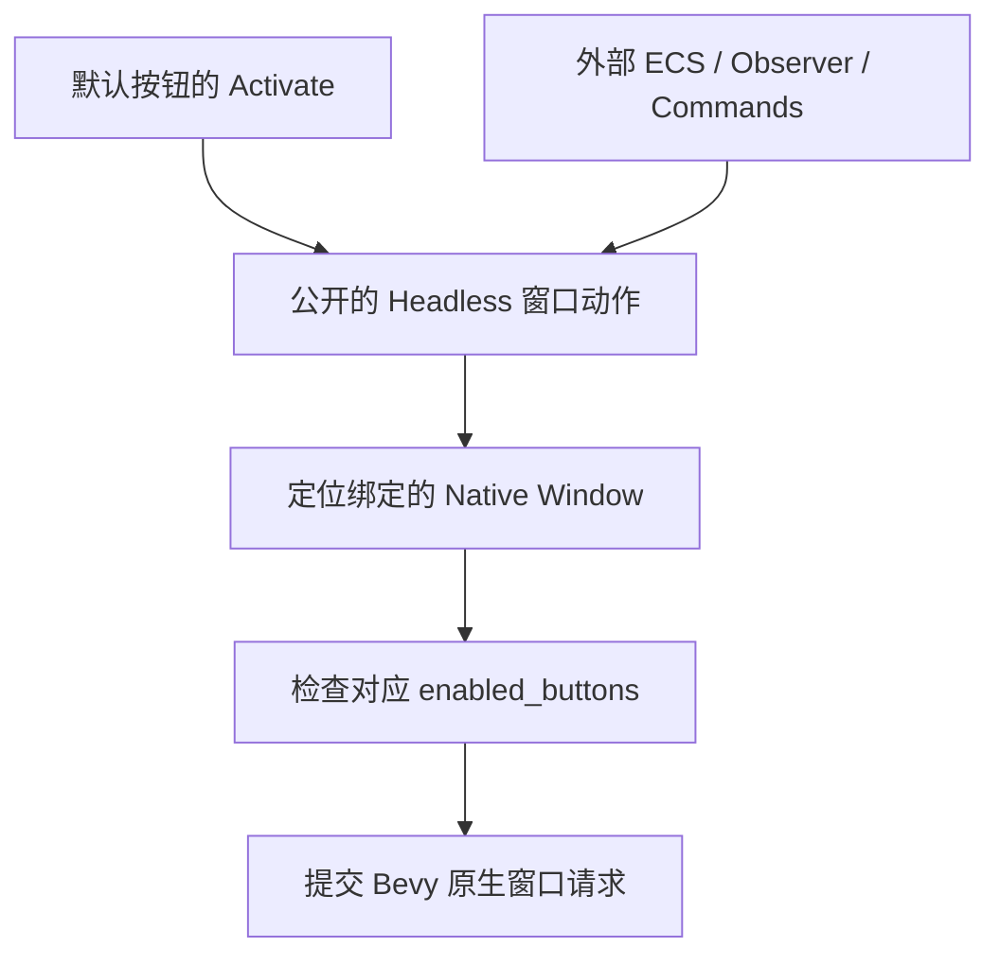

# 公开 Window Headless 窗口操作

## 独立目标与设计思路

让 Window 模块中的窗口系统操作可以不依赖内建的三个按钮而单独调用。完成后，即使调用方没有使用默认图标、默认按钮实体或默认控制区，也能对自己创建的 Widgetry Window 发起最小化、最大化、恢复和关闭请求。当前默认窗口在这一阶段仍然保持原有外观和行为，只是改为复用同一套公开操作。

这里所说的 Headless 是**没有固定视觉内容的窗口操作能力**，不是再创建一个与现有 Window UI 根并行的窗口实体，也不要求把 Owned/Borrowed、渲染初始化、缩放、模态和正文布局重做一遍。

## 动作的语义与目标窗口

操作集合包括：

- **最小化**：请求把目标窗口最小化，对应当前实现的 `Window::set_minimized(true)` 语义。
- **最大化**：请求最大化目标窗口，而不是假设当前按钮一定处于未最大化状态。
- **恢复**：专指**从最大化状态还原**，与从最小化状态重新显示窗口不是同一个概念。两种“恢复”不能在公开名称与文档中混用。
- **关闭**：提交 `WindowCloseRequested`，不在动作本身里无条件销毁 UI 根、相机或原生窗口。Gallery 和其他宿主仍可以按自己的关闭策略处理请求。

已有窗口系统必须知道动作作用于哪一个原生窗口。对使用 `widgetry_window` 的 Borrowed 窗口和使用 `owned_widgetry_window` 的 Owned 窗口，都应沿用 `WindowRoot` 保存的目标绑定，不允许从当前焦点窗口或第一个原生窗口推断目标。公开调用不应要求外部依赖 `MinimizeButton`、`MaximizeButton`、`CloseButton` 等私有组件，或手动遍历标题栏内部实体树。

对外可使用项目已有的 Bevy ECS 操作方式，供 `Commands`、`World` 和用户 Observer 组合。具体 API 名称、是动作命令还是关联方法，以及同步调用是否返回领域错误，在实现时按 Window 现有 API 规范确定；确定前不额外发明一套平行的窗口命令总线。无论采用哪种外形，外部必须能在 BSN 自定义控件的激活回调中针对指定窗口调用动作。

## 将旧按钮行为委托给新能力

当前的三个默认按钮分别在 `title_bar/minimize.rs`、`title_bar/maximize.rs`、`title_bar/close.rs` 处理 `Activate`。这些内部入口可以保留以服务默认 UI，但不再是窗口动作唯一的入口。按钮处理层仅负责识别默认按钮、找到所属窗口，然后转调公共动作，避免复制两套最大化状态判断、可用性检查或关闭请求发送逻辑。

最大化状态的实际来源仍应沿用现有的原生窗口状态判定，尤其不能仅根据按钮图标或尚未生效的请求推断当前窗口一定已最大化。该状态未来还需要被自定义外观读取，以决定显示“最大化”还是“还原”，因而操作层不应把状态信息藏在默认图标同步的内部流程里。状态读取的具体公开形态可以与第三份方案中的外观消费方式一起确定，但状态的权威来源在本阶段必须明确。

举例说，自定义的“放大”按钮可以只调用最大化，另一处“还原”按钮只调用恢复；它们不需要使用默认三按钮组件，也不需要由库替它们插入 SVG。

## 原生开关与现有窗口行为

`Window.enabled_buttons` 继续承担已有的原生可用性语义。公开动作应与旧默认按钮的权限检查保持一致：最小化对应 `minimize`，最大化／从最大化恢复对应 `maximize`，关闭对应 `close`。这不是新造一份 Headless 权限配置，也不是把配置当成不可绕过的安全系统。

原生标题栏已因 `decorations = false` 被隐藏，但原生窗口操作能力依然存在。自绘按钮是否出现是视觉构造问题，不能改变对 `enabled_buttons` 的理解。窗口不能缩放的配置、三按钮的可见性配置以及它们的原有关系也不在本阶段重新定义。

## 验证与完成条件

- 从没有默认控制按钮的调用方直接发起四种动作，确认每个动作作用在指定 Native Window 上；Owned 与 Borrowed 都可用。
- 两个以上同时存在的窗口互不串扰；错误或已失效的根绑定不会意外操作其他窗口。
- `enabled_buttons` 对应位关闭时，公开操作和默认按钮的处理一致，不发送本应拒绝的请求。
- 关闭操作产生 `WindowCloseRequested`，验证允许宿主拦截或自行处理，而不是在 Headless 层强制结束整个应用。
- 默认三个按钮的最小化、最大化／还原、关闭能力仍可用；行为共享新的操作入口而非重复实现。
- 对恢复含义及目标绑定的公开使用方式更新 `docs/features/window.md`；操作权威或职责变化同步到 `docs/design/modules/window.md`。

## 实现边界

这一增量不负责开放右上角 Scene 注入，也不修改原有按钮的图标、尺寸和颜色。它只交付可复用的窗口动作与现有默认按钮的委托关系。

对外公开的是必要的操作能力，而不是通过 `pub` 直接泄露内部按钮标记、`WindowRoot` 结构细节或样式遍历逻辑。无效目标及操作失败的处理应遵循 Window 的错误语义，不借重构引入绕过窗口绑定的新通道。
