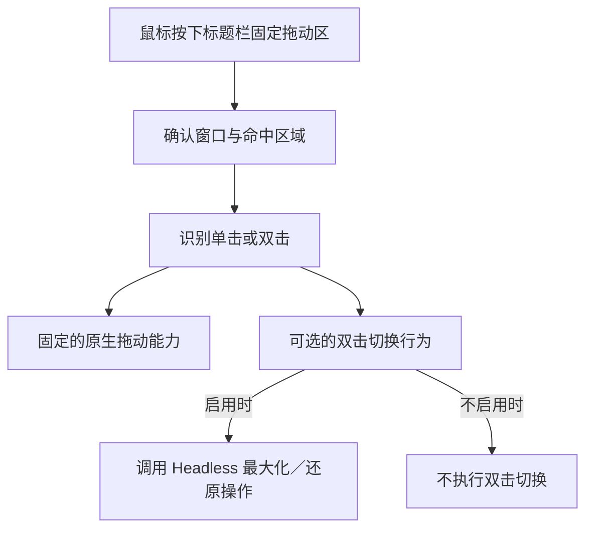

# 标题栏双击最大化行为可选化

## 独立目标与设计思路

使“在标题栏空白处双击，以切换最大化／还原”成为可选的 Headless 行为，同时**保持标题栏拖动窗口为内部固定能力**。这一增量完成后，默认标题栏仍可双击最大化；以后不使用该行为的自定义标题栏也能正常拖动窗口。

当前 `title_bar/drag.rs` 的 `on_title_bar_press` 同时识别双击并调用最大化切换，然后在一般按下场景执行 `window.start_drag_move()`。这里需要分离的是两种行为的决定权，而不是把标题栏拖动也暴露成用户必须重新组合的控件。

图中的拖动与双击分支表示职责分离，不表示同一次输入必须先拖动、再最大化。双击被识别并处理时仍应避免额外启动不合适的拖动请求。

## 固定拖动与可选双击的边界

窗口外壳继续拥有真正的 `TitleBarDragArea`，只接受与目标原生窗口匹配的鼠标输入。标题栏中加入的输入控件不能被底层拖动行为抢走事件；例如 Gallery 在标题栏放入设置选择器或自定义右侧按钮时，点击控件不会开始拖动窗口。

双击部分保留已有符合 Windows 桌面行为的识别条件：鼠标主键、同一窗口、同一拖动区域、系统双击时间与位置容差，并且按真实事件目标筛选。它不应由默认按钮的 `Activate` 触发，也不应把不同原生窗口的点击拼成一次双击。

最大化切换本身调用第一份方案中的 Headless 窗口操作。是否已最大化依据当前原生窗口状态判断；切换必须继续服从 `Window.enabled_buttons.maximize` 的现有约束。默认 Style 选择安装这一双击行为；外部自定义组合可以不启用该行为，或选择使用自己独立的双击处理，不需要为了关闭双击最大化而去关闭标题栏拖动。

这里的“可选”意味着**构造时可选择是否挂接**，而不是额外叠加一套运行时全局开关。具体的 BSN 组合形式或 Observer / Component 外形，随项目现有 Scene 与 ECS API 确定。

## 默认样式的过渡行为

拆分双击处理后，默认窗口仍应有与当前相同的用户体验。默认标题栏空白处双击仍切换最大化／还原，单次按下仍拖动，右上角已有按钮仍按各自操作响应。这个阶段不要求先实现完整的外部控制区替换；默认接线可以暂时沿用当前标题栏的构造路径，下一增量再统一到默认 Style。

不应把双击处理与某一个图标实体绑定。即使右上角三个按钮隐藏或被自定义 Scene 替换，空白拖动区域是否支持双击也只由其选用的行为决定。

## 验证与完成条件

- 默认窗口的单击拖动和双击最大化／还原表现与重构前一致，且不会发生一次双击同时重复启动拖动的异常。
- 关闭可选双击能力后，连续两次按下标题栏空白不会产生最大化请求；单击拖动仍可用。
- `Window.enabled_buttons.maximize = false` 时，默认双击不触发最大化／还原；保留拖动能力。
- 多窗口输入不会互相组成双击，超出系统双击时间或容差的两次点击不会触发切换。
- 标题栏中的自定义交互子控件接收自己的 Pointer 输入，不意外触发拖动或默认双击切换。
- 完成与本增量相关的输入交互回归测试，并在 Window 功能文档中说明双击能力可选、拖动固定的区别。

## 实现边界

不修改 `Window.enabled_buttons` 的定义或语义，不为标题栏拖动提供新的可替换入口，不改动边缘缩放行为。此增量也不负责右侧按钮的 Scene 自定义能力。
