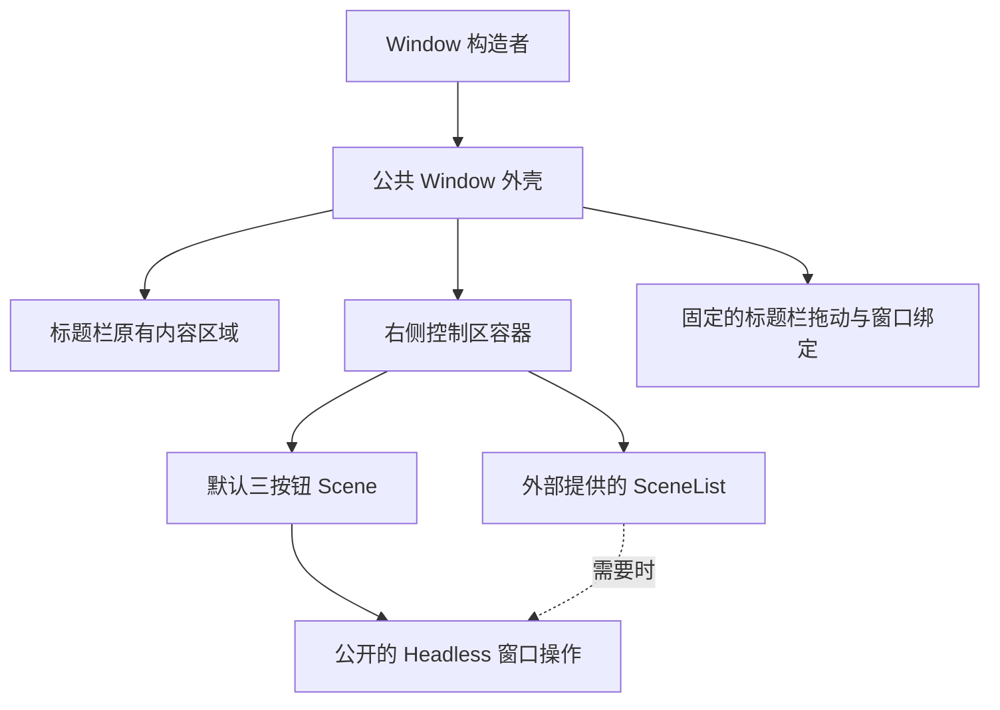

# 默认 Window Style 与自定义控制区组合

## 独立目标与设计思路

让外部应用能够直接替换自绘标题栏**整个右上角控制区域**，而不是只能替换三个内置图标。库中的默认三按钮继续作为一种现成的 Window Style；应用则通过 Bevy BSN 传入任意 Scene/SceneList，自行决定控制区的数量、排列、尺寸、内容及响应行为。完成这一增量后，默认与自定义窗口在同一套 Window 外壳、Headless 操作及原生窗口绑定之上运行。

当前 `title_bar/bar.rs` 已将标题栏内容和 `WindowControls` 放在同一个横向布局内，`scene.rs` 又将 `title_bar_content` 作为外部 SceneList 接收。因此不必再定义三份固定 Slot，也不必让 Gallery 接触内部三按钮组件。可以延续已有的 BSN 组合方式，把右侧控制区本身变成一个可替换的 Scene 内容入口。

默认与自定义分支表示两种互斥的**构造选择**，不是同时绘制两套按钮。

## 两层能力如何组合

### Window 外壳保留什么

公共外壳继续负责 UI 根绑定的 Native Window 和 Camera、标题栏及正文布局、窗口角和背景、固定拖动区、边缘缩放、焦点／模态作用域以及 Owned/Borrowed 生命周期。外部替换右侧内容，不意味着外部必须重新实现原生透明窗口初始化、关闭后的资源回收或其他窗口基础设施。

原有标题内容入口继续负责标题栏左侧／可伸缩内容区域，标题文本依然通过已有的 `WidgetryWindowTitle` 与 Native Window 同步。右侧自定义只影响控制区，不能改写标题更新、正文业务树或外壳其他模块的输入职责。

### 默认 Window Style 保留什么

库内部提供默认三按钮 Scene，使用现有 `BuiltinIcon::WindowMinimize`、`WindowMaximize`、`WindowRestore`、`WindowClose` 图标、46 像素宽的默认按钮节点、16 像素图标和现有悬停／按下／禁用配色。默认最小化、最大化／还原、关闭按钮分别调用公开 Headless 窗口操作；默认标题栏同时选用可选的双击最大化／还原行为。

`WidgetryWindowControlsConfig` 目前包含 `minimize_visible`、`maximize_visible`、`close_visible`、`resizable`。其中前三个字段描述默认自绘系统按钮是否显示；`resizable` 影响外壳边缘缩放区域。重构中应明确区分这两类职责，不让默认按钮的可见性布尔值意外决定外部自定义 Scene 是否创建。实际参数形态可以随新的 Scene 入口调整，不要求保留旧函数签名，但默认使用时的可见行为应一致。

默认的 `WidgetryWindowColorOverrides` 与 Theme 仍然控制默认窗口外壳及三按钮的颜色。自定义 Scene 可以复用库的通用视觉组件、Theme 和基础按钮，也可以自行实现外观；Window 不递归重写它的业务内容或私有颜色。

### 自定义控制区需要什么入口

外部控制区作为**一整块 BSN Scene/SceneList** 注入，可以有三个、四个或零个按钮，也可以包含文字、菜单、状态指示、复合控件等。其布局应能调整宽度、间距和对齐方式，不再强制把任意子项塞进默认的三份 46 像素按钮节点。公共 Window 外壳只为它提供在标题栏右侧的组合位置及必要布局约束。

外部自定义控件通过自己的 `Activate` Observer 或其他 Bevy 输入逻辑处理业务操作。如需最小化、最大化、恢复或关闭，则调用第一份方案公开的 Headless 操作；如果只是打开设置、切换工具面板，也无需触发任何系统窗口动作。按钮样式、Cursor、Disabled 的可见反馈由该控件的组合决定，窗口的系统操作入口仍会按原有 `Window.enabled_buttons` 判定相应动作是否可执行。

这里不用为“替换某一个图标”和“替换整个按钮”分别设计平行 API：简单换图标也可以由外部提供一个相应的 `WidgetryIcon` Scene 实现。对外公开的是控制区的组合入口，默认构造方法负责提供现有完整的默认视觉。

## 默认逻辑如何避免接管自定义内容

当前有两处值得拆开：

- `title_bar/maximize.rs` 的 `sync_maximize_state` 会查找内部 `MaximizeButton` 后代，并把子 `WidgetryIcon` 改成最大化或还原图标。改造后只应由**默认 Style 的图标适配**执行这项替换；外部自定义控件即使显示自己的最大化状态图标，也不能被库改写成内置 SVG。
- `title_bar/controls.rs` 的 `sync_enabled_buttons` 与 `style.rs` 的颜色系统按内部 `MinimizeButton`、`MaximizeButton`、`CloseButton` 标记定位默认按钮。改造后，这些默认样式相关标记只服务默认 Style，不应成为外部调用系统操作的前置条件，也不应令自定义组件被强制禁用或重上色。

原生窗口最大化状态与控制区视觉是两回事。公共层只维护／读取真实的窗口状态，默认 Style 依据它投影图标；外部 Style 有需要时也能够读取同样的状态，自己决定文字、图标或禁用反馈。若现有公开接口不足以支持这种读取，应提供恰好满足自定义显示所需的查询／通知，不额外创造一份与 Native Window 互相同步的状态权威。

例如，Gallery 可以把右侧排列为“设置｜最大化／恢复｜关闭”，而另一应用可以只放“关闭”与一个自定义菜单按钮；没有选用的系统动作不会因 Window 的默认 Style 而自动产生。

## 控制区命中与窗口交互

标题栏的固定拖动区必须继续工作，但鼠标落到自定义控件上时，输入由那个控件处理，而不是因其处在标题栏内就执行窗口拖动或双击最大化。当前右侧的容器使用 `Pickable::IGNORE`，实际交互在子控件上；改造应保持等价的命中分工，并根据 Scene 自定义内容的真实结构验证。

默认 Style 仍选择 Headless 双击切换行为；外部自定义组合可以不选择它。不能把“渲染默认三个按钮”作为启用标题栏拖动的必要条件，更不能因外部没有使用双击切换行为而取消拖动。

## 验证与完成条件

- 默认窗口不提供自定义控制区时，外观、按钮顺序、默认图标、悬停／按下／禁用颜色、可见性及功能与原实现一致；最大化状态变化后能切换内置最大化／还原图标。
- 外部通过公开的 BSN/Scene 接口提供一整块右侧控制区，能改变控件数量、宽度、排列、图标和事件回调，而不借用内部私有标记或修改库代码。
- 外部自定义内容可以调用公开的最小化、最大化、恢复、关闭操作；也能调用完全不同的业务动作，或根本不绘制系统窗口按钮。
- 自定义控件的 `WidgetryIcon`、颜色、布局和 Disabled 展示不被默认 `sync_maximize_state`、默认按钮禁用同步或窗口 Style 刷新意外覆盖。
- 自定义按钮可正确命中并激活；标题栏空白拖动区域仍能移动窗口；可选双击处理符合组合选择。
- Theme 切换、窗口最大化状态变化，以及 Owned/Borrowed 和 Modal 场景不会破坏默认外观或外部子控件树。
- Window 的功能页给出默认与自定义 BSN 示例、默认开关的适用范围和实际窗口操作绑定方法；相应模块设计文档说明状态与 Style 的职责分离。内部窗口外壳关系若改变，同步更新整体架构的相关事实。

## 实现边界

本增量只开放右侧控制区，保持左侧标题栏内容入口、窗口正文及基础外壳语义。不要通过公开内部 `TitleBar`、`WindowControls` 或默认三按钮专用 Component 来代替 Scene 组合接口。

外部的 UI 内容属于外部组件，不由 Window 样式系统递归遍历、重新构造或代为决定业务行为；只有默认 Style 的内部实体应受默认系统按钮视觉同步管理。库不因 Gallery 的演示需求而增加 Gallery 专属图标或组件依赖。
