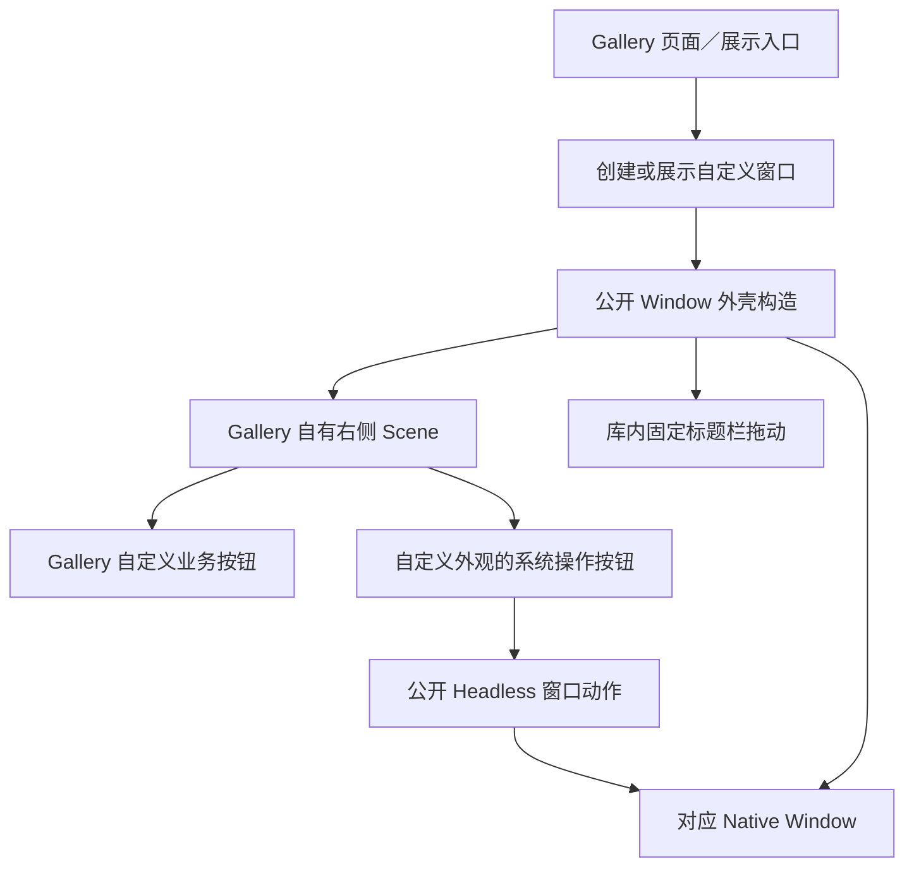

# Gallery 外部自定义窗口演示

## 独立目标与设计思路

在 Gallery 中加入一个用户可以实际打开和操作的**外部自定义窗口**示例，证明右侧控制区的扩展能力不依赖库内部私有组件。这个增量不再改造 Window 的 Headless 或默认 Style 机制，而是把 Gallery 当成普通调用方，只通过公开的 Window API 和 BSN Scene 自行完成视觉与动作组合。

示例需要让人一眼看出“默认窗口不是唯一外观”：右上角控件的排列、内容和触发行为都与内建三按钮有所区别，同时它仍然拥有可移动窗口、正常正文和原生窗口生命周期。用户能够比较默认窗口和自定义窗口，而不是只在测试中构建一个看不见的 Scene。

## 演示应展示的实际能力

Gallery 通过已有导航／展示机制提供明确入口；入口可以设置为页面中的演示触发点，也可以由展示页打开独立窗口，具体位置按 Gallery 当前组织方式确定。示例必须是应用内可见、可操作的窗口，不能只给一个静态截图或文档片段。

自定义控制区应直接使用 Gallery 自己写的 BSN Scene，而非在库里注册另一套名为“Gallery Style”的默认系统按钮。其 UI 需要有实质性的区别，例如用自定义图标／文字组合替代原来等宽的三个按钮，增减按钮数量，或在系统操作旁增加一个 Gallery 专属的设置／说明动作。具体图标与文字按现有 Gallery 主题和交互习惯选择，不要求做一套新的全局 UI 风格。

示例至少证明两种不同的调用路径：

- 自定义外观的控件调用公开的窗口系统操作，能够在自己的目标窗口上完成最小化、最大化／还原和请求关闭中的相关行为，且无需使用默认三按钮内部 Component。
- 自定义外观的控件可以执行 Gallery 自己的业务操作，不受 Window 默认按钮处理逻辑强制绑定。这个控件可以不是三个默认系统按钮之一。

为直观体现 Headless 的可选性，演示应显式选择双击标题栏切换最大化／还原的启用或不启用，并让这一选择与“仍可拖动标题栏”形成可观察对比。最简单的展示方案是**关闭该示例窗口的双击最大化行为，但保留拖动**；默认窗口继续保留双击切换。若采用其他对照方式，也必须让用户能验证两者是独立能力。

示例窗口的最大化／还原视觉应依据实际原生窗口状态更新，而不是只在点击自己的按钮后切换图标。这样通过其他合法途径发生的状态变化不会让自定义 UI 与真实窗口状态失配。颜色和背景使用 Gallery 已有 Theme/Asset 机制；Gallery 专用图标留在 Gallery 的 Asset 管理中，不移入库内建资源。

## 关闭请求与窗口拥有关系

Gallery 现有主窗口有自己的退出、关闭确认及托盘行为。新增演示窗口的“关闭”不应在没有区分目标窗口的情况下触发主窗口退出或隐藏。它通过 Headless 提交的仍是作用于目标窗口的 `WindowCloseRequested`；由 Gallery 已有的窗口关闭策略处理，必要时增加仅限演示窗口的正确路由。

示例可根据现有 Gallery 结构采用 Owned 或 Borrowed 方式创建。关键是公开 Window 构造路径应足够完成自定义，而不是通过直接操作内部 WindowRoot 或标题栏后代打补丁。若示例拥有独立窗口，其 UI 根与原生窗口回收仍交给原有的 Owned/Borrowed 生命周期机制，不为了演示另做一份回收规则。

## 可观察验收

- 从 Gallery 的正常入口可以找到并打开自定义窗口；展示的右侧控制区在图标、布局或按钮数量上与默认三按钮明显不同。
- 自定义控制区的系统操作能改变**示例窗口**，不会误操作 Gallery 主窗口；业务按钮能够执行自己的操作，不调用系统最小化／最大化／关闭逻辑。
- 不启用示例的双击切换时，双击标题栏空白不应最大化／还原；单次拖动仍能移动窗口，且交互子控件的点击不会拖动窗口。
- 通过自定义最大化／恢复控件与其他合法窗口状态变化途径，窗口实际状态和自定义视觉保持一致；库的默认 SVG 同步不替换自定义内容。
- 正常主题切换、悬停和禁用状态不会破坏自定义控件，默认窗口仍显示原有三个系统按钮并保持原有交互。
- 关闭演示窗口后没有遗留不可用的子窗口、相机或 UI 根；Gallery 主窗口及其托盘／关闭流程继续正常工作。
- 演示具有与其行为直接相关的 GUI／BRP 回归覆盖，并按 Gallery 现有结构补充可发现的入口说明。综合验证第一至第三份方案所交付的公开能力，但不把复验独立拆成只负责测试的实施增量。

## 实现边界

Gallery 只消费公开的 Headless 动作和控制区 Scene 组合接口。不能为了做出效果而查询或覆盖库内部 `MinimizeButton`、`MaximizeButton`、`CloseButton`，也不应直接改写默认 `WindowControls` 的内部子树。

本阶段不修改 `Window.enabled_buttons` 的含义，不为 Gallery 额外创建独立的标题栏拖动实现，不要求把 Gallery 主窗口整体替换为自定义外观。展示目的在于证明**一个外部使用者**确实能够选择自己的右上角 UI 和行为，而默认 Window Style 仍可与之共存。
