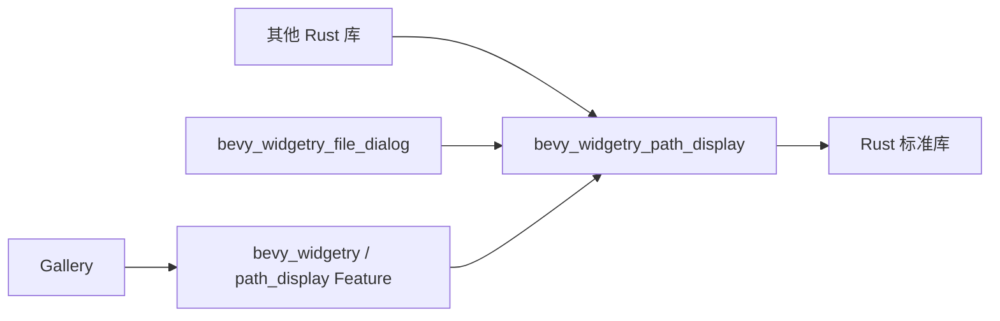

# 将 display_path 提取为独立 Crate

本文是待实施方案，尚不表示 Widgetry 已提供该 Crate。当前只保存方案；后续实施时，将新 Crate、现有调用点迁移及必要文档同步作为一个提交交付。

## 要解决的问题

Windows 的 `canonicalize` 等操作可能返回带有 `\\?\` 前缀的路径。文件操作需要保留这些路径，但界面通常希望显示熟悉的磁盘路径或 UNC 路径。Agentelier 的登录和目录设置已经需要这一能力，其他应用也可能需要直接调用。

Widgetry 当前已有同类内部实现，但调用方需要依赖 FileDialog 或自行复制逻辑。目标是提供一个只依赖标准库的独立能力，并让现有显示入口使用同一实现。

### 已核对的当前实现

| 位置 | 当前职责 | 后续处理 |
| --- | --- | --- |
| `crates/file_dialog/src/style.rs` 的 `display_path` | 简化磁盘和 UNC 的 Verbatim 前缀，用于地址栏等文字 | 提取实现，改用新 Crate |
| `crates/file_dialog/src/controls.rs` | 通过 `crate::style::display_path` 生成路径文字 | 直接调用新 Crate |
| `crates/file_dialog/src/input.rs` | 通过显示文字识别当前路径，避免无变化时重复导航 | 改用相同公共函数，保留原有判断语义 |
| `gallery/src/pages/window/file_dialog.rs` 的 `bounded_path` | 先转换路径文字，再按字符数截断结果摘要 | 复用新函数，只保留 Gallery 的摘要截断 |
| `crates/file_dialog/src/icons/native.rs` 的 `shell_path` | 为 Windows Shell 构造保留 UTF-16 单元的路径 | 保持原有实现，不改用显示字符串 |

这些位置是本次静态核对结果。续接时应重新搜索实际调用点，不能把路径清单当成永久不变的源码事实。

## 独立能力的边界

新增目录 `crates/path_display`，Cargo Package 为 `bevy_widgetry_path_display`，公开一个函数：

```rust
pub fn display_path(path: &std::path::Path) -> String;
```

输入借用原始路径，输出用于呈现的拥有所有权的字符串。不增加配置、状态对象、Plugin 或自定义路径类型。

新 Crate 只依赖 Rust 标准库，不依赖 Bevy、Widgetry Core、FileDialog、日志或诊断模块。它可以由其他 Rust 库直接依赖，无需初始化 Bevy 运行时。遵循当前仓库 Windows 64 位平台约束、入口编译期检查和 Workspace 的版本、Edition、Lint 配置；不在本任务中扩展平台支持。

Package 按现有库 Crate 惯例设置 `publish = false`。其他项目可以通过 Git 或 Path Dependency 使用，发布到 crates.io 不属于本次目标。

### 显示契约

| 输入示例 | 输出示例 |
| --- | --- |
| `\\?\C:\Users\用户\数据` | `C:\Users\用户\数据` |
| `\\?\C:\` | `C:\` |
| `\\?\UNC\server\share\目录` | `\\server\share\目录` |
| `\\?\UNC\server\share` | `\\server\share` |
| `C:\Users\用户\数据` | 原文字 |
| `\\server\share\目录` | 原文字 |
| `relative\目录`、空路径 | 原文字 |
| `\\.\COM1`、`\\?\Volume{...}\` 等其他命名空间 | 原文字 |

通过 `std::path::Component::Prefix` 和 `std::path::Prefix` 识别 `VerbatimDisk`、`VerbatimUNC`，只对这两类路径移除或替换对应开头。不能无条件删除所有字符串中的 `\\?\`。

以 Widgetry 现有实现为提取基础，保留前缀之外的文字，包括分隔符、尾部分隔符、大小写、空格、中文、`.` 和 `..`；不通过重新拼接规范化路径组件改变正文。转换不截断路径，摘要长度由上层决定。

无法用 Unicode 表示的路径按 `Path::display` / `to_string_lossy` 的语义使用替代字符。这是显示转换，不承诺可逆。不得把输出重新构造成文件操作路径，也不得用它替代 `PathBuf` 的比较、缓存身份、持久化或 Shell 接口所需的原始路径。

函数不访问文件系统，不调用 `canonicalize`，不验证路径存在性，不修改输入，也不产生新的日志或错误返回。

## 依赖与调用方式

在根 Workspace 注册新成员和内部依赖。FileDialog 直接依赖新 Crate，不能通过顶层 Facade 反向调用。

顶层 `bevy_widgetry` 增加显式可选 Feature `path_display`，通过模块 `bevy_widgetry::path_display` 导出公共函数。该 Feature 不加入默认集合；Gallery 显式启用它。FileDialog 自身的直接依赖无需启用 Facade Feature。



其他库直接使用：

```toml
[dependencies]
bevy_widgetry_path_display = { git = "https://github.com/slc90/bevy_widgetry" }
```

```rust
use bevy_widgetry_path_display::display_path;
use std::path::Path;

let text = display_path(Path::new(r"\\?\C:\Users\用户\数据"));
```

已有 Widgetry 应用也可显式开启 Facade Feature，再调用 `bevy_widgetry::path_display::display_path`。仅需要格式化的库应直接依赖独立 Crate，避免通过 Facade 引入 Bevy 等其他能力。

## 实施顺序

本任务是一个可独立交付的改动，不拆分成多个实施提交。

1. **核对与记录。** 读取当前适用规则和工作区状态，沿用或创建根目录任务进度记录。重新确认调用点、Feature 和依赖关系，保留与任务无关的本地修改。
2. **建立公共契约。** 添加新 Crate 的 Cargo 配置、平台检查和函数接口。按正式开发规则建立确定性回归保护，再完成最小实现。纯提取部分可按重构例外执行，不为流程人为制造失败。
3. **迁移实际使用方。** 删除 FileDialog 中重复的格式化函数，更新 `style.rs`、`controls.rs`、`input.rs` 的调用；增加 Facade 导出和 Gallery Feature，替换 `bounded_path` 中重复的前缀转换。保留现有摘要截断和文件操作语义。
4. **同步正式文档。** 新增 `docs/features/path_display.md`，说明直接依赖、Facade 使用、显示契约和非 Unicode 限制；更新 `docs/features/README.md` 与 `docs/design/architecture.md`。已有 FileDialog 文档若描述相关模块职责或显示行为，也应按实际影响同步。正式文档只在实现完成后更新。
5. **验证与独立 Review。** 执行下文检查，记录真实结果，再按 `rules/code-review.md` 和当前 `code-review` Skill 完成独立审查及必要修复循环。
6. **完成一次提交。** Review 通过后清理本任务进度记录及适用的 Baseline，检查暂存范围，提交完整改动。英文 Subject 可使用 `Extract reusable Windows path display crate`，以最终 Diff 为准。推送需另有用户指令。

### 测试保护

在 `crates/path_display/tests/` 从外部调用公共 API，并维护 `tests/COVERAGE.md`。不需要为简单转换额外引入测试依赖。

确定性覆盖应包含：

- Verbatim 磁盘路径及根目录、Verbatim UNC 共享根及子路径。
- 普通磁盘路径、普通 UNC、相对路径、空路径。
- 中文、空格、超过传统 MAX_PATH 长度的路径。
- 正文中的分隔符、尾部分隔符、`.`、`..` 不因提取而改变。
- 其他 Verbatim 命名空间、设备路径，以及并非开头前缀的相似文字不被误删。
- 使用 Windows `OsStringExt::from_wide` 构造非 Unicode 路径，验证有损显示契约。

保留并执行受影响的 FileDialog 测试以及 Gallery 现有 `bounded_path` 测试，保护调用方行为。测试使用默认并行执行，不使用 `--test-threads=1`。

### 验证范围与命令

修改 Workspace 成员及内部依赖后，正常更新 `Cargo.lock`；不升级无关依赖。完成 Lockfile 更新后，可用以下命令验证，具体以届时实际配置为准：

```powershell
cargo test -p bevy_widgetry_path_display --locked --offline
cargo test -p bevy_widgetry_file_dialog --locked --offline
cargo test -p widget_gallery file_dialog::tests --locked --offline
cargo check -p bevy_widgetry --no-default-features --features path_display --locked --offline
cargo check -p widget_gallery --locked --offline
cargo clippy -p bevy_widgetry_path_display -p bevy_widgetry_file_dialog -p widget_gallery --all-targets --locked --offline
cargo clippy -p bevy_widgetry --no-default-features --features path_display --all-targets --locked --offline
cargo fmt --all -- --check
git diff --check
```

Gallery 的测试过滤器应匹配 FileDialog 模块的实际测试名，确认测试输出包含路径前缀、摘要截断及原始路径保留用例，避免过滤后零测试却误报通过。TOML 使用仓库现有 Taplo 配置检查。通过 Cargo 依赖树确认直接依赖 `bevy_widgetry_path_display` 不引入任何外部库。

这是显示格式化实现的提取与复用，目标是保持已有 GUI 行为。如果调用方行为保持不变，以公共函数测试、现有回归测试及消费者编译作为验证；若实施中改变了可观察 GUI 行为，应根据 `rules/gui-debugging.md` 增加针对性 BRP 验证。此任务不作性能改善声明，不需要人为增加 Benchmark。

独立 Reviewer 使用全量 Working Tree Diff，包含未跟踪的新 Crate 和文档，仅排除精确的任务进度文件路径。每轮使用新的 Reviewer，完整遵循 Findings、Baseline、增量审查及最终全量审查规则；首次全量返回 `No review findings.` 时直接通过。

## 交付边界与续接

完成后应能由独立消费者通过 `bevy_widgetry_path_display::display_path` 调用；FileDialog 与 Gallery 共享同一套显示语义；真实路径和 Shell UTF-16 转换保持原有职责。

本提交不修改 Agentelier。后续在 Agentelier 中添加依赖、移除 `crates/login/src/path_display.rs` 等本地重复实现、调整导出与调用，并按该仓库规则验证和提交。Widgetry 的本地提交在推送前尚不能通过远端 Git 引用获取，两个仓库联调时可先使用本地 Path Dependency。

本方案尚未执行构建、测试或 GUI 验证；表格中的目标契约需要在正式实现时获得验证证据。续接从工作区、规则和任务进度核对开始，不将本文的实施步骤视为已完成记录。
