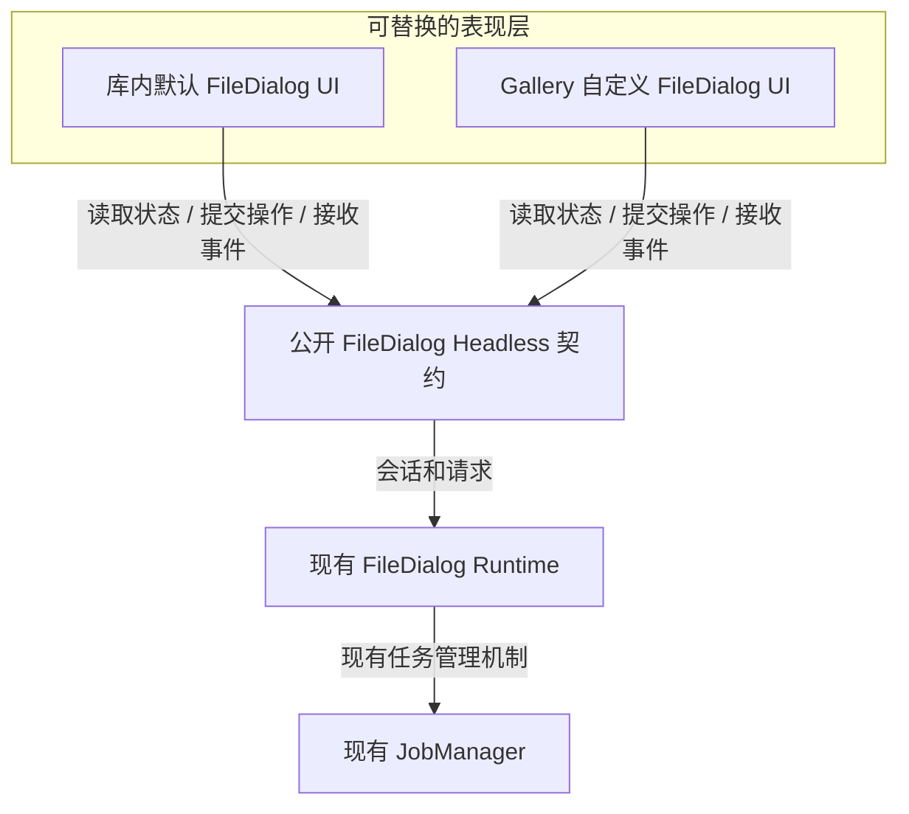

# 文件选择器 Headless 与可替换 UI 的整体设计

当前文件选择器已经有公开的文件选择状态、操作、结果事件，以及 `WidgetryFileDialogHeadlessPlugin`。但完整的 `WidgetryFileDialog` 仍把默认界面构建、输入解释、窗口管理与文件选择行为连在一起。外部虽然可以修改颜色、尺寸、过滤器、选择模式和文件系统后端，却无法只依赖公共能力重新编排整个界面。尤其是单文件确认等路径会从界面代码访问内部输入控件；这使“公开了状态”不等于“能独立实现 UI”。

目标不是增加一个新的主题皮肤，而是让**库内默认 UI 和 Gallery 自定义 UI 都成为同一个 Headless 文件选择能力的消费者**。Headless 负责文件选择会话及操作语义；UI 负责布局、控件实例、输入呈现、错误提示和窗口承载。Gallery 不复制文件系统、选择状态机、异步请求或任务取消逻辑。

这里的连线表示依赖方向，而不是要求 UI 直接操作后台任务。状态变化和结果由 Headless 通过公开契约交付给两种 UI。默认样式也不得绕开这份契约去使用 Gallery 无法使用的私有业务入口。

## 职责边界

**Headless** 持有文件选择状态及与之配套的操作：目录导航、列表投影、筛选和搜索、排序、单选/多选、文件名、确认/取消、创建文件夹、覆盖确认状态、结果和错误状态。它通过既有 Runtime 使用既有 `JobManager`，本身不创建窗口、按钮、文件列表或其他默认样式节点。独立启用 Headless 不应自动安装默认 UI。

**库内默认样式**保留现有外观与使用体验，负责显示上述状态，把用户输入转成公开操作，必要时创建自己的独立窗口与覆盖确认界面。已有 `WidgetryFileDialog` 入口及常用配置尽量保持兼容；默认 UI 不享有私有 Headless 能力。

**Gallery 自定义样式**使用同一公开 Headless API，真正拥有独立编排的可交互文件选择界面。它既不复用库内默认 `shell_scene`，也不复制底层文件任务实现。Gallery 中原有的默认文件选择器示例继续保留，以便直接比较默认 UI 和新 UI。

**不可修改的底层**是现有 `JobManager` 的实现和任务管理语义。通过 Headless 隔离任务调度，而不是在 Gallery 侧重新创建一套 JobManager 或另起异步文件访问通道。

## 实施顺序与文档

顺序按可交付功能增量安排：先形成真正可单独使用的 Headless 契约，再使库内默认 UI 通过该契约工作，最后在 Gallery 落地新的独立 UI。后一个增量需要前一个增量提供的能力，但各自可以独立验收。

1. [建立独立的 FileDialog Headless 能力与公开交互契约](01-建立独立的FileDialog-Headless能力.md)
2. [让库内默认 FileDialog UI 成为公开 Headless 的消费者](02-默认FileDialog-UI接入Headless.md)
3. [在 Gallery 实现可交互的自定义 FileDialog UI](03-Gallery自定义FileDialog演示.md)

全案最终应同时满足两种使用方式：直接使用库内默认 `WidgetryFileDialog`；或只引用公开 Headless API、自行实现布局与交互。二者功能语义一致，且不要求 UI 触碰底层 JobManager。
