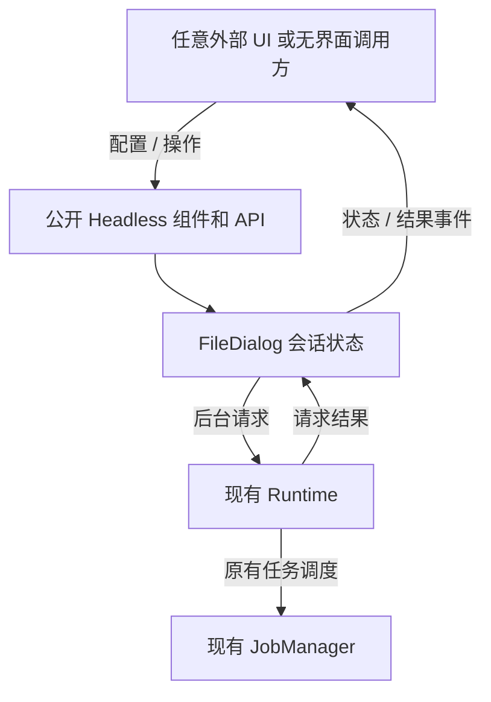

# 建立独立的 FileDialog Headless 能力与公开交互契约

本增量完成后，外部代码只安装 FileDialog 的 Headless 能力、创建一个文件选择会话实体，就可以在不生成任何默认 UI 的情况下执行目录导航、文件选择、确认与取消，并从公开状态和事件获得结果。库内现有默认界面在迁移前仍可继续使用；本增量不负责改变它的外观。

现有 `WidgetryFileDialogHeadlessPlugin` 已管理文件选择 Runtime，并沿用 `JobManager`。它的问题不在于缺少异步任务，而在于目前主要仍由 `WidgetryFileDialog` 场景入口初始化会话，若干完整交互路径需要默认 `style`、`input` 或 `window` 的内部实体。要真正支持自定义 UI，应先把这些依赖从文件选择语义中剥离。

图中的公共层应独立于表现层的具体子实体。比如用户在自定义文件列表里单击一行，外部只提交对应的稳定条目 ID、会话 token 和选择动作；Headless 不需要知道这一行来自 `WidgetryListView`、卡片网格还是一棵树。

## 会话入口应独立于默认样式

提供可单独构造的 Headless 实体入口，沿用或扩展现有 `WidgetryFileDialogHeadlessPlugin`。Headless 根实体持有文件选择会话状态，不要求上面存在 `Shell`、`PartKind`、文件名编辑框、默认文件列表或原生窗口。不要把“默认 UI 先建好，再隐藏它”当作 Headless 实现。

配置中与行为直接相关的内容属于 Headless：文件/目录选择模式（含多选与保存）、初始目录、后备目录、过滤规则、扩展名约束，以及需要的偏好存储作用域。颜色、默认样式布局和窗口参数属于上层默认 UI；若保留原有合并型 `WidgetryFileDialogProps` 以兼容使用者，也要在内部明确拆开行为配置和表现配置，不能让 Headless 初始化反向依赖默认样式的配置类型。

会话的创建、重新打开、取消、销毁和重建仍由统一状态和 Runtime 管理。自定义 UI 可以在已有窗口内嵌入 Headless 对应界面，也可以自行创建窗口承载它；Headless 对两种情况都不作窗口结构假设。

## 公开数据足以绘制任意界面

目前已公开 `WidgetryFileDialogState`、`WidgetryFileDialogEntry`、`WidgetryFileDialogQuery`、`WidgetryFileDialogSnapshot`、`WidgetryFileDialogFilter` 以及选中集合、可见条目、目录状态等查询能力。重构后需要确认的是**调用方能否仅凭公共内容形成完整界面**，而不是简单增加更多公开字段。

UI 至少要能够取得：

- 当前目录、导航历史与可导航状态；加载、部分失败、失败及错误文字；后台处理中需要显示的忙碌或禁止交互状态。
- 文件/目录条目的稳定身份、名称、类型、大小、修改时间和当前显示顺序；当前选中项、活动项，以及对应的会话和投影版本。
- 可用筛选条件、当前筛选/排序/搜索条件、隐藏与系统文件选项；供界面显示的位置列表和相关加载错误。
- 文件名、候选选择、确认阶段、覆盖确认目标、是否能够确认以及最终结果。`can_confirm` 一类能力必须由业务状态决定，不能要求调用方从默认文本框实体反推。

对现有公开类型逐项核验即可；能复用现有查询方法的地方不应另造一套镜像状态。缺少必要派生信息时，增加对 UI 中立的公开查询入口，而不是把默认样式私有组件公开出去。

## 所有业务动作都通过公共入口完成

保留当前基于 `WidgetryFileDialogAction` 的动作模型及其 `apply`、`queue` 路径所表达的语义；让 Headless 根可以直接接收同等能力。需要覆盖导航、刷新、返回/前进/上级、搜索、过滤、排序、显示隐藏/系统文件、选择与全选、活动项移动、文件名更新、确认/取消、收藏、创建文件夹和覆盖决定。

重点拆开当前 `PickFile` 模式下的**文件名确认行为**。现状是 UI 的 `apply_input` 对 `Confirm` 走特殊分支，并从默认文件名编辑控件读取文本、查找对应文件。这个判断不能继续作为只有默认 Style 能调用的业务入口。Headless 应以自身状态、公开动作和快照来完成候选匹配与确认；UI 只负责将文字编辑结果提交到状态，并决定何时发送 `Confirm`。

文件名存在无法无损转成 UTF-8 的平台情形。候选匹配应保留原始条目 ID 或原始路径身份的优先规则，不能因为自定义 UI 展示了有损文本就错误选择另一个文件。旧的选择 token、过期目录快照、未完成投影及校验中的重复确认仍按现有会话语义处理，避免把快照一致性责任转嫁给各个 UI 实现。

输入法组合态、键盘快捷键、鼠标双击、按钮禁用样式、即时视觉提示等是 UI 交互适配的责任；目录能否打开、候选是否有效、确认何时生效、覆盖决定是否过期则是 Headless 的责任。尤其不能将某个 `WidgetryTextField` 的内部实体当作所有 UI 必须遵循的标准输入来源。

## 结果、错误与任务生命周期

继续通过公开的变更事件和结果事件交付状态变化与选择结果。保持 `File`、`Files`、`Directory`、`Directories`、`SavePath`、`Cancelled` 等结果语义，让默认 UI 和 Gallery 能订阅同一事件，而不用监听某个内部按钮或读取私有临时结果。

目录读取、选择准备、验证、新建文件夹、位置列表、偏好存取，以及对应的取消与过期回复处理仍通过既有 Runtime。对外可以提供足够的状态来显示进度或错误，但不暴露 JobManager 的具体任务句柄，不要求调用方轮询后台队列，也不允许自定义 UI 另外启动同类后台任务以绕开 Headless。

覆盖文件的确认状态由 Headless 维护；是否用模态消息框、内联面板或自定义弹层呈现，由 UI 自己决定。用户接受/拒绝后提交公开覆盖动作，Headless 校验 token 并处理结果。Headless 不自行创建覆盖弹窗。

## 本增量的完成条件

- 只启用 `WidgetryFileDialogHeadlessPlugin`，不启用默认 FileDialog UI 插件，也没有默认 `Shell`、`Part`、窗口和按钮实例，仍能创建会话并成功收到目录状态与结果事件。
- 使用公开数据和动作编写一套**无界面**调用场景，分别完成单文件、文件多选、目录选择、保存路径、取消；搜索、过滤、导航、新建文件夹、覆盖确认等路径都有对应行为测试。
- 通过可控文件系统后端检验加载失败、目录部分失败、校验失败、无效文件名、失效 token、连续切换目录和异步回复延迟。事件不重复提交旧会话结果，销毁会话后不再交付已过期操作。
- 单文件确认不再读取默认文本编辑器，也不会通过 `style::filename_entity` 等私有 UI 入口验证或确定选择；平台原始文件名与展示文本的匹配不会混淆。
- Headless 源码不依赖 `style`、`view`、`controls`、`input`、`window`、`colors` 的默认 UI 类型或其实体树；默认 UI 尚未迁移时可保留原有适配层，但独立 Headless 路径不经过它。
- `JobManager` 的代码、任务管理规则和对外用法不变；Headless 沿用现有 Runtime/JobManager，不另建任务管理器。相关公开 API 的必要说明与示例随本增量更新。

## 防止解耦退化

不能以“只有默认样式能访问 `pub(crate)` 方法”为代价完成一个功能上受限的 Headless；如果业务流程仍隐含要求某个私有样式实体，说明该能力尚未真正公开。也不能为了让 Headless 独立而复制目录扫描、文件校验或任务取消逻辑。需要调整代码归属时，保持原有错误上下文、会话身份和异步取消语义；这里调整的是 API 与职责边界，不是 JobManager。
