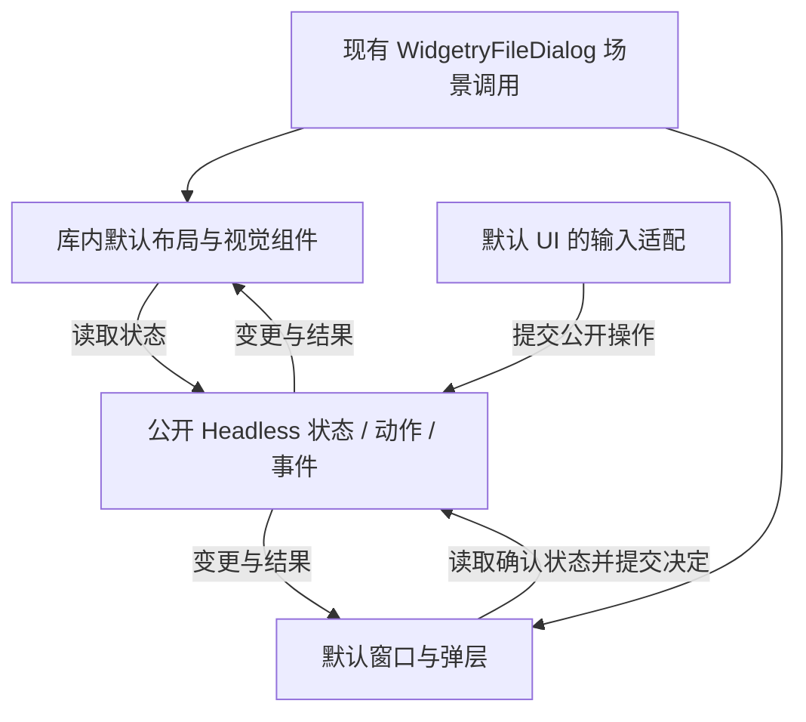

# 让库内默认 FileDialog UI 成为公开 Headless 的消费者

本增量将现有文件选择器的界面保留为库内默认实现，但改变它与业务能力的关系：默认 UI 不再是 Headless 功能的特殊入口，而是和任何外部 UI 一样，只使用公开的 Headless 状态、操作和事件。这一增量完成后，现有应用仍可打开熟悉的文件选择器；单独安装 Headless 时则不出现默认界面。

当前 `style.rs` 构造整个界面树，`controls.rs` 处理筛选、位置与按钮交互，`view.rs` 负责条目呈现，`input.rs` 处理键盘、鼠标和文件名输入，`window.rs` 负责独立窗口与覆盖提示。它们属于默认 UI 的不同部分，可以继续协作；需要改变的是**它们与业务状态机的边界**，而非把所有功能搬进一个更大的 Style 类。

窗口是默认样式可以选择提供的承载方式，并非 Headless 的先决条件。已有 `WidgetryFileDialogWindow` 可以继续为默认 UI 创建独立窗口；将来外部也可以完全自行决定窗口层级和布局。

## 默认样式的创建与组合

保留 `WidgetryFileDialog` 作为面向已有使用者的默认样式入口，内部创建或绑定独立的 Headless 会话。默认样式的插件可以继续安装按钮、文本输入、滚动区域、列表、组合框、图标、工具提示和窗口等表现层依赖；`WidgetryFileDialogHeadlessPlugin` 不应反向安装这些默认 UI 依赖。

默认场景继续接受用户熟悉的文件选择参数，包括模式、初始目录、后备目录、过滤器、扩展名规则、偏好作用域，以及默认 UI 的颜色和窗口配置。行为配置传给 Headless；颜色、字体、间距、列表行高、窗口等参数只作用于样式层。现有 `WidgetryFileDialogStyle` 的行高、预加载行数、侧边栏宽度、字号、间距和内边距仍应有效，不因 Headless 分离而丢失配置路径。

默认 UI 可以沿用当前导航栏、侧边栏、文件列表、底部文件名/文件类型和操作按钮的结构。重构目的不是视觉改版；既有控件的主题色继承、`WidgetryFileDialogColorOverrides` 及子控件颜色覆盖方式应尽量保留，避免让已有样式设置静默失效。

## 将默认输入逻辑变成公开动作的适配器

以前默认 UI 的某些处理函数既读取自身控件实体，又直接决定是否能确认。这些代码应分为两类：

- **表现行为**：焦点、键盘快捷键、鼠标点击与拖选、滚动可见性、编辑框内输入法组合态、视觉禁用、提示文字、局部的暂存输入。这些可以留在默认 `input`、`controls`、`view` 和 `style` 中。
- **文件选择语义**：条目是否可选、何时确认、候选文件匹配、扩展名限制、校验与覆盖状态、会话是否仍有效。它们由 Headless 提供统一判断，默认 UI 仅提交公开动作和呈现状态。

例如在单文件选择模式下，用户键入文件名后点击“Open”：默认 UI 将编辑结果提交为公开的文件名更新动作，再发出确认动作。它不调用一个只有默认编辑框实体存在时才有效的私有 `confirm_filename()`，也不自行复制“查找同名文件、兼顾有损编码、判断筛选结果”这一套业务规则。使用 IME 时，默认 UI 仍可在组合态未结束前暂缓提交确认；这是输入控件适配，不能据此把 Headless 的业务检查重新放回 UI。

列表点击、双击、活动项移动、范围选择、多选、全选和导航均转换为公共动作。默认 UI 要处理好每次交互携带的 `EntryId` 和 token，刷新或换目录后不用旧快照继续确认。按钮禁用状态通过 Headless 可观察状态计算，不能依赖内部输入控件恰好提供某个私有判定函数。

## 默认窗口、覆盖确认与生命周期

独立窗口的创建、父子关系、模态与非模态限制、标题、窗口尺寸、焦点以及原生窗口销毁，仍留在默认 UI 相关代码。默认 UI 可以用现有消息框显示覆盖确认，也可以继续保留内联覆盖面板；无论用哪一种方式，都应从 Headless 的覆盖确认状态读取目标与 token，再将确认或拒绝结果提交给 Headless。

外部关闭窗口应触发公共取消动作；会话已经产生结果或被取消后，默认 UI 处理窗口关闭和实体回收，但不自行生成第二份结果。原有防止窗口关闭时渲染资源提前释放的退出时序属于默认窗口实现的现有行为，重构不应绕开它。对于在已有窗口内使用的默认 UI，也不能无故把宿主窗口当作自己拥有的独立窗口回收。

原有 Gallery `Window` 页面中六类默认文件选择器演示（单文件、多文件、目录、多个目录、图片过滤、保存文件）继续保持可运行；它们仍通过现有默认入口使用窗口参数、结果事件与标题本地化。已有围绕独立文件选择器的测量入口应保持可用，不因内部 Headless 绑定变化而丢失原有场景标识和结果观察能力。

## 默认 Style 与 Headless 解耦的判据

代码依赖方向应当清晰：

- 默认 UI 引用公开 Headless 类型和方法，可以拥有自己的私有布局辅助类型；Headless 不引用默认 `style`、`view`、`controls`、`input`、`window`、颜色覆盖类型或私有 UI 部件。
- 默认 UI 不通过 `pub(crate)` 的 Headless 特权入口完成外部无法完成的行为。内部性能辅助和视觉操作可以保持私有，但业务判断或动作如果外部 UI 也需要，就必须形成公开契约。
- 单独添加 Headless 插件不触发默认 Style 构建、默认窗口构建或默认 UI 系统安装；添加默认样式插件时则可以自动满足 Headless 所需的基础初始化。
- Headless 会话不以默认 UI 节点的生命周期作为业务状态来源。默认 UI 可以随时挂载、重绘或销毁自己的视觉节点；必须明确何时结束或取消它所承载的会话，避免意外泄漏。

如果只把 `style.rs` 移到其他目录，仍通过私有 `Part`、`Shell` 或编辑器实体维持业务逻辑，那不属于本增量的完成结果。

## 本增量的完成条件

- 现有 `WidgetryFileDialog` 用法可以继续正常创建默认 UI，既有行为配置、颜色覆盖、`WidgetryFileDialogStyle` 和独立窗口参数继续发挥作用；对应公开兼容性变化若不可避免，必须在本增量解决并说明。
- 不改变视觉交互预期的前提下，默认 UI 完成文件/目录单选与多选、保存、过滤、搜索、排序、导航、创建文件夹、取消和覆盖确认；事件和原先的结果类型一致。
- 单文件输入、输入法组合态、键盘与鼠标路径、按钮禁用状态、部分目录读取失败和显示错误均可运行；从默认 UI 到 Headless 的确认路径只走公开业务动作。
- 独立窗口的模态/非模态、父窗口销毁、主动关闭、结果后回收，以及原有窗口关闭时序均有回归覆盖；嵌入式承载不误删宿主窗口。
- 只使用 Headless 的测试仍然不会产生默认 UI；默认 UI 的样式私有代码不能被 Headless 反向引用。检查默认 UI 所需的全部业务操作都有 Gallery 可调用的公开等价入口。
- 现有 Gallery 默认 FileDialog 示例和相关 GUI/BRP 测量路径继续工作；必要的样式使用说明同步更新。无须为此改动 `JobManager` 或替换其运行机制。

## 不应引入的耦合

默认样式不能偷偷维护一份与 Headless 并行的权威选中状态，也不能在公共动作之外维护特殊的文件确认通道；UI 可以缓存展示用数据，但不能让缓存决定最终选择结果。窗口关闭、任务结果与视图销毁先后可能不同，处理这些差异应依赖已有会话及生命周期状态，不引入对某个具体子控件存在顺序的隐式要求。
