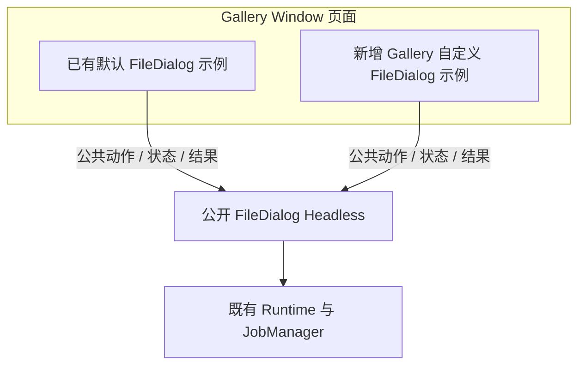
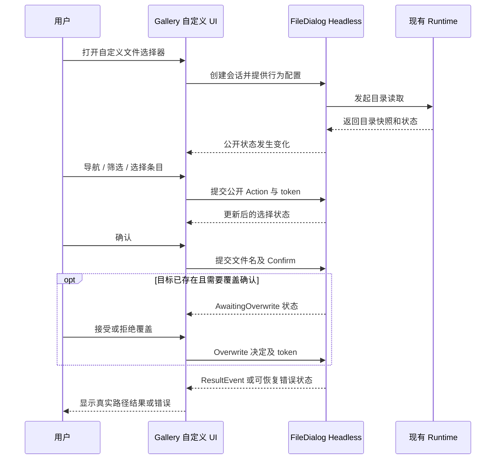

# 在 Gallery 实现可交互的自定义 FileDialog UI

本增量在 Gallery 真正新增一套由 Gallery 自己构建的文件选择器界面。它不是示意图、颜色预设、给默认 `WidgetryFileDialog` 换一组样式参数，也不是调用原有 `shell_scene` 后修改子节点。它必须用公开的 FileDialog Headless 契约独立完成 UI 结构、数据呈现和交互，并返回真实的文件选择结果。

Gallery 已有 `Window` 页面及其中的默认文件选择器示例，支持单文件、多文件、目录、多目录、文件类型过滤和保存路径。因此这里应**保留现有默认示例**，另外增加可实际操作的自定义示例，让两者共享 Headless 业务语义，外观布局却明显不同。这样 Gallery 同时成为解耦架构的使用范例和外部可扩展性的验收者。

这个示例的关键不在某一种固定视觉稿，而在于 Gallery 自行决定：哪些控件出现、如何排列、文件列表如何渲染、如何展示错误与选中结果，以及是否使用独立窗口。即使完全不创建库内默认文件选择器，新的自定义 UI 也应独立工作。

## 新增真正独立的 Gallery 场景

在 Gallery 的文件选择器演示区域新增与原有示例并列的入口与实现模块，并接入现有页面装载和退出生命周期。自定义布局由 Gallery 的 BSN/Bevy UI 场景构建，可复用库中通用的按钮、文本输入、滚动区域等基础控件，但不得构建、继承或复制库内默认 FileDialog 样式的私有部件。

为了直观展示“整个布局可以变”，新界面应与当前默认“导航栏 + 左侧位置栏 + 文件列表 + 底部确认区”的编排明显不同。具体视觉构图可在 Gallery 模块内部决定，例如将位置和筛选放到另一块面板，采用不同的文件条目呈现形式，或者调整文件名与主要操作区域的位置；这些只是可选的 UI 表现，不改变 Headless 的行为契约。

**至少有一种嵌入已有 Gallery 页面或宿主窗口的演示**，可以直观看出 Headless 自身没有创建原生窗口的强制依赖。若同时提供自定义独立窗口版本，它的创建、所有权及关闭由 Gallery 负责，不通过库内默认文件选择器的窗口封装完成。自定义窗口示例不是证明可扩展性所必需的第二套业务实现。

## 用公共状态驱动可见内容

自定义界面从 Headless 的公开状态与快照读取目录、文件类型、过滤器、当前位置、可见条目、选中集合、文件名、确认状态、错误和结果。列表可以使用 Gallery 自己选择的渲染组件，但每个条目的操作必须保留 Headless 的稳定条目 ID 与会话 token，不能以“当前显示在第几行”代替选择身份。

界面需要展示加载中、空目录、文件类型过滤后为空、读取失败或部分失败、选择校验中等状态。搜索和筛选改变后，显示列表与 Headless 的投影结果一致；若一个旧条目的操作在换目录后到达，应由 Headless 的 token 判定拒绝，Gallery 不能把它误当成新目录条目。

默认样式中的文案或按钮位置没有成为外部契约。Gallery 需要自己展示当前文件名、可选操作、确认/取消以及必要的错误提示，不依赖默认样式的 `Notice`、`PartKind` 或 `Shell`。如果当前公开状态不足以完成其中一项，就应回到 Headless 契约补齐，而不是在 Gallery 添加一个特殊内部访问通道。

## 实际可操作的选择流程

该流程应在运行的 Gallery 中可被用户实际触发，而不是只做单元测试或模拟回显。自定义界面至少提供下列有意义的真实操作：

- 进入目录、返回上级、前进/后退或刷新，结合搜索和文件类型筛选浏览文件。
- 点选文件或目录，支持与公开选择模式匹配的多选；显示当前选择，并能清除或改变选择。
- 支持打开文件、选择目录与保存路径，并演示文件名输入、确认和取消；可以复用 Headless 现有的全部五种模式，而不是为每种模式另写一份文件操作实现。
- 在需要时反馈覆盖确认，能够接受或拒绝；可以显示创建文件夹、收藏位置、排序及隐藏文件等 Headless 已支持的操作，保持与默认样式同等的业务能力。
- 对真实结果事件显示选中的路径列表或取消状态；对读取、校验和输入错误显示可理解的反馈，不把失败一律当成取消。

原有六类默认示例仍保留，便于验证同一模式在默认和自定义样式下产生一致的路径结果。对于自定义 UI 因表达方式不同而无法逐项展示的操作，仍应在公开 API 层可达；不能靠改动 JobManager 或从默认样式私有实体读取结果来补足业务能力。

## 生命周期与演示可维护性

Gallery 页面进入时建立自定义显示节点及所需会话；页面退出、关闭自定义 UI、重新打开或切换选择模式时，负责清理当前显示和关联会话。后台目录读取尚未结束就离开页面的情形应正确处理，避免已销毁 UI 收到错误目标的结果，或把上一个会话的路径写进新实例。

演示应使用现有 Gallery 的注册、页面生命周期、语言与结果呈现机制，不绕开其统一框架另起一套应用。默认 FileDialog 演示可以继续保持当前性能测量入口；新增场景不应无意中改变其定位或测量基线。

这一演示应该是可阅读的外部使用示例：依赖 `bevy_widgetry::file_dialog` 暴露的公共类型及必要的通用控件，不导入 FileDialog 的私有 `style`、`view`、`input` 或 `window` 内部模块。没有向 Headless 添加 Gallery 专用补丁或功能开关。

## 本增量的完成条件

- Gallery 中明确出现新增的自定义文件选择器入口，能在运行时打开或展示与现有默认样式**布局结构不同**的真实 UI；原有默认示例仍可使用。
- 实际在新 UI 中浏览磁盘目录、进行筛选或搜索、选择文件/目录、输入保存文件名、确认及取消，并在 Gallery 中观察到真实的 `WidgetryFileDialogResultEvent` 结果，而非静态示例数据。
- 单文件、多文件、单目录、多目录和保存场景都能由公共 Headless 机制支持；相应的选择规则、过期 token 与结果类型保持一致。覆盖确认和目录错误能在自定义 UI 中正确呈现并响应。
- 至少验证一次页面内嵌场景；切换 Gallery 页面、关闭/重开自定义 UI、在目录加载中关闭、自定义 UI 与默认 UI 同时存在时，状态与结果不串会话，也不遗留窗口和后台会话。
- Gallery 源码不调用默认 `WidgetryFileDialog` 来搭建自定义 UI，不依赖默认样式私有元素，不复制 Runtime 的文件系统扫描、异步验证或任务管理机制。业务操作仅通过公开 Headless 契约。
- 针对自定义场景补充必要的状态/交互测试及实际 GUI 验证；如公开接口缺失导致外部实现做不到默认样式的某项关键能力，应在本增量中修正公开契约并复验受影响的默认 UI。
- 保留并复验现有默认 FileDialog Gallery 入口和相关使用路径；整个改动不触碰底层 `JobManager` 实现。

## 边界与失败条件

“新的 UI 直接拼装默认 FileDialog 控件再覆盖配色”不满足本目标；“新的 UI 只是打开默认文件选择器窗口”也不满足。示例不能访问私有工作队列或用外部任务实现替代 FileDialog 的后台能力。如果要依赖默认样式的私有动作才能完成一项实际选择，失败点属于 Headless 契约不完整，而不是要求 Gallery 接受功能缩水。
