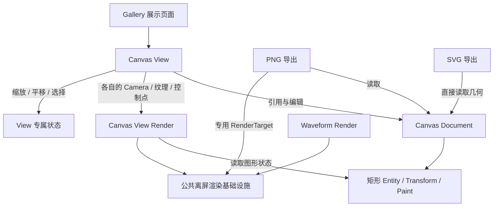

# Canvas 矩形闭环的整体设计

Canvas 的首个可交付目标，是让一个矩形在无限二维 Document 中完成创建、显示、选中、移动、缩放、旋转、删除和 PNG/SVG 导出。**“一个矩形”是验证范围，不是 Document 的容量上限**；数据模型不应被写成单图形特例。Canvas 是普通 Bevy UI 控件，不在画布内部嵌入其他 Widgetry Button。撤销/重做、圆形、文本、路径及通用绘图编辑器不属于这次目标。

核心架构是 **Document 保存可编辑的图形事实，View 保存各自的观察与交互状态，Render 将图形事实投影到每个 View 的独立离屏目标**。SVG 从 Document 几何直接生成；PNG 通过独立导出目标重新渲染，不使用当前窗口的截图。

## 一致的坐标和状态语义

Document 没有有限画布边界，允许正负坐标；原点 `(0,0)`，X 向右，Y 向下，矩形中心对应 Bevy `Transform.translation`。在 Zoom=1.0 时，一个 Document 单位对应一个 **UI 逻辑像素**，物理像素还受窗口 Scale Factor 影响；Zoom 是 View 自己的数值，绝不写回 Document。每个 View 默认以原点为中心、Zoom=1.0。

Document 是独立 ECS Entity，矩形 Entity 通过 `ChildOf` 归属 Document。矩形几何、描边、位置和旋转以 Document 中的组件为权威；渲染实体仅是投影。`CanvasPaint.fill: Option<Color>` 明确区分不填充 (`None`) 与指定颜色。多个 View 可以引用同一个 Document，拥有不同 Zoom、Pan、选择与绘制预览。删除形状必须清理所有 View 对它的引用；删除一个 View 不会删除 Document。销毁 Document 时，仍存在的 View 保持原 UI 位置和尺寸，清除选择/预览，显示空白且不可编辑，重新绑定有效 Document 后恢复。

绘制中的预览仅归当前 View，允许向四个方向拖动；释放时宽高都达到 **1 个 Document 单位**后才提交 Document，否则不创建图形并返回选择模式。Esc 取消预览并退出绘制模式；成功创建后自动选中并切回选择模式。八向缩放也遵循局部宽高各不小于 1、角点固定对角、边点固定对边和禁止翻转的规则。点击未选中的矩形只选中，不能在同一次按压中移动；再次按住选中的矩形才能拖动。选中框、八个缩放点、一个旋转点均为 View 编辑辅助表现，不进入导出文件。平移只采用 `Space + 左键拖动`，操作开始后保持到鼠标左键松开。

## 为什么公共渲染基础层先行

当前 Waveform 具有 Camera2d、Image RenderTarget、ViewportNode、RenderLayers 隔离、尺寸维护和资源回收等机制，但其 RenderLayers 分配器属于 Waveform 自身。Canvas 若自行复制会导致两个控件使用相同层号的风险。因此先抽取**跨 Widget 共用的离屏渲染基础设施**，并让 Waveform 改用它；波形抽稀、网格和矩形 Mesh 各自留在对应 Widget。公共层不变成接管各种图形绘制的通用 Renderer。

Canvas 的填充和居中描边各有独立 Mesh，使用 Bevy 二维 Mesh、ColorMaterial 和 Camera2d；位置/旋转由 Transform 投影，尺寸/描边宽度变化才更新几何。`Transform.scale` 对填充与描边整体生效，包含非均匀缩放；交互式八向调整则改变局部 `size` 和必要的中心位置。各 View 有独立相机、渲染层、目标纹理与编辑辅助图形，同一 Document 图形的 Mesh 资源按需共享。优先验证 4× MSAA 的离屏抗锯齿效果，不假定 Waveform 的 `Msaa::Off` 可直接沿用。

## 导出与最终可观察结果

PNG 和 SVG 默认导出所有已提交图形的**最小轴对齐包围盒 AABB**，包括旋转与居中描边的外扩部分；也支持显式指定 Document 坐标导出区域。Document 为空时，两种格式无条件返回 `EmptyDocument`，即使调用者指定了区域。导出默认透明，不携带 View 背景、选中框、控制点、Zoom 或 Window Scale Factor。

PNG 默认倍率 1×，支持更高倍率；每次在所需分辨率重新渲染，不放大已有位图。输出宽高依据导出区域的逻辑宽高与倍率取整，确保不裁切几何；SVG 直接输出矢量形状。两种导出结果需与 Document 几何和描边语义一致。两种导出均由 Canvas **接收路径并直接写文件，已有目标文件直接覆盖**；应用层负责检查文件是否存在、是否需要覆盖确认。SVG 同步返回写入结果；PNG 通过异步完成结果报告写入成功或失败。`EmptyDocument` 必须在打开目标文件之前返回，不能清空原文件。

## 关键约束与渲染验证

数据模型、绘制行为、Document 销毁后 View 的表现及文件覆盖语义均由各个实施增量保持一致：无填充采用 `Option<Color>`；矩形整体变换同时作用于填充和描边；绘制与编辑宽高下限为 1 个 Document 单位；导出直接覆盖路径。PNG 的 GPU 纹理读回、离屏 MSAA 与 Alpha 合成仍需在 Bevy 0.20 / DX12 的实际渲染路径中验证；这些是实现方式的验证点，而非新增绘图功能或未决定的产品行为。

## 唯一实施顺序

以下序号代表实施与提交顺序，不暗示所有相邻方案之间都有强技术依赖。每个增量在自身方案中附带必要行为测试与受影响的 GUI 验证；最后一项是实际增加 Gallery 展示能力，不是单独的“最终验收阶段”。

1. [抽取跨控件公共离屏渲染基础设施](01-抽取跨控件公共离屏渲染基础设施.md)
2. [建立 CanvasDocument 与矩形图形模型](02-建立CanvasDocument与矩形图形模型.md)
3. [在 Canvas View 中显示带填充和描边的矩形](03-在CanvasView中显示矩形.md)
4. [支持多 View 共享 Document 与渲染资源管理](04-支持多View共享Document.md)
5. [实现 Space 加左键画布平移](05-实现画布平移.md)
6. [实现以光标为锚点的画布缩放](06-实现画布缩放.md)
7. [实现矩形几何命中与单选](07-实现矩形命中与单选.md)
8. [实现已选中矩形的拖动移动](08-实现已选矩形拖动移动.md)
9. [实现预览式矩形绘制](09-实现预览式矩形绘制.md)
10. [实现八控制点矩形缩放](10-实现矩形八向缩放.md)
11. [实现矩形旋转与十五度吸附](11-实现矩形旋转与角度吸附.md)
12. [实现删除与跨 View 选中修复](12-实现删除及选择修复.md)
13. [实现 SVG 矢量导出](13-实现SVG矢量导出.md)
14. [实现 PNG 高分辨率离屏导出](14-实现PNG离屏导出.md)
15. [在 Gallery 中展示矩形完整闭环](15-在Gallery展示Canvas完整闭环.md)

全案仅面向既有 Windows 64 位、Bevy 0.20 与 DX12 环境。新增 UI 结构使用 BSN；Canvas 专属类型放入 Canvas Widget crate，跨控件共用能力放在 `core` 等现有公共层，避免 Widget crate 之间反向依赖。正式开发遵循项目的 Type/Red/Green/Refactor、关联测试、BRP GUI 检查、文档同步和独立 Code Review 约束。
