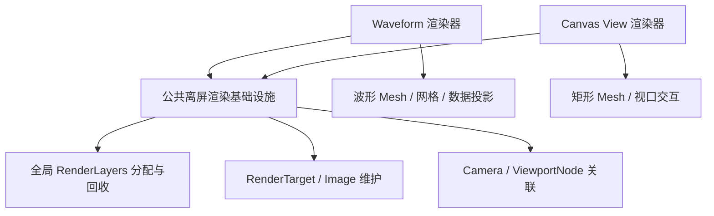

# 抽取跨控件公共离屏渲染基础设施

这个增量把已经由 Waveform 验证过、同时也是 Canvas 必需的离屏显示机制提取到跨 Widget 公共层，并让 Waveform 继续通过这一层工作。交付结果不是“通用绘图 Renderer”，而是可以由不同 Widget 实例安全使用、且有明确创建/释放职责的离屏渲染基础设施。

## 抽取的是机制，而不是 Waveform 的业务

现有 Waveform Render 在初始化时申请渲染层，创建 `Image`、`Camera2d`、绘图 `Mesh2d` 和对应材质，然后把 `ViewportNode` 关联到 Camera。更新阶段检查 UI 布局尺寸与可见性，调整相机及 RenderTarget；移除阶段回收 Image、Mesh、Material、Layer 和离屏场景。这里的 **层号管理、目标纹理创建/调整、UI Viewport 连接、生命周期清理**具有确切的跨控件价值。

公共层应提供：

- **一个共享的渲染层分配域。** Waveform 当前从自己的 `RendererLayers` 资源分配层号（初始计数为 1024）；如果 Canvas 独立复制，两个 Renderer 可能获得同一层号。必须统一分配和回收，确保同屏 Waveform 和多个 Canvas 的相机/几何不会互相串图。
- **离屏目标的可复用维护机制。** 由具体 Widget 提供 Viewport 及所需背景/清屏、相机配置；基础层负责关联 Image RenderTarget 与 `ViewportNode`、根据布局变化维护目标尺寸、在隐藏或零尺寸时避免无效渲染。
- **资源所有权与失败清理。** 单个 Renderer 的 Scene、Image、专用 Material/Mesh 和 Layer 由明确所有者释放；初始化中途失败也应回滚已获得的资源。不能因一个实例销毁就删除其他实例共享或宿主拥有的 Asset。

公共层不决定 Canvas 的 Document、Zoom、图形类型、描边、抗锯齿，也不重做 Waveform 的 `WaveformOutputLength`、幅值/通道投影、数据抽稀、网格、颜色更新。相机投影、MSAA 级别和是否使用透明背景仍由消费者选择。系统时序须与 Bevy UI Layout、Visibility 和 `update_viewport_render_target_size` 配合，不能只把几个构造函数搬到新文件而遗漏这些契约。

## 迁移时的兼容边界

Waveform 当前复用一个 Viewport/Camera/Image、波形 Mesh 和时间网格 Mesh，隐藏时暂停相机活动；颜色变化可只更新顶点颜色，尺寸或数据变化才更新几何。抽取公共层不能强制 Waveform 重建这些对象，也不能改变它的现有显示、数值或资源开销语义。

现有 Waveform 渲染测试已覆盖布局驱动渲染、窗口调整后目标纹理尺寸、隐藏/显示恢复、双实例 RenderLayers 隔离、持续绘制后的资源数量和销毁回收。这些是重构回归的依据；如果公共层引入新的可独立验证的分配与清理契约，增加对应测试，而不是复制整套波形测试。

## 完成条件与边界

- 在一个应用中同时创建多个 Waveform 实例并分配额外的公共渲染层使用者，所有层号互不冲突，释放一个后复用层号不污染其他实例。
- 原 Waveform 的 Camera/Target/ViewPort、隐藏恢复、尺寸变化、失败清理、Mesh 与 Image 资源边界仍满足原有测试。
- 公共层只承担跨 Widget 已证明相同的机制，不能反向依赖 Waveform、Canvas 或 Gallery；新依赖不破坏 Workspace 层级。
- 不在此阶段修改 Waveform 波形计算、UI 功能、颜色协议或 Canvas 专属渲染逻辑。新增 UI Scene 组合仍使用 Bevy BSN。
