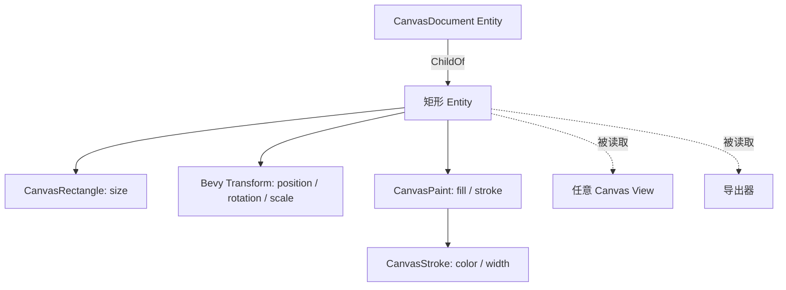

# 建立 CanvasDocument 与矩形图形模型

这个增量建立 **可脱离 UI View 独立存在**的 Canvas 数据模型，使一个矩形能够以 ECS 组件的形式创建、修改、查询、移除，且不需要先生成 Camera、Image 或 Mesh。它为后续多个 View 观察同一图形和两种导出提供唯一几何来源。新增的 Canvas Widget crate 在本增量就应纳入 Workspace，并同步更新 Workspace 架构文档，不能推迟到 Gallery 展示阶段才注册。

## Document 的坐标与实体结构

Document 是无固定边界的二维坐标空间。原点为 `(0,0)`，X 向右、Y 向下，负坐标合法。矩形的中心由 `Transform.translation` 表示，`CanvasRectangle { size: Vec2 }` 保存未旋转的局部宽高；Bevy `Transform` 是平移、旋转、缩放的唯一权威，不另存一份“矩形位置”。矩形形状 Entity 通过 `ChildOf` 归属于 Document；Document 本身不代表某个 UI 视口，也不直接附着每个 View 的 Mesh2d。

首个图形包含：

- `CanvasRectangle { size: Vec2 }`：有限、合法的局部宽高，宽和高均不小于 **1 个 Document 单位**；编辑过程中不能出现负宽高/翻转。
- `Transform`：表示中心位置、旋转与缩放；在矩形移动和旋转时更新它，在八向调整尺寸时按必要情况更新中心位置和 `CanvasRectangle.size`。
- `CanvasPaint { fill: Option<Color>, stroke: Option<CanvasStroke> }`：`None` 表示不填充，`Some(Color)` 表示给定填充颜色；可选描边独立表示。`CanvasStroke { color: Color, width: f32 }` 的宽度以 Document 单位表示；描边相对矩形边界居中，内外各占一半，并计入渲染边界和导出边界。

Document 可以在没有 View 时继续存在。模型不应因为第一个 Gallery Demo 只绘制一个矩形就写成固定单元素；创建第二个矩形或删除现有矩形也不要求重新创建 Document。图形 CRUD 属于业务模型操作；Canvas View 的选中、绘制预览、相机和编辑控制点不进入模型。

## 模型计算所需的基础几何语义

后续点击命中、控制点位置、AABB 与导出要使用同一套矩形几何定义。矩形以中心和局部四角确定基本轮廓，经过 `Transform` 变换得到 Document 中实际四角；居中描边向两侧扩展实际覆盖区域。不能用忽略旋转的原始 `size` 直接计算最终边界。

这一层可以提供不依赖 GPU 的几何计算与校验，以便后续渲染、拾取和导出复用。`Transform.scale` 对局部形状整体生效，填充和描边一起被缩放；非均匀缩放下描边方向的实际粗细也随变换改变。Canvas View 的交互式八向缩放通过修改局部 `size` 与必要的中心位置完成，而不改变 `Transform.scale`。移动或旋转不改变基础局部 Mesh，尺寸或描边宽度改变才需要重新生成相应几何。形状数据变化的消费方要能够识别哪些信息改变了，不能把 Render Proxy 的数据写回 Document 作为状态来源。

## 完成条件与模型约束

Headless 测试应证明 Document 与矩形在没有 UI/渲染插件时可以创建、更新、删除；负坐标合法，非法非有限值及小于 1 个 Document 单位的宽高不产生非法图形，旋转、整体/非均匀缩放和居中描边的边界计算正确。Document 被删除时其子图形应跟随移除；单纯没有 View 不应导致模型被删除。

没有填充而只有描边的矩形，其内部仍可由后续选择机制命中；无填充和 Alpha 为零的填充色在数据中保留不同语义。SVG、PNG 和 Canvas View 必须对 `Option<Color>` 及非均匀 `Transform.scale` 给出一致结果。

项目已有的状态/API 规则依然适用：官方 `Transform` 不因为参与 Canvas 就建立第二份状态权威；Canvas 自有 Runtime State 后续须使用明确公开更新接口。
